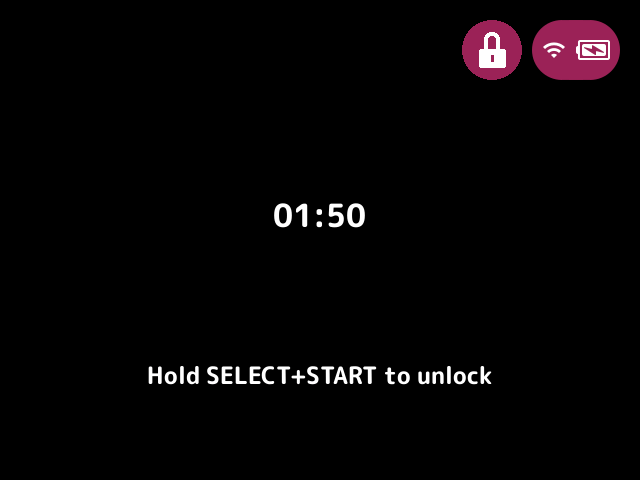
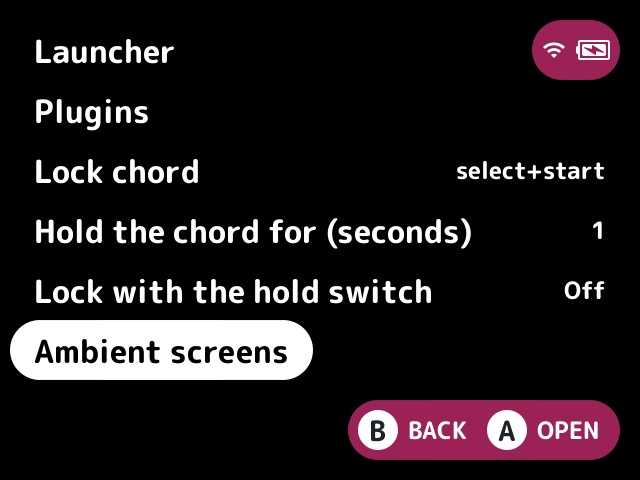

# Bundled plugins

mosaic-launcher is a replacement for NextUI's launcher that gets its features from plugins. These are the plugins that ship with it. Each name links to its own page, with what it does, how to turn it on and use it, its settings, and notes for plugin authors. New to custom firmware? The [glossary](glossary.md) explains terms such as pak, Tools and slot.

To write a plugin of your own, see [plugin-api.md](plugin-api.md).

## Turning plugins on and off

On the device, open **Launcher** from Tools and choose **Plugins**. Each plugin shows as On or Off. Select one to flip it, and open it to change its settings. The change takes effect when you leave the Launcher screen.

Plugins that share a job, such as the game list's layout, are grouped under a header, and only one in a group can be on at a time. The page for each such plugin names its group.

Nothing is on until you turn it on: with no plugins on, the launcher behaves like NextUI's own.

## The lock and ambient screens

The launcher can lock every button, so a device in your pocket or in a kid's hands doesn't change anything by accident. It's off until you pick a chord: open **Launcher** from Tools and set **Lock chord**. Changes take effect when you leave the Launcher screen.

| Setting | Choices | Default | What it does |
|---|---|---|---|
| Lock chord | select+start, l1+r1, l2+r2, off | off | Held for the hold time, locks every button, and again unlocks them |
| Hold the chord for (seconds) | 1, 2, 3 | 1 | How long to hold the chord |
| Lock with the hold switch | on, off | off | The switch on the side of the tg5040 and tg5050 locks while it's on, and the chord can't unlock it until it's switched off. It's stock's mute switch, so it still mutes as stock's Mute settings say. The h700 and desktop have none |
| Ambient screens | | | The order of the screens that open by themselves (below) |

While it's locked, a padlock shows in the header beside the status pill, and on the game list the lock screen opens, with the time, lines and buttons that plugins add, and how to unlock. Buttons still held from the unlock are taken until they're let go. A long power press still powers off, but a short one doesn't sleep. The volume keys, and the brightness with MENU held, can't be locked. The lock isn't kept when the launcher restarts.

Ambient screens are the screens that open by themselves: the lock screen, and plugins' such as a charging screen or a screensaver. When more than one wants to show, the first in the order opens. **Ambient screens** on the Launcher page lists the lock and the ambient screens of the plugins that are on, first first: select one with A, move it with up and down, and put it down with A. By default the lock comes first, then the charging screen, then the screensaver.

<!-- plugins:start (generated by scripts/plugin-table.sh from each plugin's plugin.txt, do not edit) -->
## Looks

- [art-backdrop](../plugins/art-backdrop/README.md) - Draws the selected game's art behind the game list.
- [art-boxart](../plugins/art-boxart/README.md) - Finds box art in the art folders other firmware uses.
- [art-placeholder](../plugins/art-placeholder/README.md) - Gives games with no art a generated thumbnail and box.
- [header-indicators](../plugins/header-indicators/README.md) - Shows free storage, an SSH dot, a profile badge and the FPS in the header.
- [home-dashboard](../plugins/home-dashboard/README.md) - A home screen before the game list, with your last game ready to resume.
- [launch-animation](../plugins/launch-animation/README.md) - Animates a game starting from the game list.
- [layout-carousel](../plugins/layout-carousel/README.md) - Shows the game list as a carousel of covers.
- [layout-fancy](../plugins/layout-fancy/README.md) - Shows the game list beside a panel with the selected game's art.
- [layout-grid](../plugins/layout-grid/README.md) - Shows the game list as a grid of tiles.
- [layout-hero-rail](../plugins/layout-hero-rail/README.md) - Shows the game list as a row of cards under big art for the selected game.
- [layout-shelf](../plugins/layout-shelf/README.md) - Shows the game list as cartridges standing on shelves.
- [metadata-band](../plugins/metadata-band/README.md) - Shows a game's year, publisher and genre under its art.
- [row-badges](../plugins/row-badges/README.md) - Adds dots after a game's name for unplayed, favorite and tagged games and for tiers.
- [switcher-plus](../plugins/switcher-plus/README.md) - Replaces the game switcher with your recent games in a choice of styles.
- [theme-plus](../plugins/theme-plus/README.md) - Changes colours, fonts, text size and wallpapers from a theme.
- [transitions](../plugins/transitions/README.md) - Picks how folders open and close and how the game switcher comes in.
- [video-previews](../plugins/video-previews/README.md) - Plays a short clip of the selected game in place of its thumbnail.

## Library

- [all-games](../plugins/all-games/README.md) - Lists every game from every system in one list.
- [clear-recents](../plugins/clear-recents/README.md) - Clears the Recently Played list, one game or all at once.
- [collate-subfolders](../plugins/collate-subfolders/README.md) - Merges same-named folders from a system's several folders into one.
- [collections-plus](../plugins/collections-plus/README.md) - Puts your collections on the first screen in your order, with their art.
- [favorites](../plugins/favorites/README.md) - Adds a Favorites folder and a button to add or remove favorites.
- [focus-mode](../plugins/focus-mode/README.md) - Makes the first screen list only your favorites, or the games in a tag or collection.
- [game-actions](../plugins/game-actions/README.md) - Renames, deletes or adds a game to a collection from one button.
- [genre-view](../plugins/genre-view/README.md) - Gathers the same genre from every system into one Genres folder.
- [hidden](../plugins/hidden/README.md) - Hides the games you pick from every list.
- [numeric-prefix](../plugins/numeric-prefix/README.md) - Sorts names that start with a number by that number.
- [path-repair](../plugins/path-repair/README.md) - Keeps recents and collections pointing at games after you rename them.
- [search](../plugins/search/README.md) - Finds games from every system by typing part of a name.
- [smart-collections](../plugins/smart-collections/README.md) - Sorts your games into franchise collections such as Mario and Zelda.
- [tags](../plugins/tags/README.md) - Lets you put your own tags on games, shown as folders.
- [title-disambiguation](../plugins/title-disambiguation/README.md) - Adds what tells two same-named games apart, only when needed.

## Launching games

- [core-prefetch](../plugins/core-prefetch/README.md) - Loads a game's emulator core ahead of time so it starts faster.
- [emulator-override](../plugins/emulator-override/README.md) - Lets you pick which emulator a game launches with.
- [random-game](../plugins/random-game/README.md) - Picks a game at random and launches it.
- [save-state-manager](../plugins/save-state-manager/README.md) - Browses, previews and deletes your save states.

## Play time

- [activity-stats](../plugins/activity-stats/README.md) - Shows how long you played each day and which games you played most.
- [gamification](../plugins/gamification/README.md) - Adds daily and weekly quests and a play streak.
- [playtime-captions](../plugins/playtime-captions/README.md) - Shows play time and last played at the right of each game's row.
- [playtime-limit](../plugins/playtime-limit/README.md) - Sets a daily limit on how long games can be played.

## Power

- [battery-logger](../plugins/battery-logger/README.md) - Logs how much battery each game used.
- [charging-screen](../plugins/charging-screen/README.md) - Shows a full screen with the battery level while the device charges and sits idle.
- [led-status](../plugins/led-status/README.md) - Colours the device's LEDs by the battery level or a theme colour.
- [power-plus](../plugins/power-plus/README.md) - Warns and powers off cleanly on a low battery, and after a long sleep.

## Network

- [bt-reconnect](../plugins/bt-reconnect/README.md) - Reconnects your last Bluetooth device at start and after sleep.
- [netplay](../plugins/netplay/README.md) - Hosts or joins a game over the network, once NextUI has netplay.
- [romm](../plugins/romm/README.md) - Browses a RomM server's library, downloads games and backs up saves.

## Controls and setup

- [button-remap](../plugins/button-remap/README.md) - Puts the game list's actions on other buttons.
- [first-run](../plugins/first-run/README.md) - A short setup wizard the first time the launcher starts.
- [localization](../plugins/localization/README.md) - Translates the launcher and plugins from language packs.
- [platform-jump](../plugins/platform-jump/README.md) - Makes L1 and R1 jump between systems instead of letters.
- [quick-menu-plus](../plugins/quick-menu-plus/README.md) - Renames or hides quick menu tiles and adds tiles that flip settings.
- [simple-mode](../plugins/simple-mode/README.md) - Hides Tools and settings for kids or a shared device.

## Extras

- [music](../plugins/music/README.md) - A music player that keeps playing while you play a game.
- [screensaver](../plugins/screensaver/README.md) - Cycles through images when the game list sits idle.
- [screenshot-viewer](../plugins/screenshot-viewer/README.md) - Browses the screenshots you took in games.
- [second-screen](../plugins/second-screen/README.md) - Shows the selected game in a second window (experimental, desktop only).
- [system-info](../plugins/system-info/README.md) - Shows the device's battery, Wi-Fi, storage, memory and uptime.

<!-- plugins:end -->
