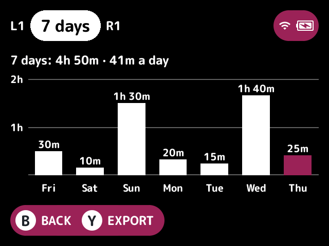
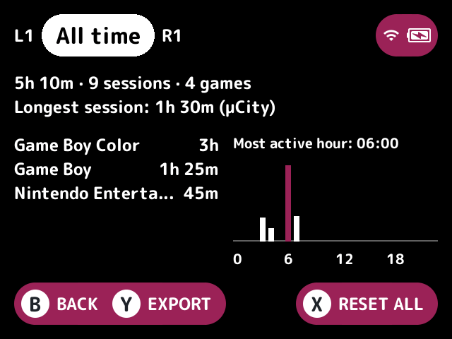
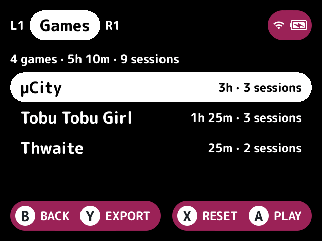
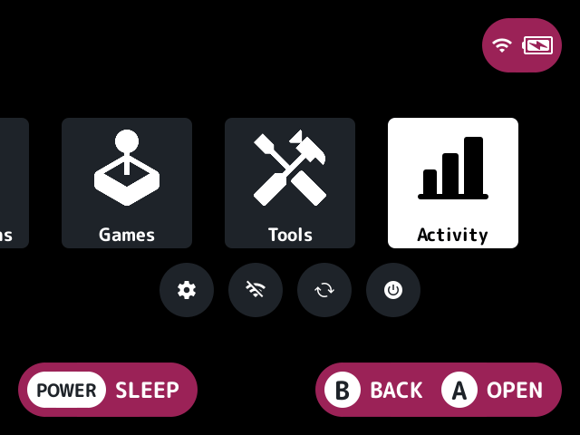
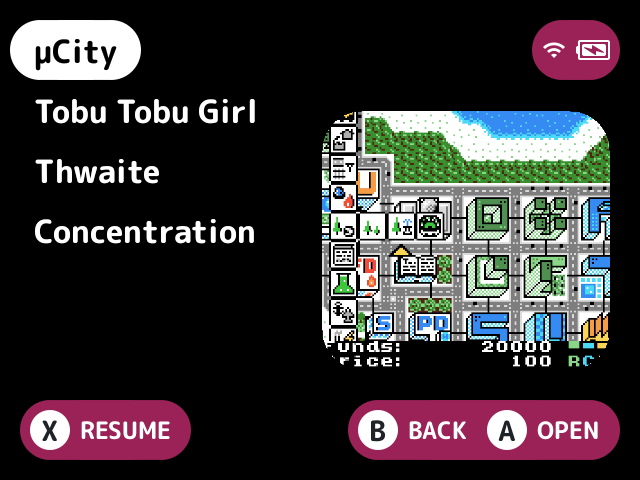

# activity-stats

Shows your play history on a screen of its own: how long you played each day, your all-time totals, and which games you played most. It can also save the history as files, list your most played games on the first screen, and reset play time.

The history is what the Game Tracker tool keeps in `game_logs.sqlite` (see [play tracker](../../docs/glossary.md#play-tracker)). This plugin reads it, and only changes it when you reset play time.

## Turn it on

Turn on **Activity stats** in Launcher > Plugins. See [turning plugins on and off](../../docs/plugins.md#turning-plugins-on-and-off).

## How to use

Open the screen from the Activity tile on the [quick menu](../../docs/glossary.md#quick-menu), or from a button on the game list if you set one in Settings below. [`button-remap`](../button-remap/README.md) or an [FN button](../../docs/glossary.md#fn-button) set to `action:activity-stats.open` can open it too.

There are five tabs:

- Last 7 days: a bar chart of the time played each day, with each day's time over its bar, and the total and the average a day.
- Last 30 days: the same chart for 30 days.
- All time: the total time, sessions and games played, the longest session, the time per system, and a chart of play by hour of day that names your most active hour.
- Games: every game in the history, most played first, with its time and sessions.
- Launches: the same games with the most sessions first.

Games the [`hidden`](../hidden/README.md) plugin hides, or any other plugin's filter, are left out of All time, Games and Launches, their totals and the export. The day charts count every game.

| Button | What it does |
|---|---|
| **L1** and **R1**, or left and right | Step through the tabs |
| Up and down | Move through a list |
| **A** | Open the selected game, while its file is still on the card |
| **Y** | Export the history to `Reports` on the card |
| **X** on Games or Launches | Reset the selected game's play time |
| **X** on All time | Reset all play time |
| **B** | Go back |

Games carried over from Onion are known only by their name, so they can't be opened or reset on their own (resetting all play time includes them). Launch counts are the tracker's sessions, and waking from sleep starts a new one. With no play history (no database yet, or no sqlite) every tab says "No play history".

### Export

**Y** saves two files in `Reports` on the card, named for the date and time, such as `activity-2026-11-19-140312.csv` and `activity-2026-11-19-140312.html`, and a message names them. The CSV has a row for each session: when it started, how long it ran, the game, its system and its path, for a spreadsheet. The HTML page is a summary to open in a browser, with the totals and the charts as tables: the time each day for the last 30 days, the time by hour of day, the time per system and every game.

### Resetting play time

Resetting deletes the sessions from the play history after you confirm. It can't be undone, and the Game Tracker tool loses them too, as it reads the same history. If the history is busy, it says so and nothing is deleted; try again after a moment. Resetting counts as making a change, so [`simple-mode`](../simple-mode/README.md#kiosk-mode)'s kiosk mode asks for the PIN first.

### Most Played

Turn on the Most Played folder in Settings to get a folder on the first screen with the 25 games you played longest, most played first. It leaves out games no longer on the card, games carried over from Onion, and games hidden or filtered by a plugin.

## Screenshots

The Last 7 days tab, with the default settings.

The All time tab.

The Games tab.

The Activity tile on the quick menu (Quick menu tile on, the default).

The Most Played folder (Most Played folder on).

## Settings

| Setting | Choices | Default | What it does |
|---|---|---|---|
| Quick menu tile (`tile`) | on, off | on | Shows the Activity tile on the quick menu |
| Activity button (`button`) | none, Y, L2, R2, SELECT | none | Puts the `activity-stats.open` action on a game list button |
| Most Played folder (`folder`) | on, off | off | Adds the Most Played folder to the first screen |

## For plugin authors

- Reads `game_logs.sqlite`, the play tracker's database, through `play_games_count`, `play_game_info`, `play_time_on`, `play_sessions_count` and `play_session_info`, and deletes sessions from it only through `play_forget`, for a reset.
- Registers the `activity-stats.open` action, which the `button` setting binds (it is the setting `button:activity-stats.open` names), and a quick menu tile.
- Registers `activity-stats.export`, which writes `Reports/activity-<date>.csv` and `Reports/activity-<date>.html` (each through a temporary file, so a full card leaves no half-written file); `activity-stats.reset`, with `MOSAIC_ACTION_PATH` and `MOSAIC_ACTION_EDITS`, which resets the play time of the game at its path; and `activity-stats.reset_all`, with `MOSAIC_ACTION_EDITS`, which resets all of it. Both resets ask with a confirm first. The screen runs them with `run_action`, so an `action_gate` is asked.
- Provides the `activity-stats.most-played` [entry set](../../docs/glossary.md#entry-set) (`sets.activity-stats.most-played`): the games the Most Played folder lists, whether the folder shows or not. It calls `set_changed` for it when a game returns and after a reset.
- Adds the Most Played folder with `root_entries` and lists it with `virtual_dir`, at `<card>/Most Played`.
- Takes no slot.
- Leaves out games `is_filtered` says a plugin's filter hides.

## Credits

Bramley, casualducko and kUI.
