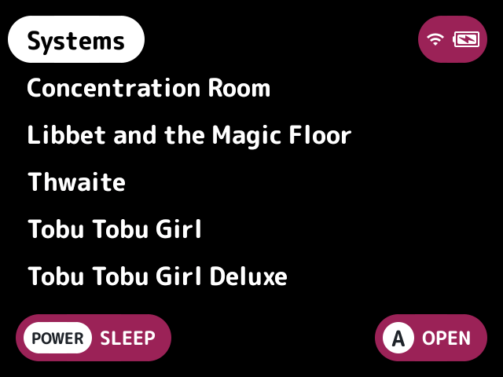

# all-games

Turns the first screen into one list of every game on the card, from all systems, sorted by name.

## What it does

- The list uses the names each system's list uses, `map.txt` aliases included.
- A Systems folder and other plugins' root folders come first. Recents, Collections and Tools stay on the [quick menu](../../docs/glossary.md#quick-menu).
- Subfolders are flattened two levels deep, and a folder with a `.cue` or `.m3u` named after it counts as one game.
- Games from different systems with the same name show their system's tag, such as "Tetris (GB)" and "Tetris (GBC)".
- Until a game is on the card the first screen is stock's.

The games come from the launcher's list of what's on the card, which it keeps up to date, so a game added or removed shows on its own. The first time the launcher starts with a card, the first screen is stock's for a moment while it reads the card.

## Turn it on

Turn on **All games** in Launcher > Plugins ([how](../../docs/plugins.md#turning-plugins-on-and-off)). It can't be on together with [`focus-mode`](../focus-mode/README.md), because both take the `root` [slot](../../docs/glossary.md#slot).

## Screenshots

The first screen listing every game, with the default settings.

## Settings

| Setting | Choices | Default | What it does |
|---|---|---|---|
| Show the system on shared names (`tags`) | on, off | on | Adds the system tag to games with the same name. Turn it off to leave that to stock or [`title-disambiguation`](../title-disambiguation/README.md) |

## For plugin authors

- Owns the `root` slot (`slots=root`), so it conflicts with any other plugin that owns it.
- Lists the games from the launcher's card index (`index_count` and `index_entry`, see [plugin-api.md](../../docs/plugin-api.md#features-added-since-the-first-api)): games in systems with an emulator, two folders deep. It asks for the index from `init` and lists the root again on `launcher.index_ready`. Until the index is first ready, as on the first start with a card the launcher hasn't read, the root is stock's. It reads nothing on the card itself.

## Credits

Xisrith.
