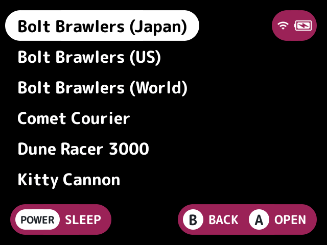
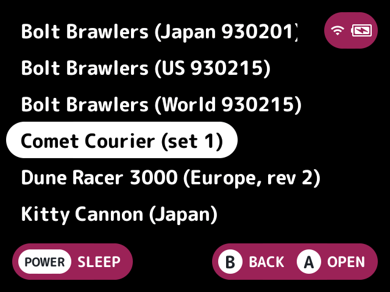
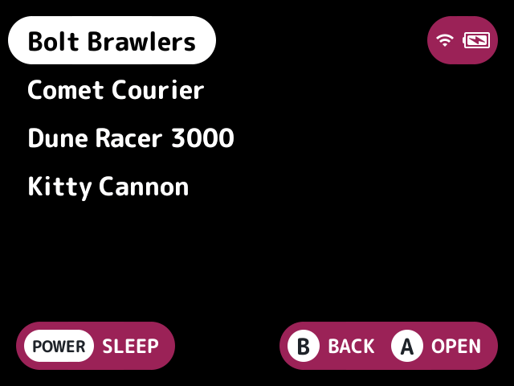

# arcade-names

Shows arcade games by their real titles, such as `sf2.zip` as "Street Fighter II: The World Warrior", from a DAT file you put on the SD card, and hides the BIOS and device files that aren't games. No list of names comes with it: without a DAT it does nothing.

## What it does

- In a system folder whose [system tag](../../docs/glossary.md#system-tag) is an arcade one, such as `Arcade (FBN)` or `MAME (MAME)`, each file named after a set in your DAT shows by that set's title. Files the DAT doesn't know keep their names.
- By default the title is clean: what's in parentheses and brackets is left off, so "Street Fighter II: The World Warrior (World 910522)" shows as "Street Fighter II: The World Warrior". When two games in the folder would show the same clean title, such as a game and its clones from other regions, each gets its region back, such as "(World)" and "(US)", and where that's still the same, what's in its parentheses, then its full title. The **Names** setting can show the DAT's full titles instead.
- BIOS and device sets, which the DAT marks as such, are always hidden. Settings can also hide:
  - a clone, a version of another game, when that game, its parent, is in the same folder and isn't hidden itself;
  - games the DAT marks as not working;
  - mahjong, casino and quiz games, from a `catver.ini` beside the DAT. DATs don't usually say what kind of game a set is, so without a `catver.ini` this setting does nothing.
- A name you gave a game in [`map.txt`](../../docs/glossary.md#maptxt) is kept.
- Search and the other plugins that look through the card's games, such as [random-game](../random-game/README.md), see the same names and leave out the same hidden files.
- Recently Played, collections and Favorites show what you put there, hidden files included.

## Where to put the DAT

Make a `DATs` folder at the top of the SD card, beside `Roms`, and put the DAT in it, such as `DATs/FBNeo - Arcade Games.dat`. Several DATs can go there, such as one for FBNeo and one for MAME; where two have a set of the same name, the first by file name wins. The DAT should match the version of the emulator you use, so its sets have the same names as your files.

It reads Logiqx XML DATs, the kind most tools write, such as FBNeo's DATs, MAME's `-listxml` output and ClrMamePro's XML DATs (`.dat` or `.xml`), and ClrMamePro's older text DATs (`.dat`).

For the mahjong, casino and quiz setting, put a `catver.ini` in the same folder, `DATs/catver.ini`.

The first start after you add or change a DAT or `catver.ini` reads it, which can take a few seconds for a large DAT such as MAME's. What it read is kept, so later starts are quick, until a file in `DATs` changes again.

## Turn it on

Turn on **Arcade names** in Launcher > Plugins ([how](../../docs/plugins.md#turning-plugins-on-and-off)).

## How to use

Put a DAT in `DATs/` and open an arcade folder. If its files still show their short names, check that the folder's tag is in the **Arcade tags** setting and that the DAT is for the same emulator version as your files.

## Screenshots

With the default settings: made-up games in Arcade, with clean titles, the region added back for Bolt Brawlers and its two clones, and the BIOS and sound chip sets hidden.

With Names set to Full: the DAT's full titles.

With Hide clones when the parent is there on: only Bolt Brawlers' parent shows.

## Settings

| Setting | Choices | Default | What it does |
|---|---|---|---|
| Names | Clean, Full | Clean | Clean leaves off the parentheses and brackets, adding the region back where two games would have the same title. Full shows the DAT's title as it is. |
| Hide clones when the parent is there | on, off | off | Hides a clone when its parent is in the same folder and isn't hidden. |
| Hide games that don't work | on, off | off | Hides the games the DAT marks as not working. |
| Hide mahjong, casino and quiz | on, off | off | Hides the games `catver.ini` puts under mahjong, casino or quiz. Does nothing without a `catver.ini`. |
| Arcade tags | text | MAME,FBN,FBNEO,FBA,ARCADE,CPS1,CPS2,CPS3,NEOGEO,HBMAME,MAME2003,MAME2003PLUS,MAME2010 | The system tags of the folders it names, separated by commas, in any case. |

## For plugin authors

- Names games with `display_name` for the game list and `index_name` for the card index, only where the entry's name is still its file name as stock tidies it, so a `map.txt` alias or an earlier plugin's name wins. Hides with `filter` in arcade folders and other plugins' lists, such as search's, but not in Recently Played, collections or Favorites.
- Reads `*.dat`, `*.xml` and `catver.ini` in `DATs/` on the card, once, as untrusted files: an XML DOCTYPE and its entities are skipped and never expanded, and names, descriptions, tags, lines, files and the number of sets have limits. Keeps what it read in `.userdata/<platform>/launcher/arcade-names.cache`, used while the files' names, sizes and times are the same, and removed when `DATs/` has no DAT. Reads each arcade folder's file names, again when the folder changes.
- No slots, services, requires or conflicts.

## Credits

nx-redux and rockyseltzer.
