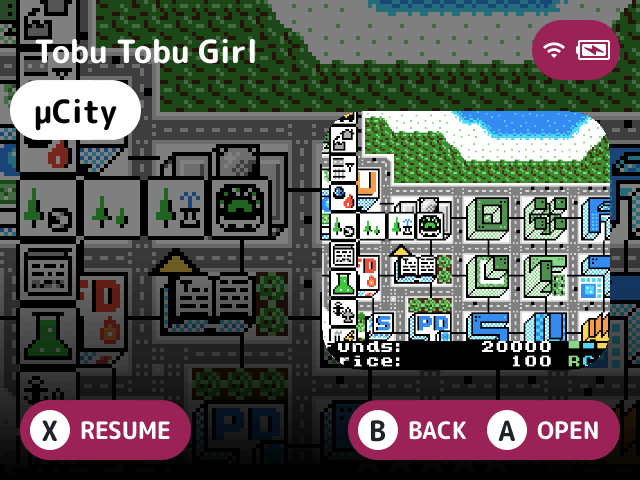
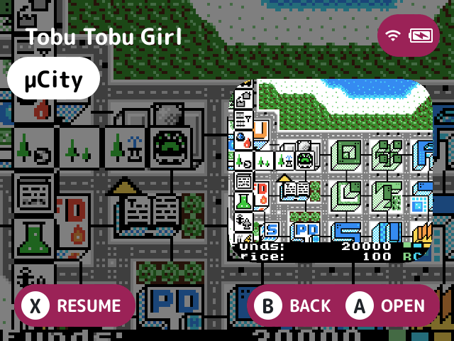
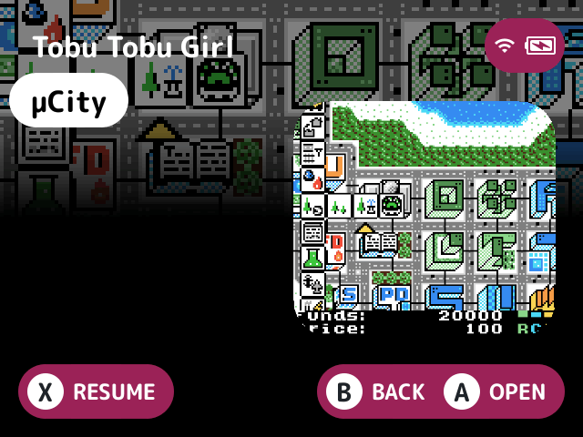
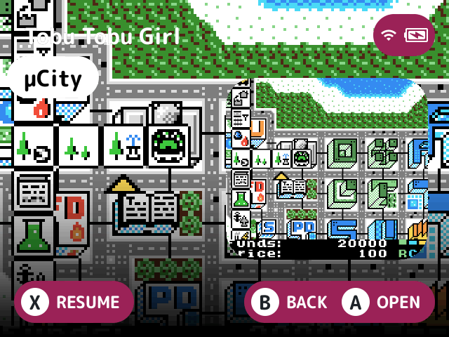
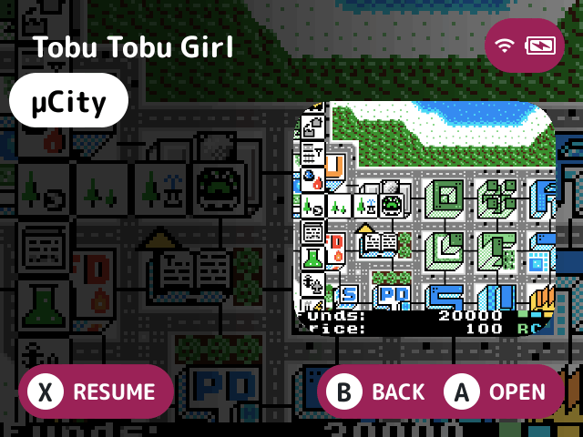
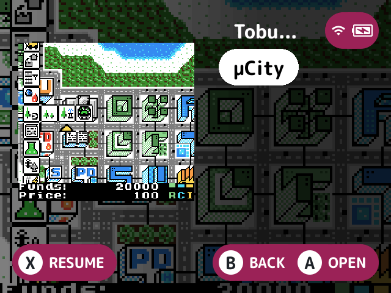

# art-backdrop

Draws the selected game's art behind the game list, dimmed.

## What it does

The art is the game's backdrop. A game with none gets its screenshot, thumbnail or box instead, the first that has a file. The art covers the top of the screen, scaled to fill it and cropped at the edges. With Fill set to full, it covers the whole screen instead, behind the list and the button hints, with a gradient darkening it toward the side the list is on so the names stay readable. Folders, paks, empty folders and games with no art keep stock's background.

Only art files count, so generated art such as [`art-placeholder`](../art-placeholder/README.md)'s cards isn't blown up behind the list. No bundled plugin gives a backdrop yet; [`art-boxart`](../art-boxart/README.md) gives the screenshot and box.

### Where the list is, with Fill at full

The darkening follows the layout:

| Layout | Darkest toward |
|---|---|
| The built-in list | the left |
| [`layout-fancy`](../layout-fancy/README.md) with its art on the right (its default) | the left, where the rows are |
| `layout-fancy` with its art on the left | the right |
| `layout-fancy` with its art across the top | the bottom |
| [`layout-hero-rail`](../layout-hero-rail/README.md) | the bottom, under the cards, though the hero rail draws over the whole screen wherever it has art for the game, so the backdrop only shows where both have none |
| [`layout-grid`](../layout-grid/README.md), [`layout-carousel`](../layout-carousel/README.md), [`layout-shelf`](../layout-shelf/README.md) | nowhere in particular: the list covers the screen, so all of it is darkened evenly |

A layout from outside the bundled plugins gets the built-in list's, the left.

## Turn it on

Turn on **Art backdrop** in Launcher > Plugins ([how](../../docs/plugins.md#turning-plugins-on-and-off)).

## Screenshots

µCity's art behind Game Boy Color, with the default settings (gradient style).

Style set to full.

Height set to half.

Dim set to 0.

Fill set to full: the art behind the whole screen, darkest toward the list on the left.

Fill set to full with [`layout-fancy`](../layout-fancy/README.md)'s art on the left: darkest toward its rows on the right.

## Settings

| Setting | Choices | Default | What it does |
|---|---|---|---|
| Fill (`fill`) | top, full | top | `top` covers the top of the screen, as Style and Height say. `full` covers the whole screen, behind the list and the hints, at full strength, and darkens it more toward the side the list is on (see above), on top of Dim. Style and Height don't apply to it |
| Style (`style`) | gradient, full | gradient | `gradient` shows the art at full strength over the top half of its area and fades it out to stock's background over the bottom half. `full` shows it at full strength over all of it |
| Dim (`dim`) | theme, 0, 25, 50, 75 | theme | How much darker the art is, in percent. `theme` uses the theme's `art-backdrop.dim` key, a percentage from 0 to 100, or 50 without one. A new theme's dim shows at once |
| Height (`height`) | full, half, third | full | How much of the screen the art covers, from the top |
| Fall back to the screenshot (`screenshot`) | on, off | on | Uses the screenshot when a game has no backdrop |
| Fall back to the thumbnail (`thumbnail`) | on, off | on | Uses the thumbnail when there's no backdrop or screenshot |
| Fall back to the box (`box`) | on, off | on | Uses the box when there's nothing else |

## For plugin authors

- Owns the `background` slot (`slots=background`).
- Reads the `art-backdrop.dim` theme key with `theme_value` (see [plugin-api.md](../../docs/plugin-api.md)).
- With `fill=full`, finds the layout with `plugin_loaded` and reads layout-fancy's public `position` setting with `cfg_read`.

## Credits

taylorbird, bmpriest and hp7hao.
