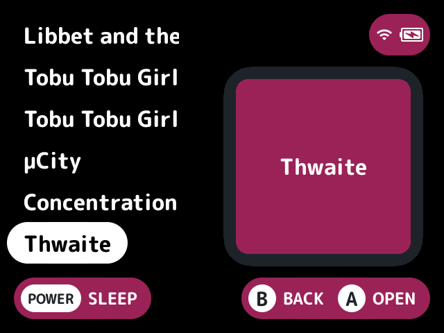
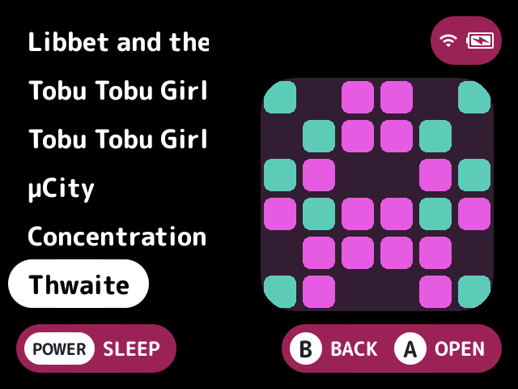
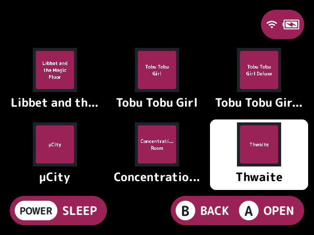

# art-placeholder

Gives games with no art a thumbnail and a box, so they don't show a blank space.

## What it does

The launcher asks for placeholder art only when no file answers. A game with any thumbnail, box, 3D box or screenshot file gets none, so it never stands in for real art. Folders and paks get none either. The thumbnail is square and the box is 3:4, each as big as the built-in list shows a thumbnail.

## Turn it on

Turn on **Placeholder art** in Launcher > Plugins ([how](../../docs/plugins.md#turning-plugins-on-and-off)).

## Screenshots

Games with no art in the Homebrew collection, with the default settings (title style).

Style set to pattern.

With layout-grid: every tile gets a title card.

## Settings

| Setting | Choices | Default | What it does |
|---|---|---|---|
| Style (`style`) | theme, title, pattern | theme | What a game with no art gets. `title` puts the game's name on a card in the theme's colours (the accent on the secondary accent), wrapped over up to three lines and shortened with "..." when it doesn't fit. `pattern` draws a mirrored grid of rounded tiles in colours picked from the rom's path, so a game always gets the same one. `theme` uses the theme's `art-placeholder.style` key, or `title` without one |

## For plugin authors

- Answers the launcher's thumbnail and box requests, last, after the providers that find files.
- Reads the `art-placeholder.style` theme key with `theme_value` (see [plugin-api.md](../../docs/plugin-api.md)).

## Credits

casualducko and nx-redux.
