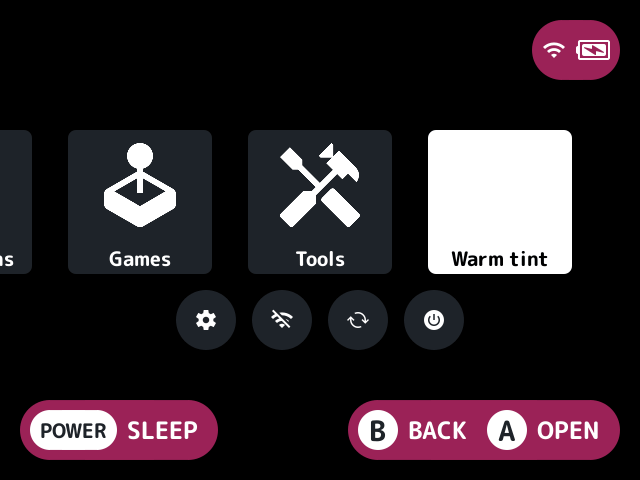
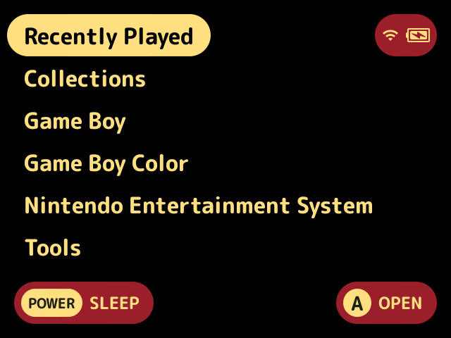
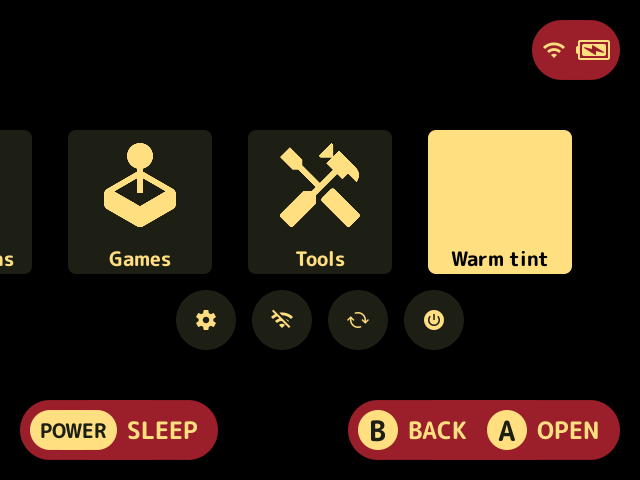
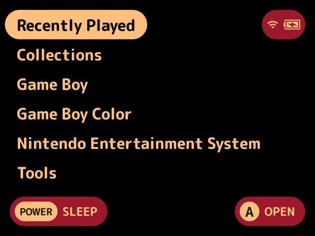
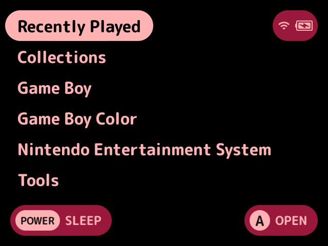
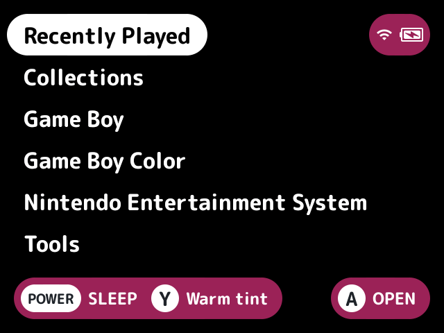

# blue-light

Puts a warm tint over every screen of the [launcher](../../docs/glossary.md#launcher) to cut blue light in the evening: amber, orange or red, at the strength you pick. Turn it on and off from the [quick menu](../../docs/glossary.md#quick-menu), or let it come on and go off at set times. Games aren't tinted.

## What it does

- The tint covers everything the launcher shows: the game list, the quick menu, the game switcher, messages and dialogs, the lock screen, and the screens other plugins add, the screensaver and charging screen included.
- White turns into the tint's colour, and black stays black. At 100% white is fully amber, orange or red; at 50% it's halfway there.
- Screenshots of the launcher, such as from [screenshot-viewer](../screenshot-viewer/README.md)'s capture, show the tint as you saw it.
- Games, and the screenshots taken in them, are never tinted.

## Turn it on

Turn on **Blue light tint** in Launcher > Plugins ([how](../../docs/plugins.md#turning-plugins-on-and-off)).

## How to use

- The Warm tint tile on the quick menu turns the tint on and off. A message says which.
- The Warm tint button setting puts the same switch on a game list button, and an [FN button](../../docs/glossary.md#fn-button) set to `action:blue-light.toggle` can too.
- The Warm tint setting turns it on and off from Launcher > Plugins as well.
- With Schedule on, the tint comes on at the Turn on at time and goes off at the Turn off at time by itself, with no button pressed. When Turn off at is earlier than Turn on at, as with the default 21:00 to 07:00, it stays on across midnight. The Warm tint setting then does nothing.
- With Schedule on, the tile or button flips the tint only until the next of those two times, and then the schedule takes over again. Turning it off at 23:00 with the default times keeps it off until 07:00, and the message says so; turning it on at noon keeps it on until 21:00, when the schedule keeps it on anyway. This lasts through games and restarts.
- The times on the Plugins page are on the hour. Turning on and off at the same time leaves the schedule off, and the launcher's log says so.

## Screenshots

The Warm tint tile on the quick menu, off, with the default settings.

On, with the default amber at 50%.

On, on the quick menu, with the tile on.

With Colour set to orange.

With Colour set to red and Strength at 30%.

With Warm tint button set to Y, the game list shows the button.

## Settings

| Setting | Choices | Default | What it does |
|---|---|---|---|
| Warm tint (`on`) | on, off | off | The tint, without a schedule. The tile and button flip it too |
| Colour (`colour`) | amber, orange, red | amber | What white turns into at 100% |
| Strength (%) (`strength`) | 10 to 100, in steps of 10 | 50 | How far toward the colour the screen goes |
| Schedule (`schedule`) | on, off | off | Turns the tint on and off at the two times below |
| Turn on at (`from`) | 00:00 to 23:00, on the hour | 21:00 | When the schedule turns it on |
| Turn off at (`to`) | 00:00 to 23:00, on the hour | 07:00 | When the schedule turns it off, the next day when it's earlier than Turn on at |
| Quick menu tile (`tile`) | on, off | on | A Warm tint tile on the quick menu that turns it on and off |
| Warm tint button (`button`) | none, Y, L2, R2, SELECT | none | A game list button that turns it on and off |

A colour or strength the plugin doesn't know, such as one typed into its cfg by hand, is logged and the default used in its place. A time typed by hand can have minutes, such as `21:30`; one that isn't a time leaves the schedule off, which the log says.

## For plugin authors

- Gives the launcher its tint through `screen_tint` (see [plugin-api.md](../../docs/plugin-api.md#features-added-since-the-first-api)). The launcher multiplies every frame it shows by it, as the last step, and `tint_shown` reads back what the frame on screen has. It needs a launcher with `tint_shown`, and declines to load on one without it.
- Registers the action `blue-light.toggle` and a quick menu tile for it. The `button` setting follows it (`button:blue-light.toggle`).
- No slots, `requires` or `conflicts`. Another plugin's `screen_tint` multiplies with this one's.
- Reads the clock about once a second from `tick`, and calls `request_redraw` when the tint comes on or goes off.
- Keeps the toggle's forcing in its own cfg, `.userdata/<platform>/launcher/blue-light.cfg`, as `forced` (`on`, `off` or empty) and `until` (seconds since 1970), beside its settings. It reads and writes no other files.
- For the tests only, `MOSAIC_BLUE_LIGHT_FAKE` names a file holding the time as seconds since 1970, read in place of the clock.

## Credits

Onion and muOS.
