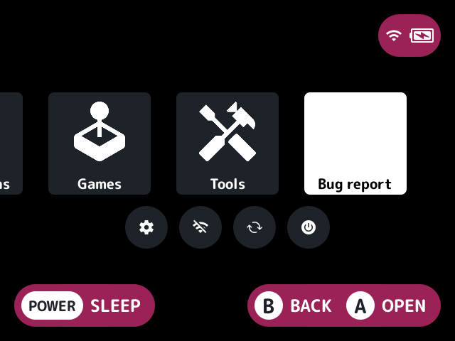
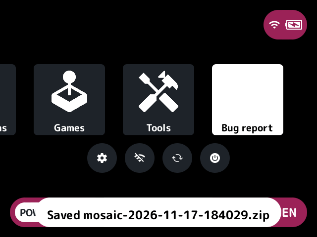

# bug-report

Saves everything someone needs to look into a problem with the launcher in one zip on the card, so you can attach it to a bug report: the launcher's and plugins' logs, their settings, your device and versions, and how many games each system has. Private details, such as passwords, tokens and your Wi-Fi network's name, are taken out first.

## What it does

- The Bug report tile on the [quick menu](../../docs/glossary.md#quick-menu) makes a report. A wait screen shows while it's made, usually for about a second, then a message names the file, such as `mosaic-2026-11-17-153012.zip`.
- Reports go in the `Reports` folder at the top of the card, one zip each, named for when they were made. Take the card out, or copy the file over the network, and attach it to your bug report.
- When the launcher crashes as it starts and pauses plugins (see [when a plugin crashes](../../docs/plugin-api.md#when-a-plugin-crashes)), it makes a report itself, so the crash's log is saved even though no plugin is running. One is made each time plugins are paused, not on every start while they stay paused.
- Only the newest 10 reports are kept: making another removes the oldest. Copy any you want to keep somewhere else. Other files you put in `Reports` are left alone.

### What's in a report

- The launcher's log, the log of the last start that crashed, and each plugin's own logs, such as [tasks](../tasks/README.md)' and [sync](../sync/README.md)'s. Each log has only its last 1 MB, and a report holds up to 64 logs; the report says when it left something out.
- `plugins.txt` (which plugins are on), the Launcher page's settings, and each plugin's settings.
- Your device's model, NextUI's version, the launcher's version, every plugin with its version and whether it's on, the theme, which [profile](../guest-profile/README.md) is on, and how much room is free on the card.
- Each system folder with how many games it has. No game's file name is in it.

### What's taken out

- Settings a plugin marks protected or secret, such as [romm](../romm/README.md)'s server, user and password and [sync](../sync/README.md)'s keys, and [playtime-limit](../playtime-limit/README.md)'s code. Their values are also taken out of the logs wherever they show. The [PIN](../../docs/plugin-api.md#the-pin) is never in a report.
- Anything a plugin keeps in its settings file that isn't one of its settings, such as what it remembers between starts.
- User names and passwords in web addresses, tokens, API keys, passwords and cookies.
- Unless you turn on Keep network details: IP addresses, MAC addresses (such as a Bluetooth device's), Wi-Fi network names and Syncthing device IDs.

Each is replaced with a marker such as `<ip>`, `<wifi>` or `<redacted>`. Text is matched by its pattern, so look through a report before you share it if you've written something private where the launcher wouldn't expect it, such as in a task's output.

## Turn it on

Turn on **Bug report** in Launcher > Plugins ([how](../../docs/plugins.md#turning-plugins-on-and-off)). It's off until you do, and it needs to be on for a report to be made after a crash.

## How to use

- Open the quick menu and pick Bug report.
- The Bug report button setting puts the same action on a game list button, and an [FN button](../../docs/glossary.md#fn-button) set to `action:bug-report.make` can run it too.
- Turn on Keep network details only when the problem is about the network, such as Wi-Fi, RomM or sync not connecting, and you're happy to share your addresses.

## Screenshots

The Bug report tile on the quick menu.

The message naming the report once it's saved.

## Settings

| Setting | Choices | Default | What it does |
|---|---|---|---|
| Quick menu tile (`tile`) | on, off | on | A Bug report tile on the quick menu that makes a report |
| Bug report button (`button`) | none, Y, L2, R2, SELECT | none | A game list button that makes a report |
| Keep network details (`keep_network`) | on, off | off | Keeps IP and MAC addresses, Wi-Fi network names and Syncthing device IDs in reports, the ones made after a crash too |

## For plugin authors

- Registers the action `bug-report.make`, with a quick menu tile, and a wait screen, `bug-report.wait`. The `button` setting follows `bug-report.make` (`button:bug-report.make`).
- The launcher makes the report, with `bug_report` (see Bug reports in [plugin-api.md](../../docs/plugin-api.md#features-added-since-the-first-api)), which lists what goes in and what's taken out. The plugin opens the wait screen, asks for the report on the tick after it has drawn, closes it and shows a toast with the zip's name, and logs its path.
- Provides `report.crash`, so the launcher makes a report itself when it pauses plugins after a crash, with this plugin's `keep_network` setting.
- Asks for the card index from `init` (`index_count`), so the game list summary is ready by the time a report is made.
- Writes `Reports/mosaic-<date>.zip` on the card, through the launcher, and keeps no files of its own. The Launcher pak's wrapper keeps the last crashed start's log as `.userdata/<platform>/logs/nextui-crash.txt`.
- No slots, requires or conflicts.

## Credits

spruceOS.
