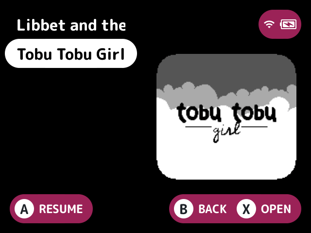

# button-remap

Puts the game list's own actions, or other plugins' actions, on different buttons.

## Turn it on

Turn on **Button remap** in Launcher > Plugins ([how](../../docs/plugins.md#turning-plugins-on-and-off)). It changes nothing until you set a button.

## How to use

Each button's setting is a list of action ids, separated by commas. The first available one runs. For example `x=gamelist.open` or `y=release:random-game.pick,favorites.toggle`.

An id can start with:

| Prefix | Meaning |
|---|---|
| none | Acts on press |
| `release:` | Acts when the button is let go |
| `repeat:` | Acts on press and again while held, as stock's letter jumps do, such as `l1=repeat:gamelist.prev_letter` |

`none` leaves the button doing nothing, and an empty setting leaves it as it is.

### The game list's actions

- `gamelist.open`
- `gamelist.back`
- `gamelist.resume`
- `gamelist.prev_letter`
- `gamelist.next_letter`
- `gamelist.switcher`
- `gamelist.quick_menu`

A letter jump repeats only with `repeat:`. Other plugins list their actions in their own pages.

### Which buttons it can take

- A, B, X, L1, R1 and SELECT are overridden, so other plugins' bindings there stop. A button another plugin overrode first stays that plugin's, and a plugin's action on one of them needs `button-remap` to load after that plugin (see `plugins.txt` in [turning plugins on and off](../../docs/plugin-api.md#turning-plugins-on-and-off)).
- Y, L2, R2 and START are shared with other plugins' bindings, so with two or more actions available the button opens a menu of them. With `repeat:` it overrides them like the others.
- With [`platform-jump`](../platform-jump/README.md) on, L1 and R1 go to whichever of the two plugins loads first, and only when `button-remap` has an `l1` or `r1` setting. If `button-remap` is first, `platform-jump` doesn't load. If `platform-jump` is first, the `l1` and `r1` settings are left out and the rest still applies. Either way the launcher log says so. Without those settings the two work together.

### Resume with A

Swaps A and X: A resumes the selected game from its save state, or opens it when there's nothing to resume, X opens it without resuming, and the hints follow. A button's own setting replaces what this puts on it.

### FN1, FN2 and HOME

On a device with [FN buttons](../../docs/glossary.md#fn-button) (L3 and R3 on the Brick, L4, R4 and HOME on the Brick Pro, HOME on the tg5050), the **FN1 button**, **FN2 button** and **HOME button** settings each name what a press runs: an action id, such as `gamelist.switcher`, or a Tools [pak](../../docs/glossary.md#pak), such as `Tools/Files.pak` (or just `Files.pak`). A press runs it from any launcher screen, the game list and the home screen included, as stock's own FN buttons do. An empty setting leaves the button as it is, and a button the device doesn't have does nothing.

These use the same FN bindings as stock's Settings, so:

- A button you assigned in stock's Settings keeps what you chose there, and the setting here is ignored for it until you unassign it.
- If another plugin bound the button first, it stays that plugin's.
- An action that changes things still asks for the launcher's PIN with [`simple-mode`](../simple-mode/README.md)'s kiosk mode on, and a Tools pak doesn't open while simple mode hides Tools.

The launcher log says when a binding is refused, and why.

### The sticks

There's no stick setting: on a device with a left stick, the launcher already moves with it as with the d-pad, on every screen, as stock does, repeating while it's held. The right stick does nothing.

## Screenshots

Resume with A on: the hints show A RESUME and X OPEN on a game with a save state.

## Settings

The keys are `a`, `b`, `x`, `y`, `l1`, `r1`, `l2`, `r2`, `start` and `select` in `.userdata/<platform>/launcher/button-remap.cfg`. The Plugins page shows only A, X, Y, L2, R2 and START of them, and the FN buttons' keys are `fn1`, `fn2` and `home`.

| Setting | Choices | Default | What it does |
|---|---|---|---|
| Resume with A (`resume_with_a`) | on, off | off | A resumes the selected game, or opens it when there's nothing to resume, and X opens it without resuming |
| Resume on press (`resume_on_press`) | on, off | off | X acts on press instead of release |
| A button (`a`) | text | empty | Action ids tried in order, as above |
| X button (`x`) | text | empty | Same |
| Y button (`y`) | text | empty | Same |
| L2 button (`l2`) | text | empty | Same |
| R2 button (`r2`) | text | empty | Same |
| START button (`start`) | text | empty | Same |
| FN1 button (`fn1`) | text | empty | An action id or a Tools pak that FN1 runs, as above |
| FN2 button (`fn2`) | text | empty | Same, for FN2 |
| HOME button (`home`) | text | empty | Same, for HOME |

## For plugin authors

- Overrides the buttons listed above through the launcher's binding calls; `b`, `l1`, `r1` and `select` work the same in `button-remap.cfg`.
- Binds any action id registered with `register_action`.
- Binds FN1, FN2 and HOME (`MOSAIC_BUTTON_FN1` to `MOSAIC_BUTTON_FN3`) with `fn_bind`, as `action:<id>` or `pak:<folder>`, from init. Like any plugin's FN binding, a button the user assigned in Settings or another plugin bound first is refused.
- Has no slot. Load order matters for the buttons it shares with other plugins, as described above.

## Credits

Nocturne, Bramley, MinUit, MyMinUI, Xisrith (Resume with A) and ProClifo (Resume on press).
