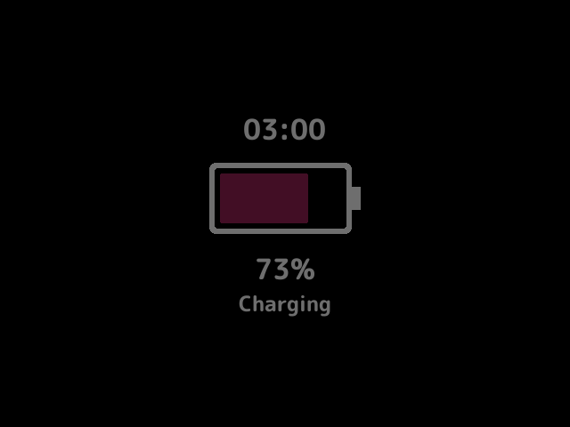
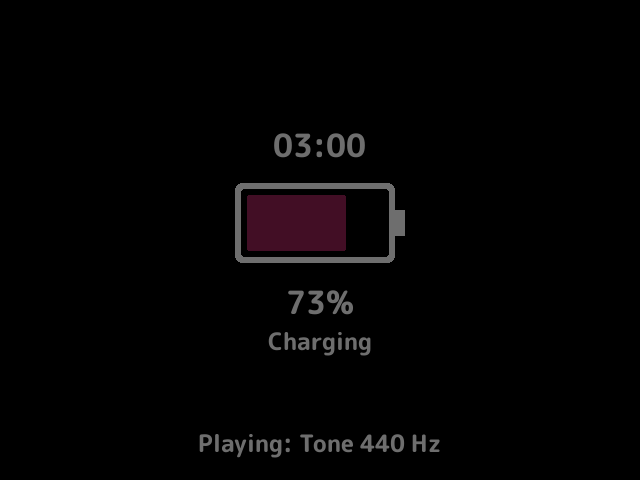

# charging-screen

Shows a full screen with the battery level while the device charges and you aren't using it. It says whether the device is charging or charged, drawn dim on black, and while the [`music`](../music/README.md) plugin has a track, what it plays.

It needs a battery, so on the desktop build it loads but logs that it's unsupported and does nothing. Its name on the Plugins page says "(unsupported on desktop)".

## Turn it on

Turn on **Charging screen** in Launcher > Plugins ([how](../../docs/plugins.md#turning-plugins-on-and-off)).

## How it behaves

- It shows while the device charges and the game list or the home screen has been left alone for the idle time.
- It's one of the launcher's ambient screens: the launcher opens it over the game list or the home [slot](../../docs/glossary.md#slot)'s screen, not over the quick menu, the game switcher or other plugins' screens, which are what you were looking at. The Ambient screens page on the Launcher page sets which ambient screen comes first; by default it comes after the lock and before the [`screensaver`](../screensaver/README.md), so while the device charges it takes over from the screensaver once its own idle time has passed.
- It's drawn again only when the level, the state, the clock's minute or what music plays changes.
- Any button closes it, back to where it opened. That press is taken until it's let go, so it doesn't also act on the screen under it.
- While the music plugin has a track, what it plays shows at the bottom, and **X** plays or pauses it without closing the screen. With music off or nothing to play, X closes it as any button does.
- The power button still sleeps the device, and waking closes the screen.
- It closes by itself when the charger comes out.
- It never holds off sleep: stock's launcher never turns the screen off or sleeps on its own while charging, with or without this screen, and its screen timeout counts from when the charger comes out.

## Settings

| Setting | Choices | Default | What it does |
|---|---|---|---|
| Show after idle on a charger, in seconds (`idle`) | off, 30, 60, 120, 300 | 60 | How long the game list or home is left alone on a charger before the screen shows |
| Clock (`clock`) | off, 24h, 12h | 24h | Shows the time above the battery |

## Screenshots

The test battery at 73% and charging, with Show after idle set to 15 seconds and the other settings at their defaults.

With the music plugin playing a track.

## For plugin authors

- Its screen, `charging-screen.main`, is an ambient screen: it lists it in `ambient=` and registers it with `register_ambient`, and its `wants` says yes while the device charges once the launcher's idle time reaches the idle setting.
- Reads what music plays with music's `music.now` service and plays or pauses it with `music.toggle`, about once a second while it shows.
- On a platform without a battery it loads but does nothing. For the tests and screenshots only, `MOSAIC_CHARGING_SCREEN_FAKE` names a file holding `<level> <charging>`, such as `73 1`, read in place of the battery.

## Credits

MinUI-Zero.
