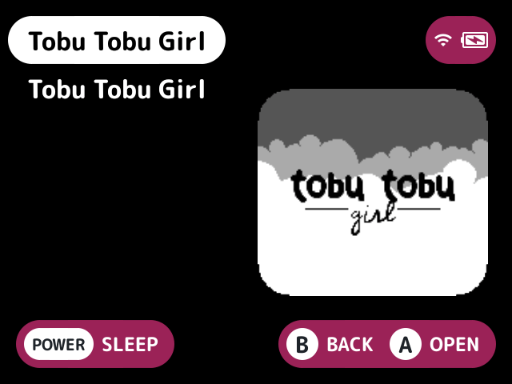

# collate-subfolders

Merges folders that have the same name in a system that is listed from several folders, so you see one folder instead of several.

## What it does

Some systems are listed by stock from several folders, whose names match up to their last `(`, such as "Game Boy (GB)" and "Game Boy (MGB)". When more than one of them has the same subfolder, it shows once, in the place of the first by folder name, and lists the games and folders of all of them together by name. Folders inside it are merged the same way.

Folders are matched by the name stock shows for them, ignoring case, spacing and punctuation, as [`genre-view`](../genre-view/README.md) does. In the system's list that is by the `map.txt` of the folder it was opened from, as stock names every collated folder's entries, and below that by each folder's own.

Left as stock lists them:

- paks
- game folders (holding a `.cue` or `.m3u` named after themselves)
- folders only one of them has
- systems that aren't collated

Back from a game in a merged folder, the launcher opens the merged folders again with the game selected.

## Turn it on

Turn on **Collate subfolders** in Launcher > Plugins ([how](../../docs/plugins.md#turning-plugins-on-and-off)). It has no settings.

## Works with

- [`genre-view`](../genre-view/README.md): the Genres folder is unchanged and a system's own genre folders are merged in its list.
- [`numeric-prefix`](../numeric-prefix/README.md) and [`title-disambiguation`](../title-disambiguation/README.md): they work in merged folders as in any folder. Folders are matched by their names before `numeric-prefix` takes the number off, and same-name games from different folders are told apart.
- [`all-games`](../all-games/README.md): its root is unchanged and the systems in its Systems folder are merged.

## Screenshots

Platformers folders from Game Boy Color (GBC) and Game Boy Color (SGB) shown as one, with the default settings.

## For plugin authors

- Has no slot, settings, services or files of its own.

## Credits

tsolfan.
