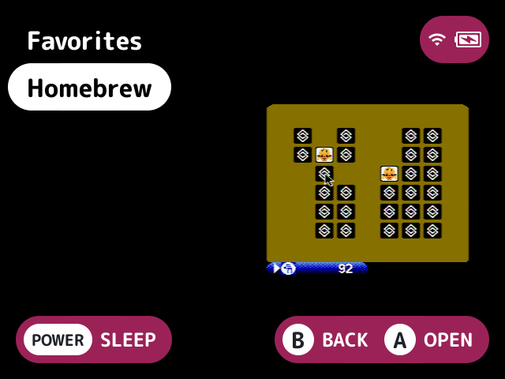

# collections-plus

Puts your [collections](../../docs/glossary.md#collection) on the first screen in your order, with their art, and adds options for how collections list.

## Turn it on

Turn on **Collections plus** in Launcher > Plugins ([how](../../docs/plugins.md#turning-plugins-on-and-off)). It changes nothing until you name collections or turn an option on.

## What it does

- **Promote:** the On the root setting names the collections to put on the first screen. They go after the consoles, as other plugins' root folders do, in the Order setting's order, then in the On the root setting's, then by name.
- **Order:** the Order setting orders the Collections folder too, with the collections it leaves out after, by name.
- **File order:** inside a collection, the games keep the collection file's own order. Stock gives that up for names when `Collections/map.txt` renames one of its games.
- **Own map:** a collection's games can be named from its own map, `Collections/.media/<name>.map.txt`. For a collection in a folder below Collections, it looks at `<folder>/.media/<name>.map.txt` and then that folder's `map.txt`, before the shared `Collections/map.txt`. It's written like any `map.txt`: a file name, a tab and the name to show, one a line. A name starting with a dot hides the game.
- **Art:** a collection's thumbnail and box come from `<folder>/.media/<name>.png`, where stock already looks for its thumbnail, or `.jpg`, so layouts that show boxes show it too, on the root and in the Collections folder.

A collection is named by its file name without `.txt`, or by the name `Collections/map.txt` gives it, ignoring case. Names are comma-separated, such as `RPGs, Shooters`, or `*` for all of them.

When stock already puts collections on the root, as it does when there are no systems to show, they aren't added again, and keep stock's order. With [`focus-mode`](../focus-mode/README.md) or [`all-games`](../all-games/README.md) owning the root, they show only where the owner adds other plugins' root folders.

## Screenshots

The Collections folder, with the Homebrew collection's art (Collection art on, the default).

On the root set to `*`: the collections on the first screen after the consoles.

## Settings

The settings are kept in `.userdata/<platform>/launcher/collections-plus.cfg`.

| Setting | Choices | Default | What it does |
|---|---|---|---|
| On the root (`promote`) | text | empty | Collections to put on the root, comma-separated by name, such as `RPGs, Shooters`, or `*` for all. Empty puts none |
| Order (`order`) | text | empty | The order collections go in, on the root and in Collections, comma-separated by name. The rest follow by name |
| Hide Collections folder (`hide_folder`) | on, off | off | Leaves the Collections folder off the root. The quick menu still has it |
| Keep file order (`file_order`) | on, off | on | Lists a collection's games in the collection file's order, even when `map.txt` renames them |
| Collection map.txt (`own_map`) | on, off | on | Names a collection's games from its own map first |
| Collection art (`art`) | on, off | on | A collection's art from `Collections/.media/<name>.png` or `.jpg`, as its thumbnail and box |
| Hide Games tile (`hide_games`) | on, off | off | Hides the quick menu's Games tile, as [`quick-menu-plus`](../quick-menu-plus/README.md)'s `hide` setting can |

## For plugin authors

- Adds root folders the way other plugins do, and provides collection art for the thumbnail and box.
- Reads `Collections/*.txt`, `Collections/map.txt`, `Collections/.media/<name>.map.txt` and `.png` or `.jpg`.
- Writes only its own `collections-plus.cfg`.

## Credits

UnuOS, Bramley, LodorOS, kUI and tsolfan (keep file order, the folder's own `map.txt`, and the hide Games switch).
