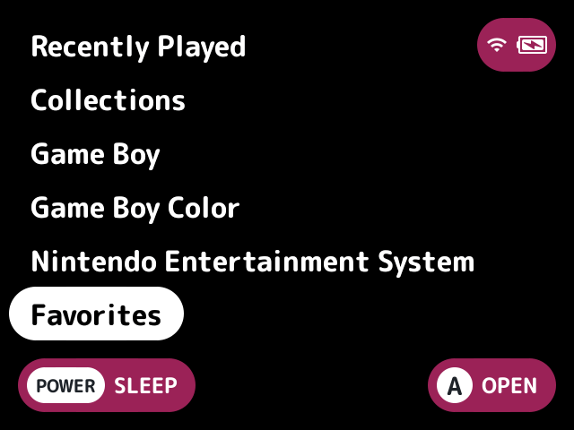
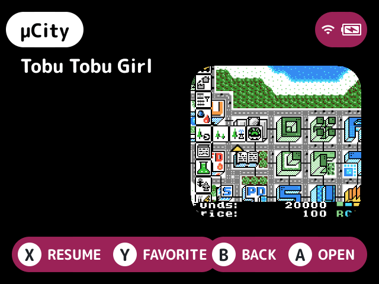

# favorites

Adds a Favorites folder on the first screen, and a button to add or remove a favorite.

## Turn it on

Turn on **Favorites** in Launcher > Plugins ([how](../../docs/plugins.md#turning-plugins-on-and-off)).

## How to use

On the game list, press **Y** to add or remove the selected game or [pak](../../docs/glossary.md#pak). Favorites show in the Favorites folder.

With Pin to top on, favorites also sort first in whichever folder they're in, except Recently Played, [collections](../../docs/glossary.md#collection) and Favorites itself.

## Screenshots

The Favorites folder on the first screen, with the default settings.

The Favorites folder.

Pin to top on: µCity, a favorite, comes first in Game Boy Color.

## Settings

| Setting | Choices | Default | What it does |
|---|---|---|---|
| Collection (`collection`) | text | Favorites | The collection in `Collections/` that holds favorites, and the folder's name on the root |
| Pin to top (`pin`) | on, off | off | Sorts favorites first in every folder but Recently Played, collections and Favorites |

## For plugin authors

- Provides the `favorites` entry set (`provides=sets.favorites`). It's announced as changed (`launcher.set_changed`) each time a favorite is added or removed.
- Other plugins read favorites through the entry set rather than the collection file: [`search`](../search/README.md), [`random-game`](../random-game/README.md), [`focus-mode`](../focus-mode/README.md), [`row-badges`](../row-badges/README.md), [`home-dashboard`](../home-dashboard/README.md) and [`screensaver`](../screensaver/README.md).
- Stores favorites in the collection file in `Collections/`.
- Its model code is in `pin_model.c`.

## Credits

Pin to top is from kUI and nx-redux.
