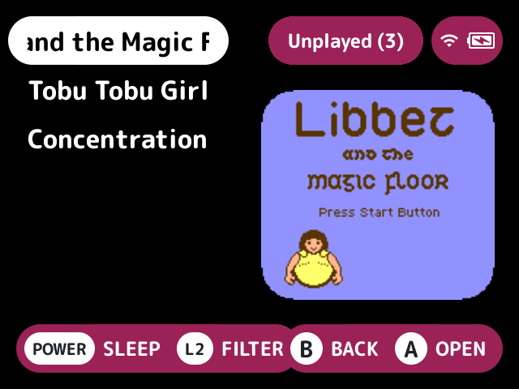
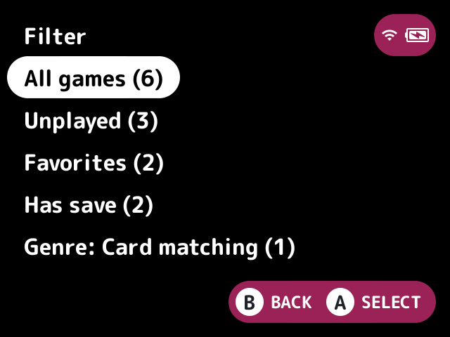
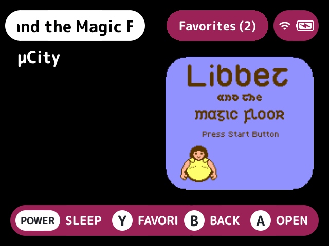

# filter-presets

Filters the game list you're in, a system or a collection, with L2 and R2: to its unplayed games, your favorites, games with a save, one genre or a number of players, or a filter of your own. The header shows which filter is on and how many games it shows.

## What it does

- L2 and R2 step through the filters for the system or collection you're in, and past the last one back to all its games:
  - Unplayed: games you haven't played, as [`row-badges`](../row-badges/README.md) decides, or without it, games that aren't in Recently Played;
  - Favorites: games in your [favorites](../favorites/README.md);
  - Has save: games with a save state, from [`save-state-manager`](../save-state-manager/README.md);
  - one for each genre its games have, such as Genre: Puzzle, and one for each number of players they reach, such as 2+ players, from the `genre` and `players` lines of the games' `.info` sidecar files, `<folder>/.media/<name>.info`;
  - your own filters, each written as a [search](../search/README.md) query.
- A filter that would show no games is skipped, as is one whose plugin is off, such as Favorites with favorites off.
- The header shows the filter and how many games it shows, such as Unplayed (12).
- Folders inside the system are hidden while a filter is on.
- Leaving the system or collection, by backing out, opening something else or playing a game, shows all its games again.

## Turn it on

Turn on **Filter presets** in Launcher > Plugins ([how](../../docs/plugins.md#turning-plugins-on-and-off)). Turn on [`favorites`](../favorites/README.md), [`row-badges`](../row-badges/README.md) and [`save-state-manager`](../save-state-manager/README.md) too for their filters.

## How to use

Open a system or collection and press R2 for the next filter or L2 for the previous one. L2 and R2 are used only when no other plugin has them on the game list, such as search with its Search button on L2; the Previous filter button and Next filter button settings pick other buttons.

A Filter tile on the [quick menu](../../docs/glossary.md#quick-menu) lists All games and every filter with how many games it shows. Pick one to turn it on. An [FN button](../../docs/glossary.md#fn-button) set to `action:filter-presets.next`, `action:filter-presets.prev` or `action:filter-presets.pick` does the same as the buttons and the tile.

Your own filters go in the Your filter settings, written as [search](../search/README.md) writes queries: `fav:` for favorites, `tag:<name>` for a [tag](../tags/README.md), `unplayed`, `system:<name>` for a system by its tag or name, `genre:<name>`, `year:<year>`, `decade:<decade>`, `played:<days>`, `hours:<hours>` and `added:<days>`, each turned around by a leading `-`, and words a game's name has to have. For example `-fav: unplayed` is the unplayed games that aren't favorites, and `mario` the games with mario in their name. The filter shows in the header as you wrote it.

## Screenshots

With the default settings: the Homebrew collection filtered to its unplayed games, picked from the Filter tile.

With favorites and save-state-manager: the Filter tile's list, with how many games each filter shows.

With favorites: the Homebrew collection filtered to the favorites.

## Settings

| Setting | Choices | Default | What it does |
|---|---|---|---|
| Your filter 1 to 4 (`preset1` to `preset4`) | text | empty | Your own filters, after the built-in ones, each a search query such as `-fav: unplayed` |
| Previous filter button (`prev_button`) | none, Y, L2, R2, SELECT | L2 | The game list button for the previous filter, used only when no other plugin has it there |
| Next filter button (`next_button`) | none, Y, L2, R2, SELECT | R2 | The game list button for the next filter, used only when no other plugin has it there |
| Filter tile on the quick menu (`tile`) | on, off | on | A Filter tile on the quick menu that lists the filters with how many games each shows |

## For plugin authors

- Registers the `filter-presets.prev` and `filter-presets.next` actions, bound with `bind_button` on the first `tick`, once every plugin has loaded, and only to a button no other action has on the game list, as `action_info` lists them. `prev_button` and `next_button` are marked `button:` for them.
- Registers `filter-presets.pick`, which lists the filters with `choose`, and its quick menu tile.
- Keeps each folder's games from `list_ready` while no filter is on, other plugins' filters applied, and hides the rest of a filter's folder with its `filter` hook, in that folder only, so `is_filtered` says so too while it's on. Draws a header widget while a filter is on.
- Reads favorites and tags with `set_has` (a game folder by its `.m3u` or `.cue` too), unplayed from `games.played` (or recents without it), Has save from `states.last`, genre, year and players from the card index (`index_find`), `played:` and `hours:` from the play history (`last_played` and `play_time`), and `added:` from the game's file times (`stat`). It works the filter's games out again on `launcher.set_changed` and `launcher.index_ready`.
- Parses and matches its queries with search's own model, `plugins/search/search_model.c`, built into its `plugin.so` through its `plugin.mk`.
- Reads and writes no files of its own.

## Credits

Playnite, ES-DE and Onion.
