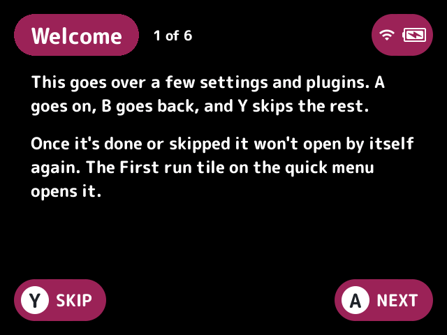
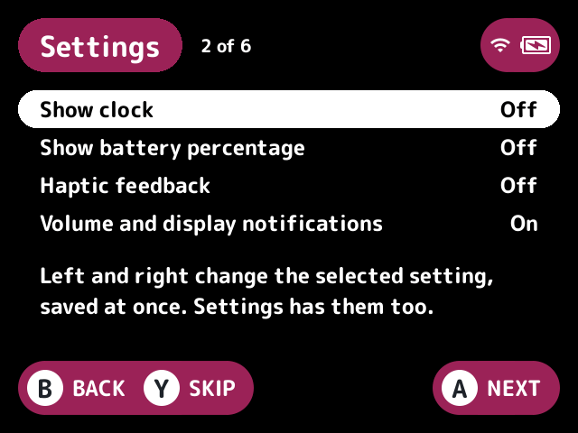
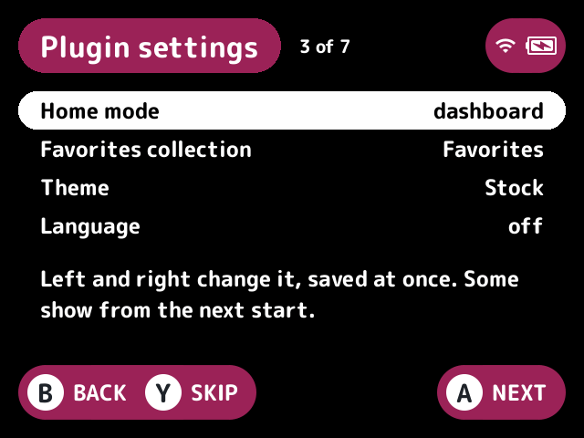
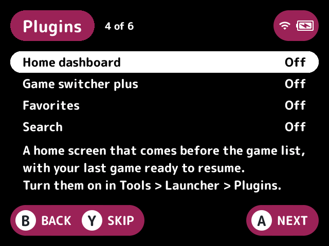
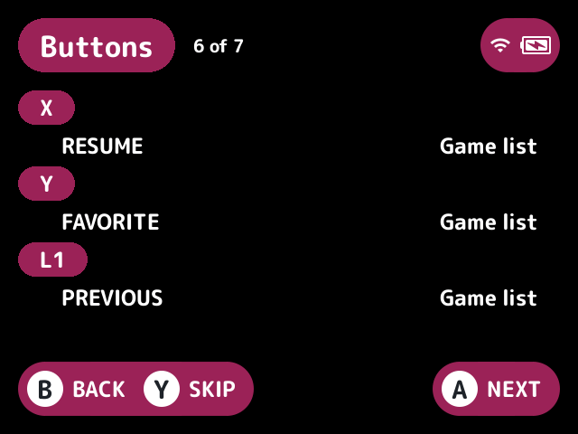

# first-run

A short setup wizard that shows the first time the launcher starts with it on.

## Turn it on

Turn on **First run** in Launcher > Plugins ([how](../../docs/plugins.md#turning-plugins-on-and-off)).

## How it works

It opens by itself over the screen the launcher starts on, the game list or the home [slot](../../docs/glossary.md#slot)'s screen, on the first frame that shows one, so closing it goes back there. It waits while the quick menu, the game switcher, a dialog or another plugin's screen shows.

| Page | What it shows |
|---|---|
| Welcome | A welcome |
| Settings | Stock's Show clock, Show battery percentage, Haptic feedback and Vol / Display Adjustments notification toggles. Pick with up and down and flip with left or right. They're saved at once, as stock's Settings app saves them. Toggles the launcher doesn't know are left out |
| Plugin settings | Other plugins' settings: [`home-dashboard`](../home-dashboard/README.md)'s Home mode, [`favorites`](../favorites/README.md)' collection, [`theme-plus`](../theme-plus/README.md)'s theme and [`localization`](../localization/README.md)'s language, each while its plugin is on. Pick with up and down and change with left or right. Each is saved at once by its plugin; the theme shows at once, and the others from the next time the launcher starts. With none of those plugins on, the page is left out |
| PIN | Says whether the launcher has a PIN and points to the PIN row in Tools > Launcher > Plugins |
| Plugins | The plugins the Suggested plugins setting names, each with whether it's loaded (on and started). Up and down pick one, and what it does shows under them, from its `plugin.txt`. It points to Tools > Launcher > Plugins to turn them on |
| Buttons | What's on each button: every action, the launcher's own and plugins', under each button it's on, with the screen it's on, then the FN buttons the device has and what they run, then the actions on no button, such as ones only on a quick menu tile. Up and down scroll it when it doesn't fit |
| Last page | The end |

Plugins can't set the PIN or turn plugins on, so those two pages only show what's there. It never writes `plugins.txt`.

| Button | What it does |
|---|---|
| **A** | Go on, and finish on the last page |
| **B** | Go back |
| **Y** | Skip the rest |

Finishing or skipping turns the Already shown setting on, so it doesn't open by itself again. Turn it off to see the wizard again at the next start. A First run tile on the [quick menu](../../docs/glossary.md#quick-menu) opens it again, as does the `first-run.open` action, which the First run button setting puts on Y, L2, R2 or SELECT on the game list.

A Buttons tile on the quick menu opens the Buttons page on its own, as does the `first-run.buttons` action, which the Buttons button setting puts on Y, L2, R2 or SELECT on the game list. **A** or **B** closes it, and it doesn't change the Already shown setting.

## Screenshots

The first page, with the default settings.

The Settings page.

The Plugin settings page, with home-dashboard, favorites, theme-plus and localization on.

The Plugins page.

The Buttons page, with favorites on, scrolled down to its Y.

## Settings

| Setting | Choices | Default | What it does |
|---|---|---|---|
| Already shown (`seen`) | on, off | off | Set once the wizard is finished or skipped. Turn it off to see it again at the next start |
| Quick menu tile (`tile`) | on, off | on | A First run tile on the quick menu that opens the wizard |
| First run button (`button`) | none, Y, L2, R2, SELECT | none | A game list button that opens the wizard |
| Settings page (`toggles`) | on, off | on | The page of stock's clock, battery percentage, haptics and notification toggles |
| Plugin settings page (`setup`) | on, off | on | The page of other plugins' settings: the home mode, the favorites collection, the theme and the language, for each plugin that's on |
| PIN page (`pin`) | on, off | on | The page saying whether the launcher has a PIN |
| Suggested plugins (`suggest`) | text | `home-dashboard,switcher-plus,favorites,search` | Plugin ids the plugins page suggests, comma-separated. Empty leaves the page out |
| Buttons page (`buttons`) | on, off | on | The page of what's on each button |
| Buttons tile (`buttons_tile`) | on, off | on | A Buttons tile on the quick menu that opens the Buttons page on its own |
| Buttons button (`buttons_button`) | none, Y, L2, R2, SELECT | none | A game list button that opens the Buttons page on its own |

## For plugin authors

- Opens its screen on the first frame that shows one, because plugins can't open a screen from `init`.
- Registers the `first-run.open` action, which the `button` setting follows, and the `first-run.buttons` action, which the `buttons_button` setting follows, with a screen each, `first-run.main` and `first-run.buttons`.
- Writes stock's toggles the way stock's Settings app does.
- Sets other plugins' settings only through their services, `home-dashboard.setup`, `favorites.setup`, `theme-plus.setup` and `localization.setup` (see each plugin's page), which decide what they accept. It calls each with no arguments as the wizard opens, leaving out the ones nobody provides, and with `<key>=<value>` on each change.
- Describes the suggested plugins by their `plugin.txt`'s `description`, from `plugin_info` while the plugin's loaded and otherwise from the `plugin.txt` beside its own folder (`Launcher.pak/plugins/*.plugin/`) or in `Tools/<platform>/*.pak/`, falling back to `summary` without one. Names and descriptions are translated as the plugin's own text, so a plugin that isn't loaded shows its English.
- Lists the Buttons page from `actions_count` and `action_info`, and the FN buttons from `fn_name` and `fn_binding`.

## Credits

LodorOS.
