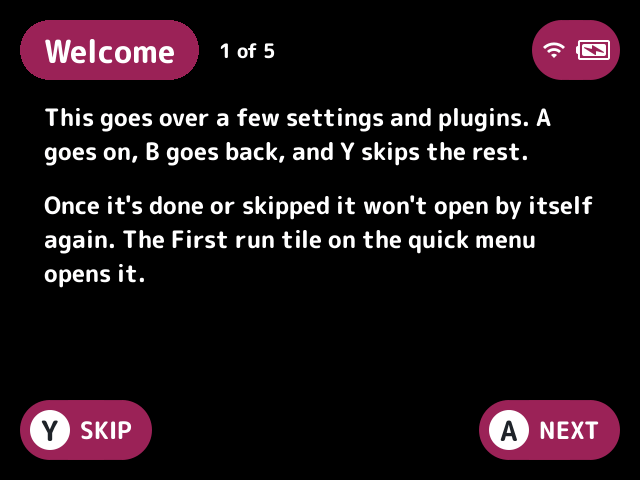
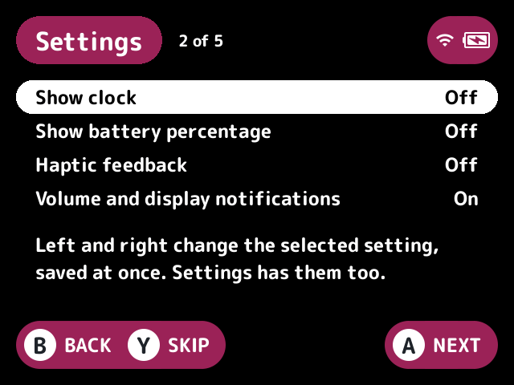
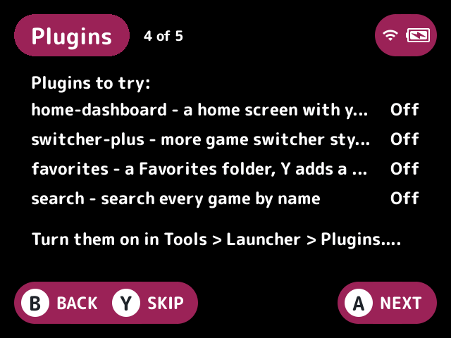

# first-run

A short setup wizard that shows the first time the launcher starts with it on.

## Turn it on

Turn on **First run** in Launcher > Plugins ([how](../../docs/plugins.md#turning-plugins-on-and-off)).

## How it works

It opens by itself over the screen the launcher starts on, the game list or the home [slot](../../docs/glossary.md#slot)'s screen, on the first frame that shows one, so closing it goes back there. It waits while the quick menu, the game switcher, a dialog or another plugin's screen shows.

| Page | What it shows |
|---|---|
| Welcome | A welcome |
| Settings | Stock's Show clock, Show battery percentage, Haptic feedback and Vol / Display Adjustments notification toggles. Pick with up and down and flip with left or right. They're saved at once, as stock's Settings app saves them. Toggles the launcher doesn't know are left out |
| PIN | Says whether the launcher has a PIN and points to the PIN row in Tools > Launcher > Plugins |
| Plugins | The plugins the Suggested plugins setting names, each with whether it's loaded (on and started), pointing to Tools > Launcher > Plugins to turn them on |
| Last page | The end |

Plugins can't set the PIN or turn plugins on, so those two pages only show what's there. It never writes `plugins.txt`.

| Button | What it does |
|---|---|
| **A** | Go on, and finish on the last page |
| **B** | Go back |
| **Y** | Skip the rest |

Finishing or skipping turns the Already shown setting on, so it doesn't open by itself again. Turn it off to see the wizard again at the next start. A First run tile on the [quick menu](../../docs/glossary.md#quick-menu) opens it again, as does the `first-run.open` action, which the First run button setting puts on Y, L2, R2 or SELECT on the game list.

## Screenshots

The first page, with the default settings.

The Settings page.

The Plugins page.

## Settings

| Setting | Choices | Default | What it does |
|---|---|---|---|
| Already shown (`seen`) | on, off | off | Set once the wizard is finished or skipped. Turn it off to see it again at the next start |
| Quick menu tile (`tile`) | on, off | on | A First run tile on the quick menu that opens the wizard |
| First run button (`button`) | none, Y, L2, R2, SELECT | none | A game list button that opens the wizard |
| Settings page (`toggles`) | on, off | on | The page of stock's clock, battery percentage, haptics and notification toggles |
| PIN page (`pin`) | on, off | on | The page saying whether the launcher has a PIN |
| Suggested plugins (`suggest`) | text | `home-dashboard,switcher-plus,favorites,search` | Plugin ids the plugins page suggests, comma-separated. Empty leaves the page out |

## For plugin authors

- Opens its screen on the first frame that shows one, because plugins can't open a screen from `init`.
- Registers the `first-run.open` action, which the `button` setting follows.
- Writes stock's toggles the way stock's Settings app does.

## Credits

LodorOS.
