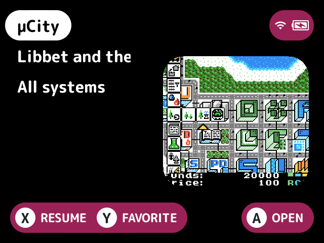
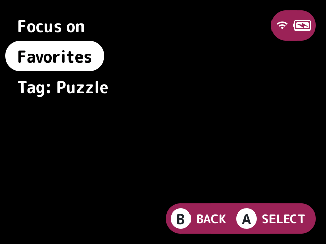
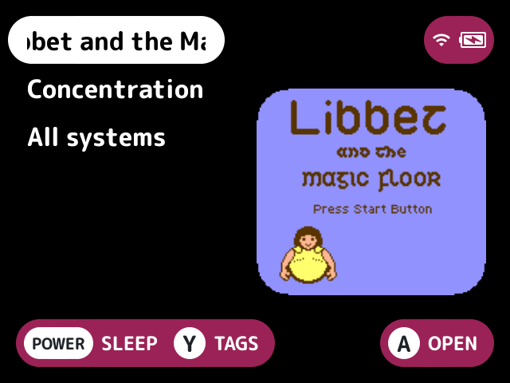

# focus-mode

Makes the first screen list only your favorites, so you reach them without scrolling past every console. It can list the games with a tag, or in a smart collection, instead.

## What it does

- The first screen lists your [favorites](../favorites/README.md), in the favorites collection's order, then an All systems folder with every console.
- Or, picked with Focus on, the games with one [tag](../tags/README.md) or in one [smart collection](../smart-collections/README.md).
- Other plugins' root folders stay off it.
- Recents, Collections and Tools stay on the [quick menu](../../docs/glossary.md#quick-menu).
- Until a game in the set is on the card, the first screen is stock's. That's also so while the plugin the set comes from, such as favorites, is off.

## Turn it on

Turn on **Focus mode** in Launcher > Plugins ([how](../../docs/plugins.md#turning-plugins-on-and-off)). Turn on [`favorites`](../favorites/README.md), [`tags`](../tags/README.md) or [`smart-collections`](../smart-collections/README.md) too, for something to focus on. It can't be on together with [`all-games`](../all-games/README.md), because both take the `root` [slot](../../docs/glossary.md#slot).

## How to use

A Focus tile on the quick menu turns focus mode off and on, as does the Focus mode setting.

A Focus on tile on the quick menu lists your favorites, every tag and every smart collection. Pick one to list its games on the first screen, which turns focus mode on too. The Focus on button setting puts the same list on a game list button, and an [FN button](../../docs/glossary.md#fn-button) set to `action:focus-mode.pick` can too.

## Screenshots

With favorites: the first screen listing the favorites and All systems, with the default settings.

With favorites and tags: the Focus on list, from its tile.

With tags, focused on the Puzzle tag: the first screen listing its games and All systems.

## Settings

| Setting | Choices | Default | What it does |
|---|---|---|---|
| Focus mode (`on`) | on, off | on | The first screen lists only the set's games and All systems. The Focus tile on the quick menu flips it too |
| Focus on (`set`) | text | favorites | The set the first screen lists: a set's name, such as `favorites`, `tags:RPG` or `smart:Mario` |
| Focus on tile on the quick menu (`pick_tile`) | on, off | on | A Focus on tile on the quick menu that lists every set to focus on |
| Focus on button (`pick_button`) | none, L2, R2, SELECT | none | A game list button that lists every set to focus on |

## For plugin authors

- Owns the `root` slot (`slots=root`).
- Reads the `set` setting's entry set with `set_list` each time the root is listed, and lists the root again on `launcher.set_changed` for it. A set nobody registered has no games, so the root is stock's.
- Registers the `focus-mode.toggle` and `focus-mode.pick` actions and their quick menu tiles. `focus-mode.pick` lists the sets with `set_names`, leaving out `hidden`.

## Credits

MinUI-Zero and UnuOS.
