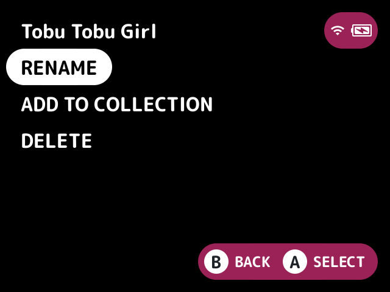
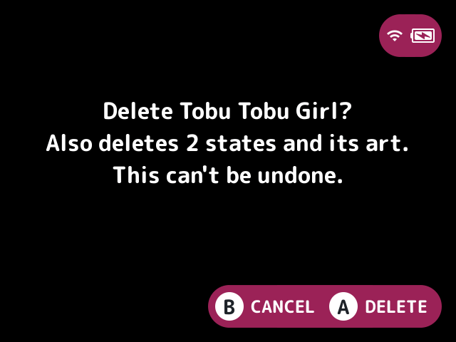

# game-actions

Rename, delete, or add to a [collection](../../docs/glossary.md#collection) the selected game, from one button.

## Turn it on

Turn on **Game actions** in Launcher > Plugins ([how](../../docs/plugins.md#turning-plugins-on-and-off)).

## How to use

Press **Y** on a game (the Game actions button setting picks another). It shares the button with other plugins' actions there, so with favorites or hidden on, **Y** opens a menu of them all.

- **Rename** sets the name shown for any entry, typed on the keyboard. An empty name restores the usual one. It never touches files; names are kept in `.userdata/<platform>/launcher/game-actions-names.txt`.
- **Delete** removes a game under `Roms/` after a confirm that says what goes with it (see below).
- **Add to collection** appends the game to a collection in `Collections/`, as stock stores it, or to a new one named on the keyboard.

### What Delete removes

- The rom. For a multi-disc or cue-sheet game that's its whole folder, and for a loose `.cue` or `.m3u` the files only it lists.
- Its art in `.media/`.
- With Delete saves and states with a game on (the default): its saves in `Saves/<tag>/`, its states in `.userdata/shared/<tag>-<core>/` and `.userdata/shared/.minui/<tag>/`, and its own emulator settings.
- The game also leaves recents, every collection (favorites too) and its renamed name.

A save or art name another game in the system shares is kept. Links are removed but never followed, and nothing outside the card is touched.

## Screenshots

Y on a game, with the default settings.

Delete's confirm.

## Settings

| Setting | Choices | Default | What it does |
|---|---|---|---|
| Game actions button (`button`) | Y, L2, R2 | Y | The game list button, shared with other plugins' actions on it |
| Rename (`rename`) | on, off | on | Turns Rename off or on |
| Delete game (`delete`) | on, off | on | Turns Delete off or on |
| Add to collection (`collections`) | on, off | on | Turns Add to collection off or on |
| Delete saves and states with a game (`saves`) | on, off | on | Off keeps a deleted game's saves, states and emulator settings |

## For plugin authors

- Registers the actions `game-actions.rename`, `game-actions.collect` and `game-actions.delete`, which the `button` setting follows.
- Writes `game-actions-names.txt`, collection files in `Collections/`, and deletes the files listed above.

## Credits

nx-redux, LodorOS, MinUit, kUI and casualducko.
