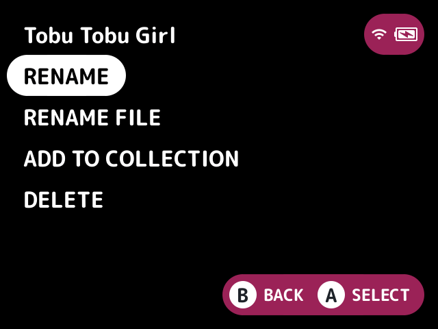
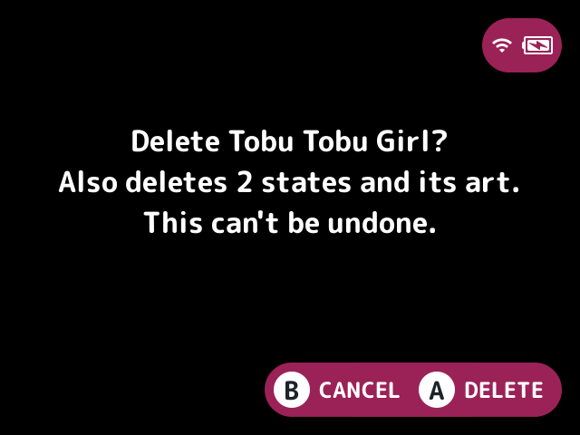
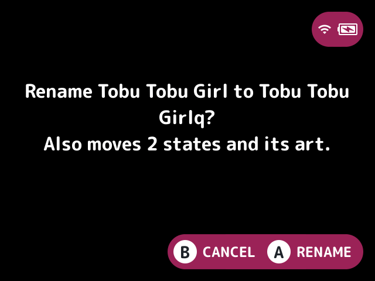

# game-actions

Rename, rename the files of, delete, or add to a [collection](../../docs/glossary.md#collection) the selected game, from one button.

## Turn it on

Turn on **Game actions** in Launcher > Plugins ([how](../../docs/plugins.md#turning-plugins-on-and-off)).

## How to use

Press **Y** on a game (the Game actions button setting picks another). It shares the button with other plugins' actions there, so with favorites or hidden on, **Y** opens a menu of them all.

- **Rename** sets the name shown for any entry, typed on the keyboard. An empty name restores the usual one. It never touches files; names are kept in `.userdata/<platform>/launcher/game-actions-names.txt`.
- **Rename file** renames a game under `Roms/` on the card, typed on the keyboard, and takes its saves, art and play time with it (see below). The keyboard starts on the file's name without its extension, which stays. A confirm says what moves with it.
- **Delete** removes a game under `Roms/` after a confirm that says what goes with it (see below).
- **Add to collection** appends the game to a collection in `Collections/`, as stock stores it, or to a new one named on the keyboard.

### What Rename file moves

Each is found by the name stock gives it, from the game's file name, or for a game folder from the `.m3u` (or `.cue`) named after the folder:

- The rom. For a multi-disc or cue-sheet game in its own folder, the folder and the `.m3u` and `.cue` named after it; the discs and tracks keep their names, as the `.m3u` and `.cue` list them. A loose `.cue` or `.m3u` is renamed on its own, as it names its files.
- Its art and `.info` in `.media/`, beside the game.
- Its saves in `Saves/<tag>/` (`.sav`, `.rtc`, and `.srm` under the name without its extension), its states in each `.userdata/shared/<tag>-<core>/` (every slot, in each of minarch's formats), its resume slot and each slot's preview and disc in `.userdata/shared/.minui/<tag>/`, and its own emulator settings, by the [system tag](../../docs/glossary.md#system-tag).
- Its recents, and every collection's entry for it, Favorites too.
- Its tags and status flags, through `tags` when it's on, and its favorite through `favorites` when it's on.
- Its play time: the path in stock's `game_logs.sqlite`, so Game Tracker keeps its history, in one transaction.
- A name Rename gave it goes, so the new file name shows.

Before anything moves it checks every target. If one is there already, it says which and changes nothing; it never overwrites. It also refuses a name another game in the system has, as the two would share saves. A save or art name another game shares is copied, not moved, so both keep it. Links are moved as links, never followed, and nothing outside the card's game data is touched. If a move fails part way, or the play time can't be moved (such as while a game is being tracked), it puts back what it moved and says what it couldn't put back.

### What Delete removes

- The rom. For a multi-disc or cue-sheet game that's its whole folder, and for a loose `.cue` or `.m3u` the files only it lists.
- Its art in `.media/`.
- With Delete saves and states with a game on (the default): its saves in `Saves/<tag>/`, its states in `.userdata/shared/<tag>-<core>/` and `.userdata/shared/.minui/<tag>/`, and its own emulator settings.
- The game also leaves recents, every collection (favorites too) and its renamed name.

A save or art name another game in the system shares is kept. Links are removed but never followed, and nothing outside the card is touched.

## Screenshots

Y on a game, with the default settings.

Delete's confirm.

Rename file's confirm, after typing a letter on the keyboard.

## Settings

| Setting | Choices | Default | What it does |
|---|---|---|---|
| Game actions button (`button`) | Y, L2, R2 | Y | The game list button, shared with other plugins' actions on it |
| Rename (`rename`) | on, off | on | Turns Rename off or on |
| Rename file (`rename_file`) | on, off | on | Turns Rename file off or on |
| Delete game (`delete`) | on, off | on | Turns Delete off or on |
| Add to collection (`collections`) | on, off | on | Turns Add to collection off or on |
| Delete saves and states with a game (`saves`) | on, off | on | Off keeps a deleted game's saves, states and emulator settings |

## For plugin authors

- Registers the actions `game-actions.rename`, `game-actions.rename-file`, `game-actions.collect` and `game-actions.delete`, which the `button` setting follows. Each is marked `MOSAIC_ACTION_EDITS`, so kiosk mode asks for the PIN.
- Writes `game-actions-names.txt` and collection files in `Collections/`, and renames and deletes the files listed above.
- Rename file moves recents with `recent_set` (and `recent_remove` for one that would then be there twice), favorites, tags and statuses through the `favorites.move` and `tags.move` services, and play time with `play_move_paths`, which it needs. Its model, listing and checking every step and putting them back, is in `actions_model.c`.
- `optional=favorites,tags`. No requires or conflicts.

## Credits

nx-redux, LodorOS, MinUit, kUI and casualducko. Rename file, carrying a game's data, is from MinUI-Plus and nx-redux.
