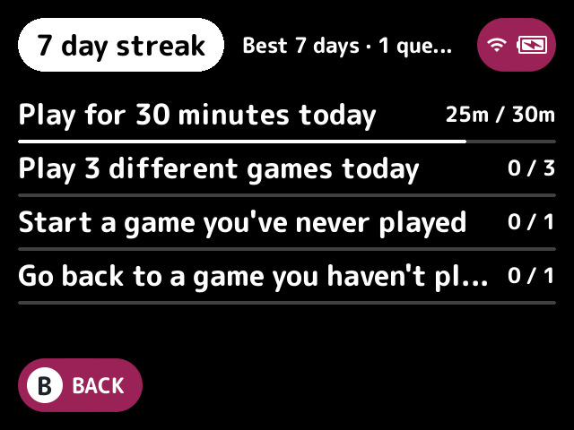
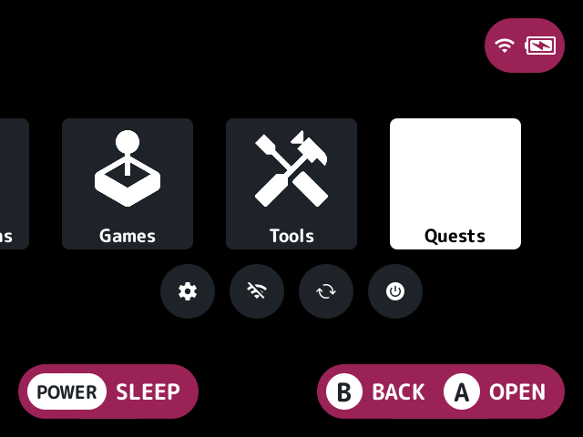

# gamification

Daily and weekly quests and a play streak, from your game launches and returns and stock's play tracker.

## Turn it on

Turn on **Gamification** in Launcher > Plugins ([how](../../docs/plugins.md#turning-plugins-on-and-off)).

## The quests

| Quest | Resets | What it asks |
|---|---|---|
| Daily play | Midnight | Play for a while (Daily play, 30 minutes by default) |
| Daily games | Midnight | Play a number of different games (3 by default) |
| New game | Midnight | Start a game never played before |
| Old game | Midnight | Go back to a game not played for 30 days |
| Days a week | Monday | Play on a number of days (5 by default) |
| Weekly play | Monday | Play for a number of hours (5 by default) |

The streak is the days in a row with at least the streak-day minutes (5 by default) of play. Today joins it once it has them, and until then the streak runs to yesterday.

Each day's play is the most of the plugin's own count (the time between a launch and its return, leaving out sleep) and the tracker's, so it works without the [play tracker](../../docs/glossary.md#play-tracker). The never-played and not-played-for-30-days quests need it.

## How to use

Open the Quests screen from the Quests tile on the [quick menu](../../docs/glossary.md#quick-menu), or from a button on the game list if you set one. [`button-remap`](../button-remap/README.md) or an [FN button](../../docs/glossary.md#fn-button) set to `action:gamification.open` can open it too. It shows the streak, the best streak, the quests done in all and each quest's progress.

| Button | What it does |
|---|---|
| Up and down | Scroll when the quests don't fit |
| **B** | Go back |

When a game's return completes a quest, or else extends the streak (once a day), a toast says so.

## Screenshots

The Quests screen, with the default settings.

The Quests tile on the quick menu (on by default).

## Settings

| Setting | Choices | Default | What it does |
|---|---|---|---|
| Quick menu tile (`tile`) | on, off | on | A Quests tile on the quick menu |
| Quests button (`button`) | none, Y, L2, R2, SELECT | none | A game list button that opens the quests |
| Daily play, in minutes (`daily_minutes`) | 15, 30, 45, 60, 90, 120 | 30 | The daily quest to play for this long |
| Daily games (`daily_games`) | 2, 3, 4, 5 | 3 | The daily quest to play this many different games |
| Days a week (`week_days`) | 3, 4, 5, 6, 7 | 5 | The weekly quest to play on this many days |
| Weekly play, in hours (`week_hours`) | 2, 3, 5, 7, 10, 14, 20 | 5 | The weekly quest to play for this long |
| Streak day, in minutes (`streak_minutes`) | 1, 5, 10, 15, 30 | 5 | A day counts towards the streak and the days a week once it has this much play |
| Toasts (`toasts`) | on, off | on | A toast when a game's return completes a quest or extends the streak |

## For plugin authors

- Registers the `gamification.open` action, which the `button` setting follows, and a quick menu tile.
- Works from the launch and return hooks, and reads stock's play tracker.
- Keeps its state in `.userdata/<platform>/launcher/gamification/state.txt`.

## Credits

kUI.
