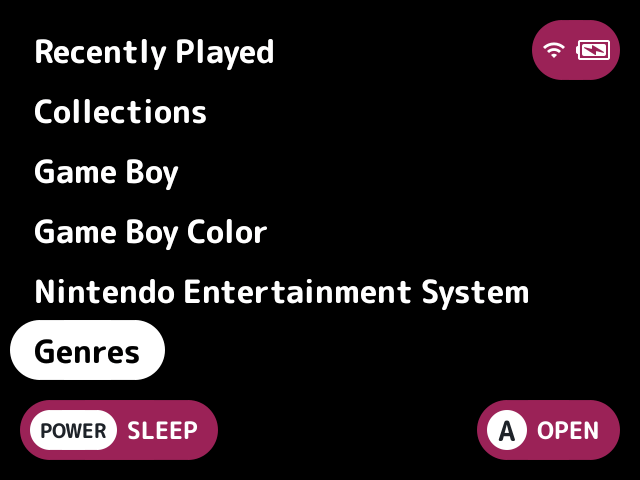
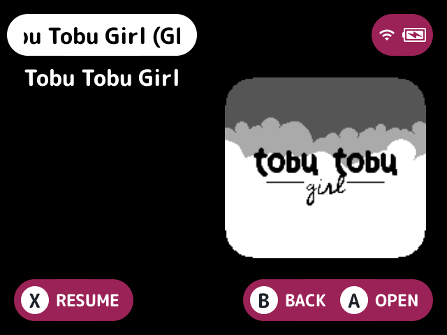

# genre-view

Adds a Genres folder on the first screen that gathers the same genre from every system, such as all your platformers in one place.

## What it does

The Genres folder shows while the card has a genre. A genre folder is any folder directly inside a system folder stock lists, except a [pak](../../docs/glossary.md#pak) or a game folder (one holding a `.cue` or `.m3u` named after itself).

- Same-name genre folders from every system are merged.
- Folders are matched by the name stock shows for them, `map.txt` aliases included, ignoring case, spacing and punctuation. So "Shoot 'em up" in one system and "shoot-em-up" in another are one genre, named as the system first in name order names it.
- A genre lists the games from every system's folder together by name, and folders inside genre folders are merged the same way.
- Games from different systems with the same name show their system's tag, such as "Tetris (GB)" and "Tetris (GBC)".

The folders come from the launcher's list of what's on the card, which it keeps up to date, so a folder added or removed shows on its own.

## Turn it on

Turn on **Genre view** in Launcher > Plugins ([how](../../docs/plugins.md#turning-plugins-on-and-off)).

## Screenshots

The Genres folder on the first screen, with the default settings.

A genre gathered from Game Boy and Game Boy Color.

Show the system set to always.

## Settings

| Setting | Choices | Default | What it does |
|---|---|---|---|
| Consoles a genre needs (`min`) | 1, 2, 3, 4 | 1 | The fewest consoles a genre's folders need to come from. Folders stock's root collates, such as GBA and MGBA, count as one |
| Folders that aren't genres (`skip`) | text | empty | Folder names that aren't genres, comma-separated, such as `Hacks, Imgs` |
| Show the system (`tags`) | shared, always, off | shared | Which games show their system's tag: those sharing a name with another system's, every game, or none (left to stock) |

## For plugin authors

- Adds a root folder, as other plugins do.
- Reads the system folders and their genre folders from the launcher's card index (`index_count` and `index_entry`, see [plugin-api.md](../../docs/plugin-api.md#features-added-since-the-first-api)), asking for it from `init` and listing again on `launcher.index_ready`. Until the index is first ready there are no genres. It writes nothing.

## Credits

Ru_UI.
