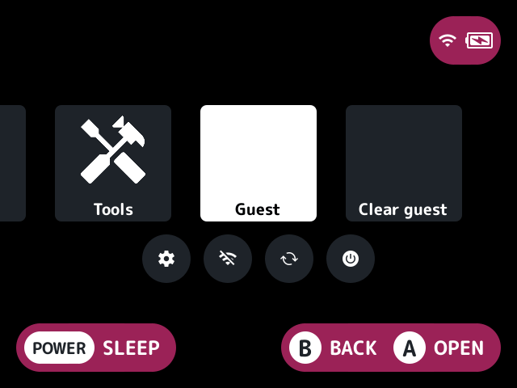
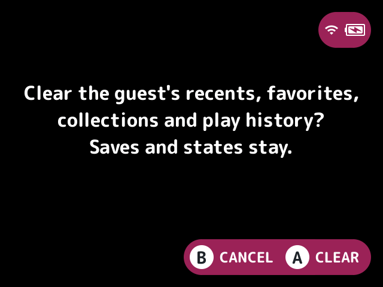
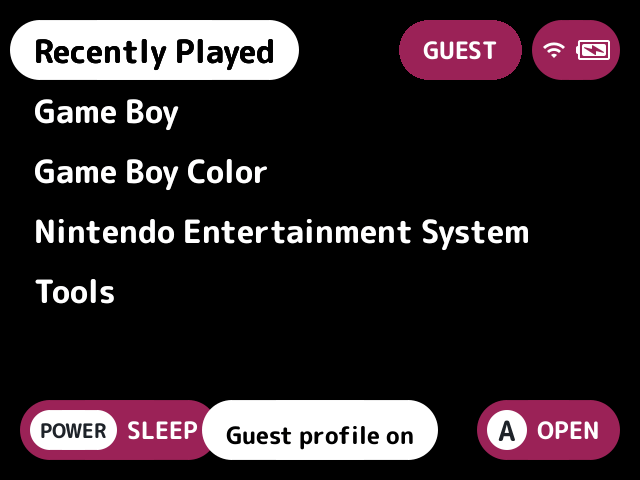

# guest-profile

Gives a guest their own recently played list, favorites, collections and play history while you lend the device, and keeps them for the next time they borrow it. Your own lists and play history stay as you left them.

## What it does

- Guest mode switches these to the guest's own:
  - Recently Played, and the game switcher's list;
  - [favorites](../favorites/README.md) and every other [collection](../../docs/glossary.md#collection) in the Collections folder;
  - [tags](../tags/README.md);
  - the [play tracker](../../docs/glossary.md#play-tracker)'s play history, which play time, stats and the Game Tracker tool show, such as [activity-stats](../activity-stats/README.md), [playtime-captions](../playtime-captions/README.md) and the unplayed dot of [row-badges](../row-badges/README.md);
  - [gamification](../gamification/README.md)'s quests and streak.
- Saves and [save states](../../docs/glossary.md#save-state) are not switched: they stay shared between you and the guest, so a guest who plays one of your games continues from your save, and their saves are yours too.
- Everything else stays shared as well: games, settings, other plugins' settings, hidden games and the [PIN](../../docs/plugins.md#the-pin).
- Guest mode stays on when the device restarts and when a game is played, until you switch it off.
- The guest's data is kept for next time. Clear guest removes it, so the next guest starts empty.

## Turn it on

Turn on **Guest profile** in Launcher > Plugins ([how](../../docs/plugins.md#turning-plugins-on-and-off)).

## How to use

- The Guest tile on the [quick menu](../../docs/glossary.md#quick-menu) switches to the guest's data and back. A message says which is on. Switching back asks for nothing.
- While guest mode is on, a GUEST mark shows in the header, beside the clock and battery.
- The Guest button setting puts the same switch on a game list button, and an [FN button](../../docs/glossary.md#fn-button) set to `action:guest-profile.toggle` can too.
- The Clear guest tile on the quick menu clears the guest's data: it asks first, then removes the guest's recents, collections, tags, play history and quests. It works with guest mode on or off. An FN button can run it as `action:guest-profile.clear`.

Turning the plugin off, or turning the launcher off, switches back to your own data.

## Screenshots

The Guest and Clear guest tiles on the quick menu, with the default settings.

Clear guest asks first.

Guest mode on: the GUEST mark in the header, and the guest's own Recently Played.

## Settings

| Setting | Choices | Default | What it does |
|---|---|---|---|
| Guest tile on the quick menu (`tile`) | on, off | on | A Guest tile on the quick menu that switches to the guest's data and back |
| Clear guest tile on the quick menu (`clear_tile`) | on, off | on | A Clear guest tile on the quick menu that clears the guest's data, which asks first |
| Guest mark in the header (`mark`) | on, off | on | A GUEST mark in the header while guest mode is on |
| Guest button (`button`) | none, L2, R2, SELECT | none | A game list button that switches to the guest's data and back |

## For plugin authors

- Provides `profile.guest`, which lets it switch the launcher to the `guest` profile and clear it with `profile_switch` and `profile_clear` (see Profiles in [plugin-api.md](../../docs/plugin-api.md#features-added-since-the-first-api)).
- Registers the actions `guest-profile.toggle` and `guest-profile.clear`, and a quick menu tile for each. The `button` setting follows `guest-profile.toggle` (`button:guest-profile.toggle`).
- Adds a header widget (`header_width` and `header_widget`) while the `guest` profile is live.
- Keeps no files of its own. The launcher swaps `.userdata/shared/.minui/recent.txt`, `.userdata/shared/game_logs.sqlite` and the `Collections` folder in place, parking the profile that isn't live in `.userdata/shared/launcher/profiles/<owner or guest>/`, and keeps which is live in `.userdata/shared/launcher/profile.txt`. Plugins keep their own data for the guest in `.userdata/<platform>/launcher/profiles/guest/`, through `profile_path`.
- The bundled plugins that follow the profile: `favorites` and every collection (through the Collections folder), `tags` (its `tags.txt`), `gamification` (its `state.txt`), and every plugin that reads recents or the play history through the launcher. `favorites` and `tags` announce their sets as changed when the profile changes, and `filter-presets` works out its presets again.
- Left shared on purpose: `hidden`'s list, `smart-collections`' dismissed collections, `emulator-override`'s choices, `manuals`' pages, `music`'s place, `multi-disc`'s combined games, `sync`, `romm` and every plugin's settings. They're settings or about the card's files, not the player's history. `playtime-limit`'s daily limit counts the live profile's play.
- While the plugin is off and the guest's data is in place, the launcher switches back to the owner's as it starts, and the Launcher pak does too as it turns the launcher off. When the launcher falls back to stock NextUI after crashes, stock uses whichever profile's data is in place until the launcher runs again.

## Credits

Onion.
