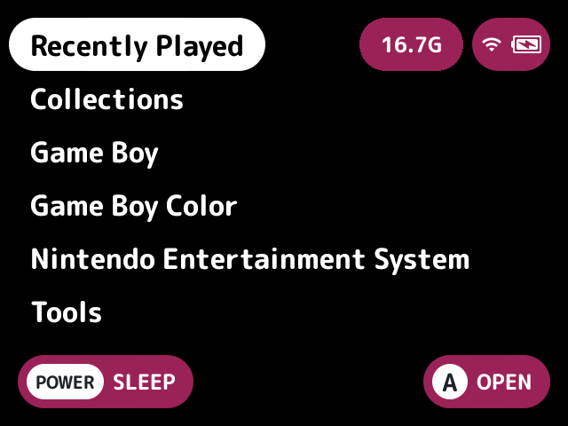
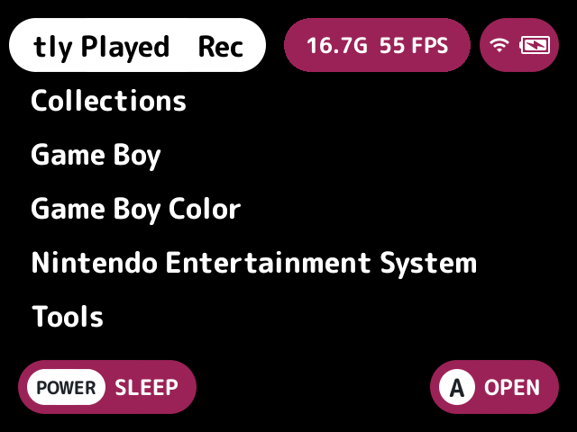
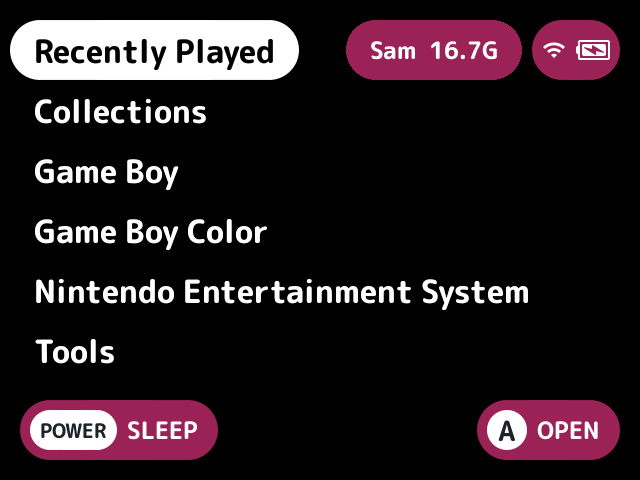
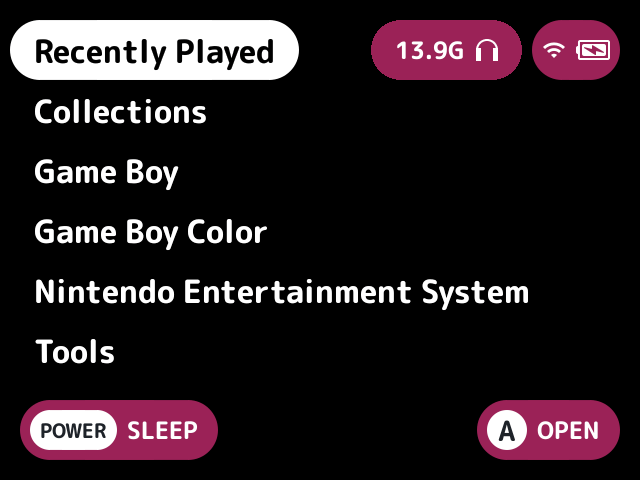

# header-indicators

Adds a small pill beside the status pill with free storage, an SSH dot, a profile badge, the FPS and a headset while the sound goes to Bluetooth.

It shows on the game list, the game switcher, the quick menu and the dialogs, in the theme's accent with its hint colour for the text. Stock already shows the clock and battery percentage, so this plugin doesn't.

## Turn it on

Turn on **Header indicators** in Launcher > Plugins ([how](../../docs/plugins.md#turning-plugins-on-and-off)).

## What it shows

- **Free storage:** the card's free space, such as `12.3G`, looked at every 5 seconds.
- **SSH dot:** a dot while a socket listens on port 22, as an SSH [pak](../../docs/glossary.md#pak)'s server does, looked at every 5 seconds in `/proc/net/tcp` and `tcp6`. On desktop it stays off, and the plugin logs that once.
- **Bluetooth audio:** a headset while the sound goes to a Bluetooth device: one that's connected and that stock has switched the sound to, whether or not anything is playing. It sits last, nearest the status pill. A USB DAC or the device's own speaker or headphone jack doesn't show it. Desktop has no Bluetooth, so it stays off there.
- **Profile badge:** text you set, such as whose device it is, since stock has no profiles.
- **FPS:** the launcher's frames a second, counted each second from its main loop and smoothed.

The pill is redrawn only when what it shows changes. When they don't all fit, the FPS goes first, then the profile, then free storage, then the SSH dot.

## Screenshots

Free storage in the header, with the default settings.

FPS on.

A profile badge set.

The headset while the sound goes to a Bluetooth device.

## Settings

| Setting | Choices | Default | What it does |
|---|---|---|---|
| Free storage (`storage`) | on, off | on | Shows the card's free space |
| SSH dot (`ssh`) | on, off | off | A dot while an SSH server listens on port 22. Never on desktop |
| Bluetooth audio (`bt_audio`) | on, off | on | A headset while the sound goes to a Bluetooth device, playing or not |
| FPS (`fps`) | on, off | off | The launcher's frames a second |
| Profile badge (`profile`) | text | empty | A short name to show, such as whose device it is. Empty for none |

## For plugin authors

- Draws in the header, using the theme's accent and hint colours.
- Reads `/proc/net/tcp` and `/proc/net/tcp6`.
- Asks `audio_sink` each tick for the headset, and needs a launcher with it.
- Has no slot or service of its own.

## Credits

casualducko, marcelopcx, LodorOS and hp7hao.
