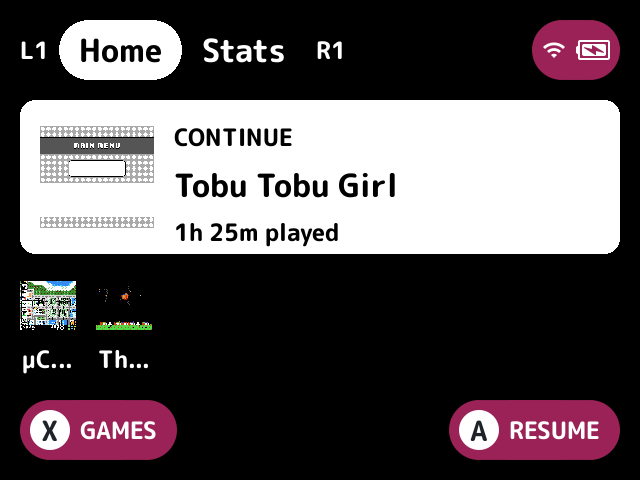
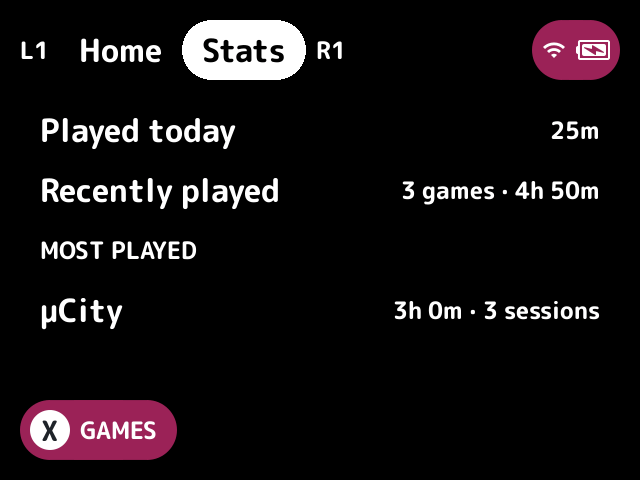
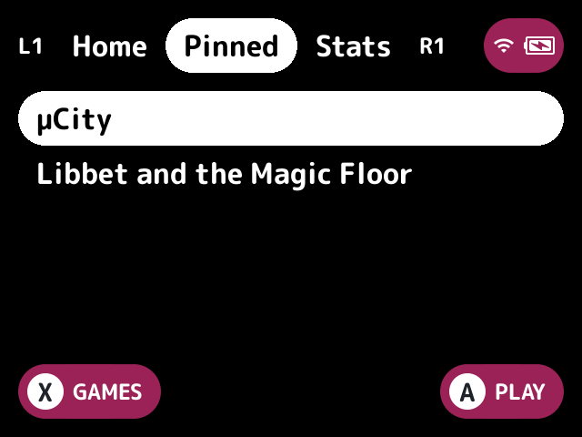
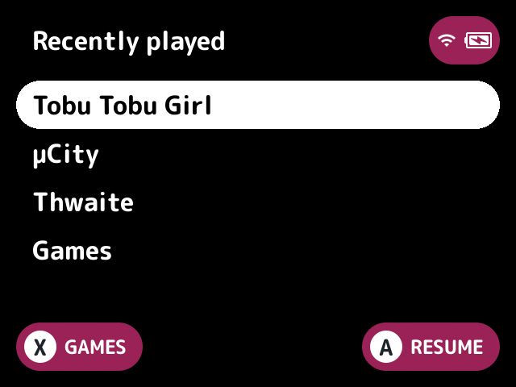
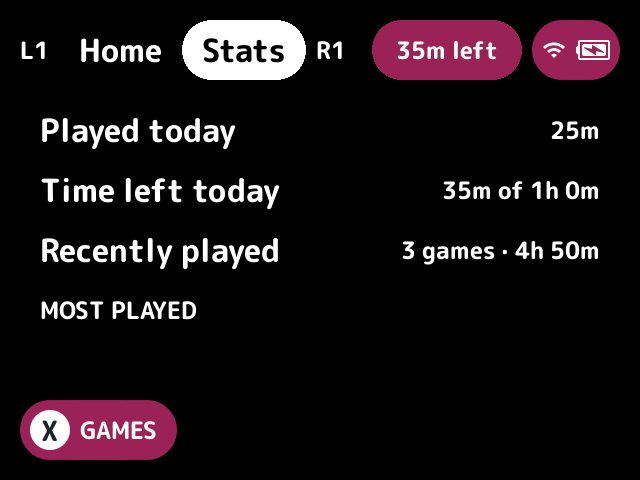
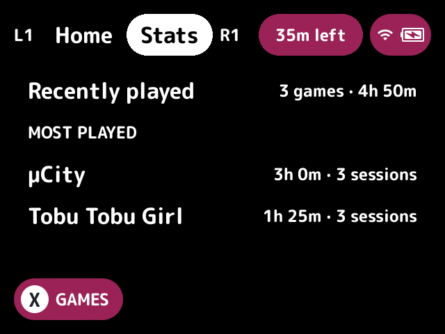
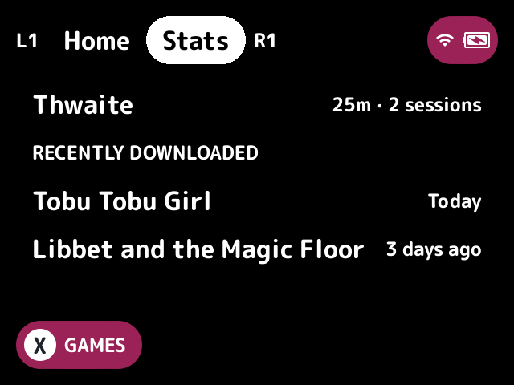

# home-dashboard

A home screen that comes before the game list, with your last game ready to resume.

## What it does

The launcher starts on it, and **B** at the first screen goes back to it. A game or [pak](../../docs/glossary.md#pak) opened from it comes back to it afterwards.

## Turn it on

Turn on **Home dashboard** in Launcher > Plugins ([how](../../docs/plugins.md#turning-plugins-on-and-off)). It owns the `home` [slot](../../docs/glossary.md#slot).

## How to use

| Button | What it does |
|---|---|
| **X** (labelled GAMES) | Go on to the game list |
| **MENU** | Opens the [quick menu](../../docs/glossary.md#quick-menu) |
| **SELECT** | Opens the game switcher |
| **A** | Opens the selected game: a recent through the switcher's own call, resuming its save state when it has one, and anything else as the game list opens it |
| **B** | Does nothing, as at the first screen |
| **L1** and **R1** | Switch tabs, in the dashboard mode |
| Up and down | Scroll the Stats tab when it doesn't fit |

### Modes

The Home mode setting picks the home.

- **dashboard** (the default) has tabs, switched with **L1** and **R1** and kept when the home screen opens again:
  - Home: a continue card for the last game played, with its save state's preview (or its thumbnail or box) and its [`playtime-captions`](../playtime-captions/README.md) caption, such as "1h 25m · today", in that plugin's parts and format, which **A** resumes. While playtime-captions is off, the card shows the game's play time instead, such as "1h 25m played". Under it is a top shelf of the games played before it (the Top shelf setting).
  - Pinned: favorites' games in the favorites collection's order, shown while the [`favorites`](../favorites/README.md) plugin is loaded (the Pinned tab setting).
  - Stats: today's play time, the time left today while [`playtime-limit`](../playtime-limit/README.md) has a daily limit set (such as "35m of 1h 0m", of today's limit with any extra time), the recently played games' total and the five most played of the recent and pinned games (the Stats tab setting). While [`romm`](../romm/README.md) is on and has downloaded games still on the card, a Recently downloaded section lists the last three, with the day each came. When they don't all fit, up and down scroll the tab, and the Most played and Recently downloaded headings only show with a game under them. The launcher has no call for the whole play history, so Stats covers only the games the dashboard knows about. With no play history (no database yet, or no sqlite) it says so rather than showing numbers.
- **minui:** a plain list of the recently played games, then Games, which goes on to the game list.
- **retroachievements:** the recent and pinned games with RetroAchievements progress on the card, as "12/40 · 150/400 points", from what minarch keeps there through the host's `achievements` call. Games with nothing cached are left out, and nothing is fetched.
- **pico8:** the Pico-8 carts (`.p8` and `.p8.png`) in the `Roms` folders whose tag is one of the Pico-8 folder tags setting's, as a grid, with their art or else their first letter.

## Screenshots

The Home tab, with the default settings.

The Stats tab.

With favorites: the Pinned tab.

Home mode set to minui.

With playtime-captions: its caption on the continue card.

With playtime-limit's daily limit set to 60 minutes: the time left on the Stats tab.

The same, scrolled down to the most played games.

With romm and two games it downloaded: the Stats tab scrolled down to Recently downloaded.

## Settings

| Setting | Choices | Default | What it does |
|---|---|---|---|
| Home mode (`mode`) | dashboard, minui, retroachievements, pico8 | dashboard | Which home to show, as above |
| Top shelf (`shelf`) | on, off | on | The games played before the last one, under the continue card |
| Pinned tab (`pinned`) | on, off | on | Favorites' games, while favorites is on |
| Stats tab (`stats`) | on, off | on | Play time from stock's play tracker |
| Pico-8 folder tags (`pico8_tags`) | text | `P8,PICO8,PICO` | The tags of the folders the pico8 mode lists carts from, such as `Roms/Pico-8 (P8)` |

## For plugin authors

- Owns the `home` slot (`slots=home`).
- Lists `favorites` as `optional`, so it loads after it, since it asks as it starts whether favorites is loaded. The Pinned tab is the `favorites` entry set, read with `set_list` each time the screen opens.
- Leaves out of every tab what `is_filtered` says a plugin's filter hides, such as the [`hidden`](../hidden/README.md) plugin's games.
- Reads stock's play tracker, the switcher's recents, and the host's `achievements` call.
- Asks `playtime-captions`' `captions.text` service for the continue card's caption, and `playtime-limit`'s `limit.left` service for the Stats tab's time left. Without them it shows the play time on the card and no time left.
- Asks `romm`'s `romm.downloads` service for the Stats tab's Recently downloaded section as the screen opens. Without it there's no section.

## Credits

nx-redux, Bramley, kUI and MaxUI (home modes).
