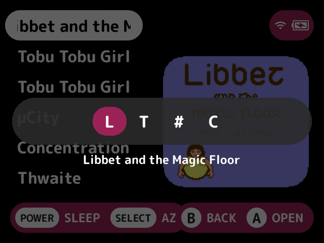

# jump-letter

Hold SELECT on the game list for a strip of the letters the list's games start with. Move along it with the d-pad and let go to jump to the first game with that letter.

## What it does

- Holding SELECT on the game list, for a system, a folder or a [collection](../../docs/glossary.md#collection), shows a strip of the first letters in that list, in the list's own order, with the selected game's letter lit. Only letters the list has are on the strip, so every stop jumps somewhere.
- Names that start with a digit or a symbol, such as 1942, are under `#`. Letters with accents are under their letter, so Élite is under E.
- The letters come from the names the list shows, such as a name from `map.txt` or from [`arcade-names`](../arcade-names/README.md).
- A plugin that sorts the list another way can give its own sections in place of letters, such as years or publishers.
- A quick press of SELECT still opens the game switcher, as it does without the plugin.

## Turn it on

Turn on **Jump letter** in Launcher > Plugins ([how](../../docs/plugins.md#turning-plugins-on-and-off)).

## How to use

Hold SELECT in a list; the game list's hints show it as SELECT AZ. When the strip shows, press left or right (or up or down) to move along it, and let go of SELECT to jump to the lit letter. The name under the strip is the game you'll land on. Press B to close the strip without jumping. Letting go without moving leaves the selection where it was.

SELECT is used only when no other plugin has an action on it on the game list, such as [search](../search/README.md) with its Search button on SELECT; the Strip button setting picks another button. An [FN button](../../docs/glossary.md#fn-button) set to `action:jump-letter.strip` opens the strip until you press A to jump or B to close it.

## Screenshots

With the default settings: the Homebrew collection with SELECT held, its letters in the collection's own order, lit on Libbet and the Magic Floor's L.

## Settings

| Setting | Choices | Default | What it does |
|---|---|---|---|
| Strip button (`button`) | none, SELECT, Y, L2, R2 | SELECT | The game list button to hold for the strip, used only when no other plugin has an action on it there |

## For plugin authors

- Registers the `jump-letter.strip` action, bound with `bind_button` on the first `tick`, once every plugin has loaded, and only to a button no other plugin's action has on the game list, as `action_info` lists them; the game list's own SELECT tap for the game switcher doesn't count. `button` is marked `button:` for it.
- Opens the strip once the button is held past 300 ms, beyond stock's 250 ms tap, and not while another button is held with it, such as the lock's SELECT and START. While it shows, an `input_filter` takes every button but MENU, power and the FN buttons, and an `overlay_render` draws it on the game list.
- Asks `entry_section` for each entry's section, which a plugin that orders the list with `sort_compare` answers with `section_key`, and otherwise uses the first letter of `entry_name`. Moves the selection with `select_index`.
- Reads and writes no files of its own. No slots, services, requires or conflicts.

## Credits

ES-DE and Batocera.
