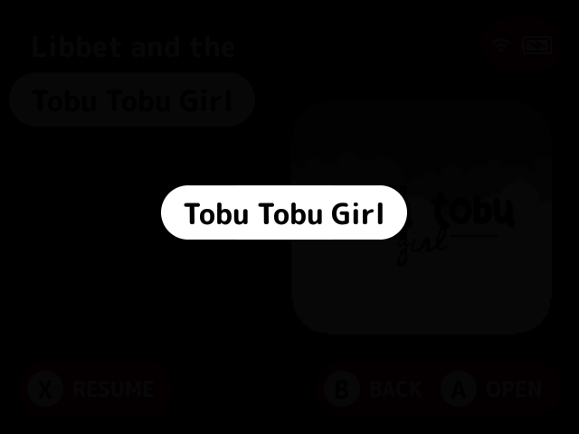

# launch-animation

Animates a game or [pak](../../docs/glossary.md#pak) starting from the game list.

## What it does

As a game or pak starts from the game list, the selection pill glides from its row to the middle of the screen while the rest of the screen dims to black, then fades out, finishing on the black the launch goes into.

- Under a plugin layout, which draws its own highlight, the selected cell glides instead.
- When the launcher doesn't know where the selection is, such as a launch from the game switcher, the screen fades to black with no glide.
- Launches from the [quick menu](../../docs/glossary.md#quick-menu) aren't animated.

## Turn it on

Turn on **Launch animation** in Launcher > Plugins ([how](../../docs/plugins.md#turning-plugins-on-and-off)). It owns the `launch` [slot](../../docs/glossary.md#slot).

## Screenshots

Partway through starting a game, with the default settings.

## Settings

| Setting | Choices | Default | What it does |
|---|---|---|---|
| Duration (`duration`) | 200, 350, 500 | 350 | How long the selection pill takes to glide to the middle and fade, in ms |
| Ease (`ease`) | linear, in, out, in-out | out | How the glide moves. `out` slows as the pill reaches the middle |

## For plugin authors

- Owns the `launch` slot (`slots=launch`), using the `transition_*` hooks.

## Credits

hp7hao.
