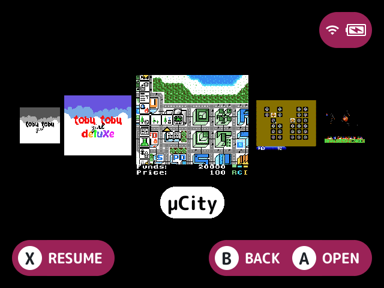

# layout-carousel

Shows the game list as a carousel of covers instead of the built-in list.

## What it does

The selected game's cover is large in the middle, with its name under it on a pill when the launcher shows names. Its neighbours get smaller to either side, as many as fit whole (two either side at 1024 wide).

- Each cover shows the entry's box, or else its thumbnail, from the art cache, fitted inside it. Art shows only while Show game art is on.
- While an entry has no art, or its art is still loading, its cover shows the first letter of its name on a card in the theme's accent colour.
- A name a plugin hides stays hidden while the cover has art, and shows when it doesn't.

## Turn it on

Turn on **Carousel layout** in Launcher > Plugins ([how](../../docs/plugins.md#turning-plugins-on-and-off)). It owns the `layout` [slot](../../docs/glossary.md#slot), the same as the other layouts, so only one is on at a time. It's picked over [`layout-grid`](../layout-grid/README.md) with `slot.layout` (see [turning plugins on and off](../../docs/plugin-api.md#turning-plugins-on-and-off)).

## How to use

| Button | What it does |
|---|---|
| Left and right | Move by one game |
| Up and down | Move by a page, as many covers as are in view |
| **A**, **B**, **X**, the shoulders and the letter jumps | Stay the launcher's |

A press past an end wraps around to the other end, and holding the direction stops there instead.

The selected cover always stays in the middle. With Slide between games on, a move of no more games than show on one side slides the covers into place, and longer jumps don't.

## Screenshots

The Homebrew collection, with the default settings.

## Settings

| Setting | Choices | Default | What it does |
|---|---|---|---|
| Slide between games (`slide`) | on, off | on | Slides the covers into place when the selection moves by one or two |

## For plugin authors

- Owns the `layout` slot (`slots=layout`), using the `layout_*` hooks.
- Row decorators draw on each cover. A plugin's `art_replace` surface stands in for the selected cover's art, and art decorators draw under the selected cover's name.
- There's no covers row style, as `layout-grid` with 1 row draws one.

## Credits

nx-redux, kUI and MaxUI.
