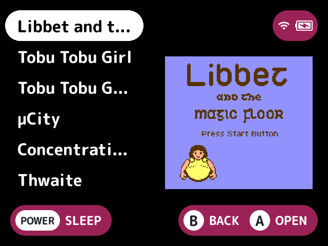
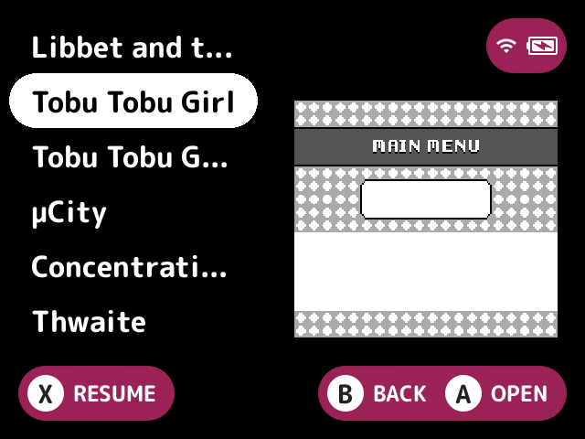
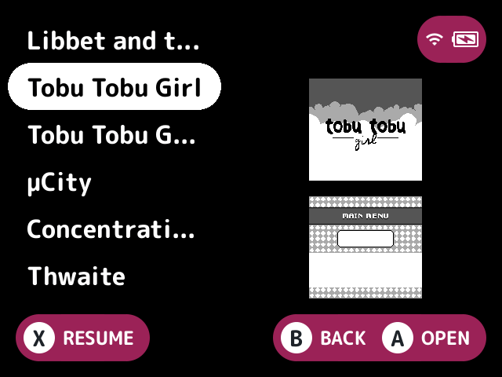
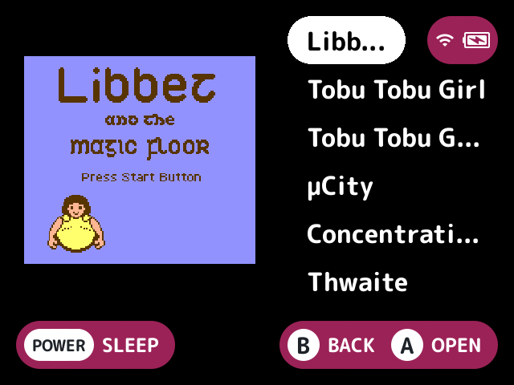
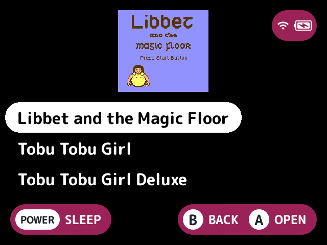
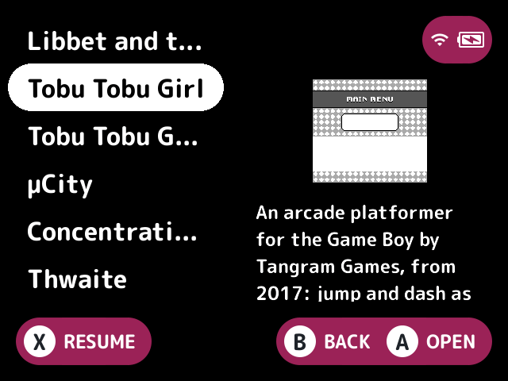

# layout-fancy

Shows the game list as the built-in list's rows beside a panel with the selected game's art.

## What it does

The rows, their names, the selected name's pill and how the d-pad moves through them are the built-in list's, so every button stays the launcher's, and they end where they do beside stock's thumbnail.

The panel is on the right, as stock's thumbnail is, unless Art position puts it on the left (the rows then on the right) or across the top half (the rows then under it, as wide as with no art). It shows:

- The game's box art, or else its thumbnail, from the art cache.
- The preview of its last save state: the slot minarch last used, named in `.userdata/shared/.minui/<tag>/<rom>.txt`, whose preview is `<rom>.<slot>.bmp` beside it, found as stock finds them for resuming (a disc by its game's `.m3u`).

With Prefer state preview on, the preview stands in for the box when there is one. With it off, the box goes in the top half and the preview in the bottom half. The state files are looked for once each time the selection moves to another game, and again back from a game.

With Description on, a game whose `.info` sidecar (see [game metadata](../../docs/plugin-api.md#without-writing-c)) has a `description` shows it wrapped in the panel: the art in the panel's top half and the description under it, or with the art at the top, the art in the panel's left half and the description beside it. A description taller than its place starts scrolling up slowly once the selection has stayed on the game for 2 seconds, and starts again from the top after its end. It's redrawn every frame only while it scrolls. A game with no description shows its art as with Description off.

Art shows only while Show game art is on. With it off the rows take the width. A name a plugin hides shows only on the selected row while the panel has no art, as on the built-in list.

## Turn it on

Turn on **Fancy layout** in Launcher > Plugins ([how](../../docs/plugins.md#turning-plugins-on-and-off)). It owns the `layout` [slot](../../docs/glossary.md#slot), so only one layout is on at a time.

## Screenshots

The Homebrew collection, with the default settings.

A game with a save state: its preview in the panel (Prefer state preview on, the default).

Prefer state preview off: the box above the state preview.

Art position left: the panel on the left and the rows on the right.

Art position top: the panel across the top half and the rows under it.

Description on: a game's description under its art.

## Settings

| Setting | Choices | Default | What it does |
|---|---|---|---|
| Prefer state preview (`prefer_preview`) | on, off | on | Shows the last save state's preview in place of the box art when there is one |
| Art position (`position`) | right, left, top | right | Where the art panel goes: right of the rows, left of them, or across the top half above them |
| Description (`description`) | on, off | off | Shows the game's `.info` description wrapped in the panel under the art, scrolling once the selection settles |

## For plugin authors

- Owns the `layout` slot (`slots=layout`).
- Row decorators draw on each row, and art decorators under the panel's art, except while a description shows, as it takes that space.
- A plugin's `art_replace` surface takes the box's place in the panel. The save state's preview never stands in for it: with `prefer_preview` off the preview goes under it.
- Marks its `position` setting public, so other plugins can read it with `cfg_read`; [`art-backdrop`](../art-backdrop/README.md) does, to darken its art toward the rows.
- Reads the save state files named above, and with `description` on, the `description` key of the selected game's `.info` sidecar through `entry_info` (up to 4095 bytes, which the launcher keeps of that key).

## Credits

MyMinUI.
