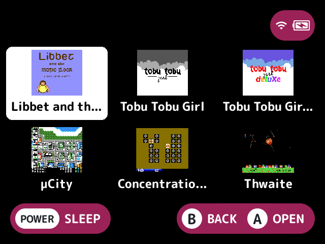
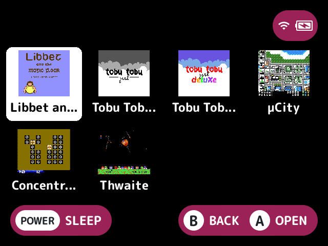

# layout-grid

Shows the game list as a grid of tiles instead of the built-in list.

## What it does

- Each tile shows the entry's thumbnail, or else its box art, from the art cache, fitted inside the tile. Art shows only while Show game art is on.
- While an entry has no art, or its art is still loading, its tile shows the first letter of its name in the theme's accent colour.
- Names show under the tiles when the launcher shows names.
- A name a plugin hides, such as [`art-boxart`](../art-boxart/README.md)'s `cover_name` hiding a covered folder's, is left out of a tile that draws art (a file, generated art such as [`art-placeholder`](../art-placeholder/README.md)'s cards, or an `art_replace` surface), its strip left blank. It still shows on a tile with a letter, with no art or with art that hasn't loaded, so every game stays identifiable. The selected tile goes by the same rule.

## Turn it on

Turn on **Grid layout** in Launcher > Plugins ([how](../../docs/plugins.md#turning-plugins-on-and-off)). It owns the `layout` [slot](../../docs/glossary.md#slot), so only one layout is on at a time.

## How to use

The d-pad moves through the grid: left and right step through the entries in order, and up and down keep the column. A press past an end wraps around:

- left from the first entry goes to the last, and right from the last goes to the first
- up from the top row goes to the column's lowest entry, and down from the last row goes to the column's top one

Holding the direction stops at the end instead. Down where the column has nothing below goes to the last entry. **A**, **B**, **X**, the shoulders and the letter jumps stay the launcher's.

## Screenshots

The Homebrew collection, with the default settings.

Columns set to 4.

## Settings

| Setting | Choices | Default | What it does |
|---|---|---|---|
| Columns (`columns`) | theme, auto, 2 to 8 | theme | Tiles across the screen. `auto` fits the screen: 3 at 640 wide, 4 at 1024, 5 at 1280. `theme` uses the theme's `layout-grid.columns` key, `auto` or a number, or `auto` without one |
| Rows (`rows`) | theme, auto, 1 to 6 | theme | Rows of tiles in view. `auto` keeps the tiles about square (2 on each of those screens). `theme` uses the theme's `layout-grid.rows` key, or `auto` without one |

A new theme's keys are followed at once.

## For plugin authors

- Owns the `layout` slot (`slots=layout`).
- Reads the `layout-grid.columns` and `layout-grid.rows` theme keys with `theme_value` (see [plugin-api.md](../../docs/plugin-api.md)).
- Row decorators draw on each tile. A plugin's `art_replace` surface, such as a video preview, stands in for the selected tile's art.

## Credits

Xisrith, nx-redux and Bramley.
