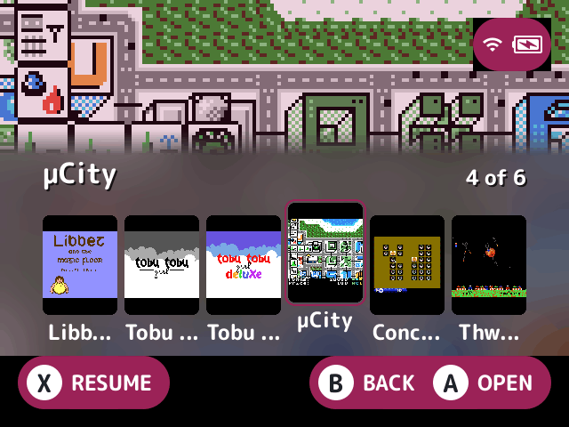
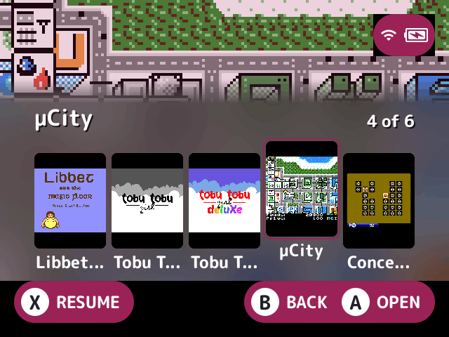
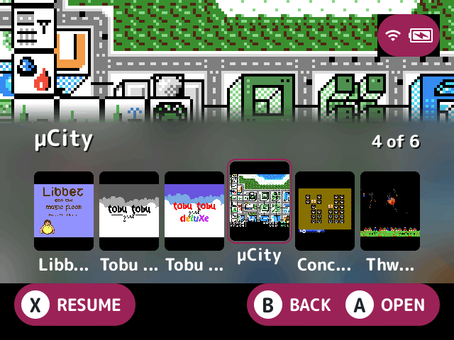
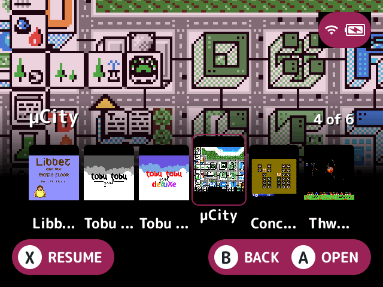

# layout-hero-rail

Shows the game list as a row of cards along the bottom of the screen, under big art for the selected game.

## What it does

- **The hero** across the top is the selected entry's backdrop, or else its screenshot, thumbnail or box, the first that has a file. Generated art such as [`art-placeholder`](../art-placeholder/README.md)'s cards isn't blown up. It's scaled to fill the screen and cropped at the edges, and tinted toward the theme's accent colour. It stays sharp at the top, and the band along the bottom, behind the cards, shows a blurred, darkened copy of it, the sharp art fading into it. With Blur off, the hero stops at the middle of the cards instead, fading into the theme's background colour above them. Where there's no art, stock's background stays.
- **The logo** (from [`art-boxart`](../art-boxart/README.md), out of `.media/wheel`), or else the entry's name in the large font, sits at the hero's bottom left and fades in once the selection settles.
- **The cards** show the entry's thumbnail, or else its box art. While an entry has none, or it's still loading, its card is a tile in the theme's accent colour with the first letter of its name.
- Names show under the cards when the launcher shows names. A name a plugin hides doesn't show where there's art to stand in for it.
- The selected card is lifted a few pixels with a ring in the theme's accent colour round it. As the selection moves to it, it rises a little past its place and settles back, once; with Animation off it's lifted at once, ring and all.
- The count, such as "3 of 12", sits at the rail's top right.
- Art only shows while Show game art is on.

The art of the entries either side of the selection, and of the cards just outside the rail, is asked for ahead so it's in when it shows.

## Turn it on

Turn on **Hero and card rail layout** in Launcher > Plugins ([how](../../docs/plugins.md#turning-plugins-on-and-off)). It owns the `layout` [slot](../../docs/glossary.md#slot), so only one layout is on at a time.

## How to use

| Button | What it does |
|---|---|
| Left and right | Move one card |
| Up and down | Move a rail's worth of cards back or on, stopping at the first and last |
| **A**, **B**, **X**, the shoulders and the letter jumps | Stay the launcher's |

A press past an end wraps around to the other end, and holding the direction stops there instead.

## Screenshots

The Homebrew collection, with the default settings.

Card size set to large.

Tint set to 0.

Blur off: the hero fades into the theme's background colour above the cards.

## Settings

| Setting | Choices | Default | What it does |
|---|---|---|---|
| Card size (`cards`) | theme, small, medium, large | theme | How tall the cards are: 22, 28 or 34 percent of the screen above the hints. `theme` uses the theme's `layout-hero-rail.cards` key, one of those three, or `medium` without one. A new theme is followed at once |
| Tint (`tint`) | 0, 20, 40 | 20 | How much the hero art is tinted toward the theme's accent colour, in percent |
| Logo fade (`fade`) | 0, 150, 300, 600 | 300 | How long the logo takes to fade in once the selection settles, in milliseconds |
| Blur (`blur`) | on, off | on | Whether the band behind the cards shows a blurred, darkened copy of the hero art. Off, the hero fades into the theme's background colour above the cards |
| Animation (`animation`) | on, off | on | Whether the selected card rises past its place and settles back as it's selected. Off, it's lifted at once, with its ring |

## For plugin authors

- Owns the `layout` slot (`slots=layout`).
- Reads the `layout-hero-rail.cards` theme key with `theme_value` (see [plugin-api.md](../../docs/plugin-api.md)).
- Uses the host's `surface_blur` for the band, once each time the selection moves to an entry whose hero isn't kept, never each frame, and `draw_ring` for the selected card's ring (see [plugin-api.md](../../docs/plugin-api.md)). On a launcher without them, the band isn't blurred and the selected card is framed in the theme's main colour instead.
- Translates the count's `%i of %i` with `tr`.
- Row decorators draw on each card. A plugin's `art_replace` surface stands in for the hero's art, tinted and faded the same way, but isn't blurred, as each of its frames is new. Art decorators don't draw under the hero, as the cards are there.

## Credits

tapionallanaire.
