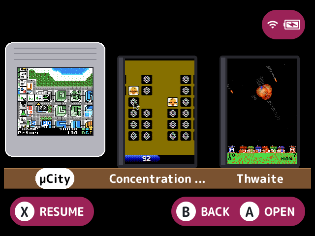

# layout-shelf

Shows the game list as cartridges standing on shelves, instead of the built-in list.

## What it does

Each cartridge takes the shape of the system it's in, by the system tag of the outermost folder it's in, or for a game with none by its extension:

| Shape | Systems |
|---|---|
| Nearly square Game Boy cartridge with a ridged grip | `GB`, `GBC` and `SGB` (and `.gb`, `.gbc` and `.sgb` games) |
| Wider, landscape Game Boy Advance cartridge | `GBA` and `MGBA` (and `.gba` games) |
| Game case standing face out with a spine on the left | Every other system, and folders, paks and toggles |

The columns are sized for the folder's own shape, by its tag, or else the one all its first games share, or else the case. So a mixed folder such as Recently Played gets case-sized columns with each game in its own shape inside.

- The label shows the entry's box, or else its thumbnail, from the art cache, filling it. While it has no art, or its art is still loading, it shows the first letter of the name on a label in the theme's accent colour. Art shows only while Show game art is on.
- Names show on tags along the plank under each cartridge when the launcher shows names, the selected one's on a pill. A name a plugin hides stays hidden while the cartridge has art, and shows when it doesn't.
- The selected cartridge stands lifted off its shelf, edged in the theme's main colour.
- As many cartridges as fit stand on each shelf (on the desktop build at 1024 wide, 6 Game Boy cartridges, 3 Game Boy Advance ones or 7 cases).

## Turn it on

Turn on **Cartridge shelf layout** in Launcher > Plugins ([how](../../docs/plugins.md#turning-plugins-on-and-off)). It owns the `layout` [slot](../../docs/glossary.md#slot), so it's picked over the other layouts with `slot.layout` (see [plugin-api.md](../../docs/plugin-api.md#turning-plugins-on-and-off)).

## How to use

The d-pad moves along and between the shelves: left and right step along them in order, on to the next shelf, and up and down keep the column. A press past an end wraps around as in [`layout-grid`](../layout-grid/README.md), and holding the direction stops there instead. The shelves in view follow the selection. **A**, **B**, **X**, the shoulders and the letter jumps stay the launcher's.

## Screenshots

The Homebrew collection, with the default settings.

Shelves set to 1.

## Settings

| Setting | Choices | Default | What it does |
|---|---|---|---|
| Shelves (`shelves`) | theme, auto, 1, 2, 3, 4 | theme | Shelves in view. `auto` fits the screen: 2 at 640, 1024 and 1280 wide. `theme` uses the theme's `layout-shelf.shelves` key, `auto` or 1 to 4, or `auto` without one. A new theme is followed at once |
| Animate the lift (`animate`) | on, off | on | The selected cartridge rises off its shelf as the one before drops back, rather than at once |

## For plugin authors

- Owns the `layout` slot (`slots=layout`).
- Reads the `layout-shelf.shelves` theme key with `theme_value` (see [plugin-api.md](../../docs/plugin-api.md)).
- Row decorators draw on each cartridge, with its name tag. A plugin's `art_replace` surface stands in for the selected cartridge's label art.

## Credits

slot-flip.
