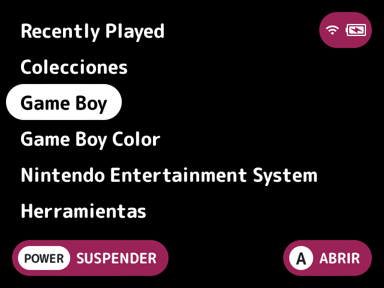
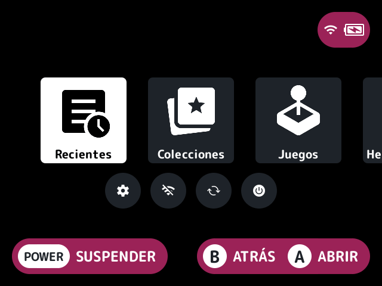
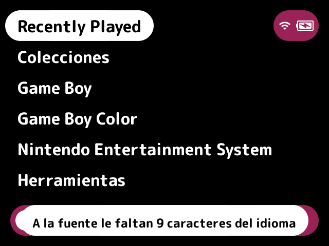
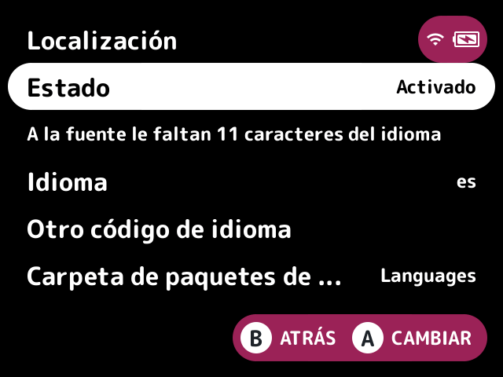

# localization

Translates the launcher, and other plugins' own text, from language packs, so the menus show in your language.

## What it does

The launcher's and plugins' text is translated from gettext `.po` language packs, read by a small reader of its own (no `.mo`, no libintl). Stock has no language setting to follow, so the language is off by default and translates nothing.

A Spanish pack is bundled for the launcher and for every bundled plugin. Their translations haven't had a native speaker's review.

It also supplies the launcher's fallback font, and can write display names into `map.txt` files. Both are below.

## Turn it on

Turn on **Localization** in Launcher > Plugins ([how](../../docs/plugins.md#turning-plugins-on-and-off)), then pick a language in its settings. It owns the `strings` [slot](../../docs/glossary.md#slot).

## Language packs

The Language setting picks a pack by its code, such as `es`. `other` takes the code from the Other language code setting, such as `eu` or `pt_PT`. A code with a region falls back to its language's pack, so `pt_BR` uses `pt.po` when there's no `pt_BR.po`.

| What | Where |
|---|---|
| The launcher's strings | `<code>.po` in the language pack folder on the card (`Languages` by default, or a full path), and in this plugin's `res/lang/launcher/`. The template is `po/launcher.pot`, with `msgid` keyed on the English and `msgctxt` where the launcher gives one |
| A plugin's own strings, such as its name, setting labels and options on the Launcher pak's Plugins page | `res/lang/<code>.po` in the plugin's folder (bundled or installed as its own [pak](../../docs/glossary.md#pak)), and `<folder>/<plugin id>/<code>.po` on the card |

A pack in the folder on the card comes first, string by string, so it can change or add to a bundled one. The launcher's packs are read at start, and a plugin's the first time one of its strings is asked for, as the list of plugins is only ready once they've all loaded. A plugin with no pack for the language stays in English.

A file with a syntax error, a bad escape, a duplicate entry, text that isn't UTF-8 or a charset other than UTF-8 is refused whole, so only the strings it holds show in English, and the launcher log names the file and the line.

## Write map.txt names

The `localization.map` action writes display names into each system folder's `map.txt` from names lists in `<folder>/<code>/<TAG>.txt`, where `<TAG>` is the system folder's tag, such as `GB` for `Game Boy (GB)`. A names list has one game a line: its English title, a tab and the name to show. No names lists are bundled.

- Games are matched loosely, ignoring their extension, everything in brackets, a leading "The" or trailing ", The", case, spacing and punctuation, so "Tetris (World) (Rev 1).gb" finds "Tetris".
- It only adds lines for games a `map.txt` doesn't already list, keeps the file's own lines as they are, and leaves a `map.txt` that isn't a regular file alone.
- It asks before writing anything.
- Only the files directly in each system folder under `Roms/` are named.

Run it from the Write map.txt names tile on the [quick menu](../../docs/glossary.md#quick-menu) (off by default) or from a game list button (none by default).

## Fallback font

The launcher's fallback font draws the characters the UI font has no glyphs for, such as CJK game names or a translated UI, a stretch of text at a time. It's the Fallback font setting's TrueType or OpenType file (a path on the card, relative to it or full), or with it empty `<folder>/<code>.ttf` or `.otf` beside the language's pack (`pt_BR` falls back to `pt` here too). It works with the language off.

The launcher only uses a regular file on the card that opens as a font, and a theme's fallback font wins over this one. No font is bundled. Freely licensed ones that cover CJK are Noto Sans CJK and Source Han Sans (both SIL Open Font License), or a smaller subset of one, as casualducko's fork ships a subset of Noto Sans JP. To choose a CJK-capable font for the whole launcher, use the theme slot's `font`, which [`theme-plus`](../theme-plus/README.md) owns.

## Font check

With a language picked, it checks the UI font, the theme's (from [`theme-plus`](../theme-plus/README.md)) or stock's, has every character the language's translations use: the launcher's and the plugins' that are on. A font that lacks any gets a toast saying how many, such as "Font lacks 9 characters of this language", once at start and again when the theme changes, and the toast doesn't repeat until the language or the font changes. While it lacks them, a note under Status on this plugin's page and on the theme's (theme-plus's) in Launcher > Plugins says the same; the pages count the packs of every plugin they list, on or off.

The characters a theme's font lacks are drawn with the fallback font, theme-plus's Fallback font or this plugin's (below), or with none of those, with stock's own font. With the language off there's no check. Stock's font is checked the same way, so a language it lacks characters of, such as Korean, warns too, and a fallback font below draws them.

## Screenshots

Language set to es: the first screen in Spanish.

Language set to es: the quick menu in Spanish.

Language set to es, with a theme whose font has none of Spanish's accents: the toast at start.

The same, on this plugin's page in Launcher > Plugins: the note under Status.

## Settings

| Setting | Choices | Default | What it does |
|---|---|---|---|
| Language (`language`) | off, other, ca, cs, da, de, el, es, fi, fr, hu, it, ja, ko, nl, no, pl, pt, pt_BR, ru, sv, tr, uk, zh_CN, zh_TW | off | The language pack to use, by its code. `other` takes the code below, and `off` translates nothing |
| Other language code (`code`) | text | empty | A language code for `other`, such as `eu` or `pt_PT` |
| Language pack folder (`folder`) | text | `Languages` | The folder on the card with your own packs (`<code>.po` for the launcher, `<plugin id>/<code>.po` for a plugin) and names lists (`<code>/<TAG>.txt`) |
| Fallback font (`font`) | text | empty | A font for the characters the UI font has no glyphs for, such as CJK, relative to the card or a full path. Empty uses `<folder>/<code>.ttf` or `.otf` when there's one |
| Write map.txt names button (`button`) | none, Y, L2, R2, SELECT | none | A game list button that writes display names into each system's `map.txt` |
| Write map.txt names tile (`tile`) | on, off | off | A Write map.txt names tile on the quick menu |

## For plugin authors

- Owns the `strings` slot (`slots=strings`): it answers `host->tr` and `host->tr_plural` for every plugin, and finds a plugin's `res/` through `host->plugin_info` (see [plugin-api.md](../../docs/plugin-api.md#translations)).
- The reader takes `msgctxt`, `msgid_plural` and `msgstr[n]`, strings over several lines and C's escapes, and skips fuzzy, obsolete and untranslated entries. A plugin's `msgid`s have no `msgctxt` for its id: `msgctxt` is only a context the plugin passes to `host->tr`.
- Plural forms come from the header's `Plural-Forms`, evaluated by its own reader of the expressions gettext allows (`n`, numbers, parentheses, `!`, arithmetic, comparisons, `&&`, `||` and `?:`, and nothing else). A header without a usable `Plural-Forms`, or a rule that divides by zero or picks a form past `nplurals`, picks as English does.
- Registers the `localization.map` action, which the `button` setting follows.
- Reads `<folder>/<code>.po`, `<folder>/<plugin id>/<code>.po`, `<folder>/<code>/<TAG>.txt` and the font file, and writes each system's `map.txt`.
- Checks the UI font with `host->font_missing`, at its first `tick` and on `launcher.theme_changed`, and keeps what it last warned about in its own cfg's `warned` key. Its `settings_note` notes its page and the `theme` slot owner's.

## Credits

UnuOS, NextUI-CN (the `map.txt` writer), Bramley and casualducko (the fallback font).
