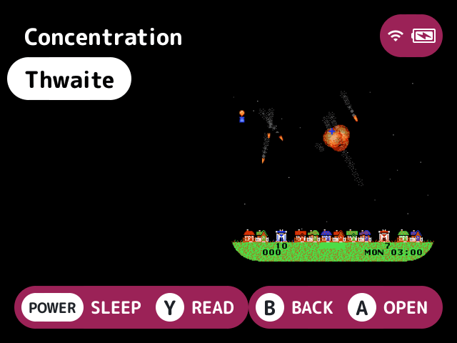
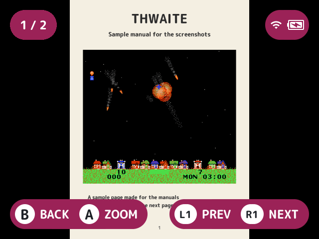
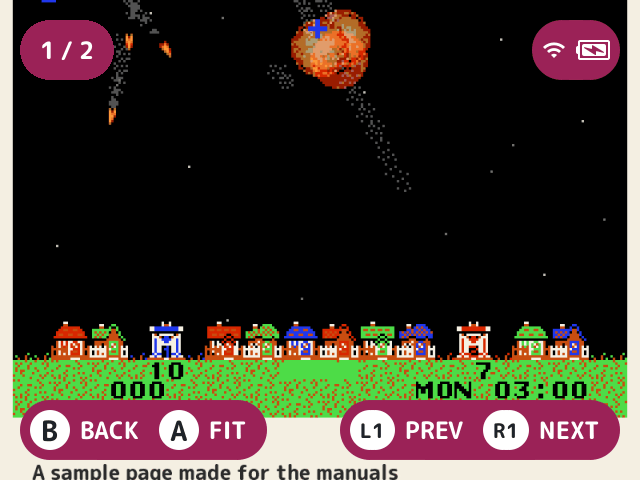
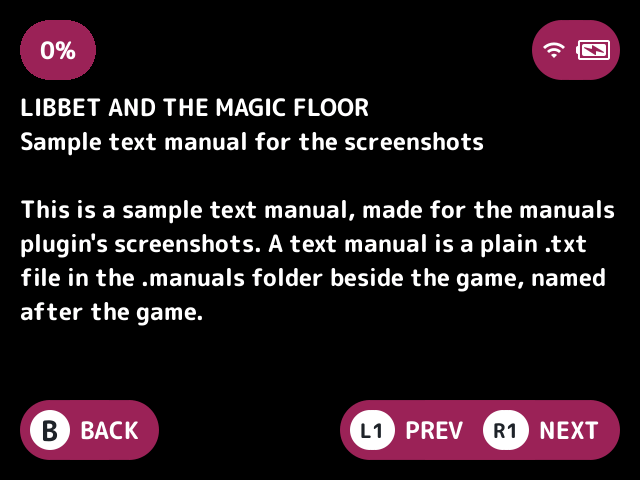

# manuals

Shows a game's manual or guide on a screen of its own: pages of images, such as a scanned manual, or a text file, such as a guide. You put them on the card beside the game, the way stock keeps a game's art in `.media`.

## Where manuals go

A game's manual goes in a `.manuals` folder in the game's own folder, named after the game's file without its extension, as its art is in `.media`:

- **Pages:** a folder holding the pages as images, `01.png`, `02.png` and so on. PNG and JPEG work. They're shown in name order, counting numbers by their value, so `2.png` comes before `10.png`.
- **Text:** a `.txt` file, plain text in UTF-8.

```
Roms/Game Boy (GB)/Tetris (World).gb
Roms/Game Boy (GB)/.manuals/Tetris (World)/01.png
Roms/Game Boy (GB)/.manuals/Tetris (World)/02.png
Roms/Game Boy (GB)/.manuals/Zelda.txt
```

A game with both shows its pages. The name can also be:

- the game's name without a disc marker, so `Final Fantasy (Disc 1).chd`, and the game [multi-disc](../multi-disc/README.md) shows for its discs, find `.manuals/Final Fantasy`;
- the name the game list shows for it, such as the name stock gives it without its tags, a `map.txt` name, or an arcade game's title from [arcade-names](../arcade-names/README.md), so `sf2.zip` finds `.manuals/Street Fighter II` too;
- for a game in a folder of its own, such as `Chrono/Chrono.m3u`, the folder's name, in the `.manuals` beside the folder.

A game in a folder inside its system's folder can keep its manual in the system folder's `.manuals` too. Names are matched ignoring upper and lower case, as the card does.

## Turn it on

Turn on **Manuals** in Launcher > Plugins ([how](../../docs/plugins.md#turning-plugins-on-and-off)).

## How to use

Select a game with a manual and press **Y**; the game list's hints show it as Y READ. Games without a manual don't show it. With other plugins' actions on Y, such as [game-actions](../game-actions/README.md), Y opens a menu of them all, where it's READ. The Manual button setting puts it on a second button as well.

Pages are fitted to the screen. The page number shows in the top left.

| Button | What it does |
|---|---|
| **L1**, **R1** | The previous and next page |
| Left, right | The previous and next page, while the page is fitted |
| **A** | Zooms to twice the size, and back |
| D-pad | Moves around a zoomed page |
| **B** | Closes the manual |

A text manual is wrapped to the screen in the launcher's font, the theme's with stock's as its fallback. When it's longer than the screen, how far through it you are shows in the top left.

| Button | What it does |
|---|---|
| Up, down | Scrolls a line |
| **L1**, **R1**, left, right | Scrolls a screen |
| **B** | Closes the manual |

A manual opens on the page, or the line, you left it on the last time.

Large pages, such as a page scanned at 300 dpi, are read one at a time and shrunk to fit as they're read, so they take little memory. A page over 16 MB, over 8192 pixels a side or over 40 million pixels shows as one that can't be shown, as does a file that isn't a PNG or JPEG. Only the first 1 MB of a text file is read.

## Screenshots

With the default settings: Thwaite, which has a manual, selected in NES.



Y on Thwaite: its first page, fitted to the screen.



A on the page: twice the size, moved down with the d-pad.



Y on Libbet and the Magic Floor: its text manual.



The pages and text are samples made for these screenshots.

## Settings

| Setting | Choices | Default | What it does |
|---|---|---|---|
| Manual button (`button`) | none, L2, R2, SELECT | none | A second game list button that opens the selected game's manual, besides Y |

## For plugin authors

- Registers the `manuals.open` action, which takes a path (`MOSAIC_ACTION_PATH`) and is available only for a game with a manual, bound to Y on the game list with `bind_button`, beside other plugins' actions there, and to the `button` setting's button, marked `button:manuals.open`.
- Registers the `manual` entry set (`provides=sets.manual`): `has` is true for a game with a manual, and `list` goes through the [card index](../../docs/plugin-api.md#features-added-since-the-first-api), so it lists nothing until the index is ready, and then calls `set_changed`. Each folder's `.manuals` is read once, until a game returns or the card index changes. [row-badges](../row-badges/README.md)' manual mark reads it.
- Reads pages with the launcher's `image_load_fit`, once fitted to the screen and once at twice that for the zoom, and enlarges a smaller page with `surface_scale`. Only one page is kept at a time.
- Reads `.manuals` folders and their files, never following links. Keeps the page or line each game was left on, for the last 500 games, in `.userdata/<platform>/launcher/manuals.txt`, by the game's path on the card.
- No slots, services, requires or conflicts.

## Credits

ES-DE, ROCKNIX and Allium.
