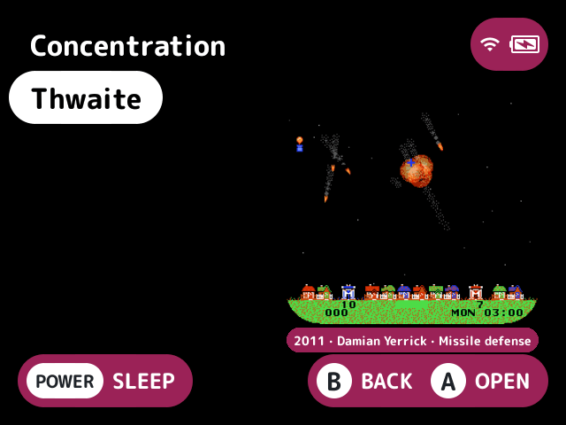
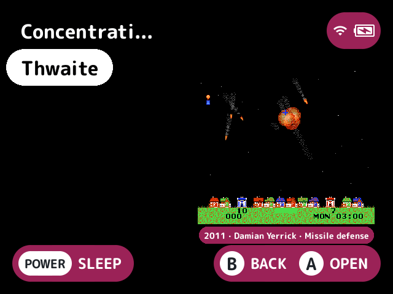
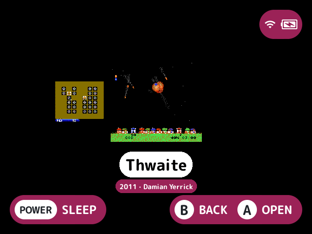

# metadata-band

Shows a game's year, publisher and genre in a pill under its art, such as "1994 · Nintendo · Platformer".

## What it does

The details come from the game's `.info` sidecar file, `<folder>/.media/<name>.info`. The pill is in the theme's accent colour with its hint-coloured text, centred on the art.

- A year written as a date, such as `1994-11-21`, shows as its first four digits. The other fields show as they're written.
- When the line doesn't fit under the art the last fields are left out, and the first is cut with "..." when even it alone doesn't fit.
- Games whose sidecar has none of the keys, or that have no sidecar, get no band, and neither do folders and paks.
- It shows in the largest small font the room allows.
- It shows only while the built-in list shows a thumbnail (Show game art on, a game with art, room under it). Under a plugin layout it shows only where the layout draws it: [`layout-fancy`](../layout-fancy/README.md) does for its panel and [`layout-carousel`](../layout-carousel/README.md) under the selected cover's name.

## Turn it on

Turn on **Metadata band** in Launcher > Plugins ([how](../../docs/plugins.md#turning-plugins-on-and-off)).

## Screenshots

Thwaite's band under its art, with the default settings.

Fields set to `genre,year`.

With layout-fancy: the band in its panel.

With layout-carousel: the band under the selected cover's name.

## Settings

| Setting | Choices | Default | What it does |
|---|---|---|---|
| Fields (`fields`) | text | `year,publisher,genre` | The `.info` keys shown under a game's art, in order and comma separated, from `year`, `publisher`, `genre`, `developer` and `players`. The last ones are left out when they don't fit |

## For plugin authors

- Provides the `info.format` service (`provides=info.format`): a game's `.info` fields, tidied and joined as the band shows them. Ask with the game's `path`, optionally other `fields` and a `width` to fit, and get each tidied value and the joined line (see [plugin-api.md](../../docs/plugin-api.md)).
- Draws through the art decorators (`host->decorate_art`).
- Reads `<folder>/.media/<name>.info`.

## Credits

kUI and nx-redux.
