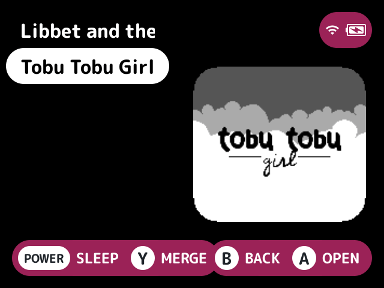
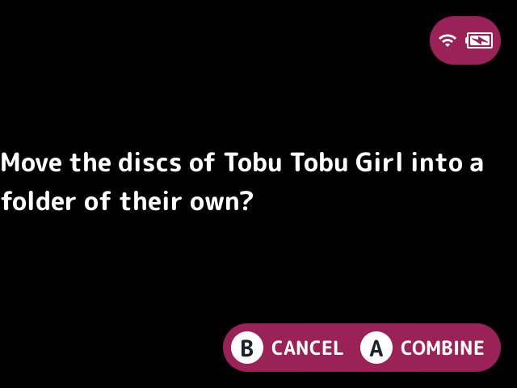

# multi-disc

Shows the discs of a game, such as `Game (Disc 1).chd` and `Game (Disc 2).chd` side by side in a system's folder, as one game, without moving them. The first time you play it, it writes an `.m3u` listing the discs beside them and launches that, and carries the first disc's saves over to it. **Y** can move the discs into a folder of their own, which [minarch](../../docs/glossary.md#minarch) needs to change discs.

## What it does

- Files whose names differ only by a disc number show as one game, named without the number, with the first disc's art when the game has none of its own. The discs' own rows are hidden. The markers it knows are `(Disc N)`, `(CD N)` and `(Disk N)`, in any case, and the same with `of M`, such as `(Disc 1 of 3)`. Anything else, such as `(Side A)` or `[Disc 1]`, stays as it is. A game needs two discs or more, each number once, all with the same word, the same `of M` and the same extension.
- A cue sheet's files, such as `Game (Disc 1).bin` and `Game (Disc 1) (Track 2).bin` beside `Game (Disc 1).cue`, belong to the sheet, so the game is the `.cue` files. Subchannel and audio files (`.sbi`, `.sub`, `.wav`, `.mp3`, `.ogg`, `.flac`, `.ape`) aren't discs either, and two games that would have the same `.m3u` name stay separate.
- The first time you open the game, it writes `Game.m3u` beside the discs, listing them by disc number, and the launcher launches that, so new saves, states, recents and play time go under the `.m3u`'s name. An `.m3u` already there is never replaced, and it's launched as it is. That first time only:
  - the first disc's saves and [save states](../../docs/glossary.md#save-state) are copied to the `.m3u`'s name, where there isn't one under that name already, and the first disc's own are kept;
  - the first disc's line in Recently Played and its favorite, with [favorites](../favorites/README.md) on, move to the `.m3u`.
- A folder already in stock's layout for a game of several files, `Game/` with the discs and a `Game.m3u` (or `Game.cue`) in it, is left alone: stock shows it as one game already.

### Changing discs

minarch only offers to change discs for a game in stock's layout, so a game shown from loose discs always starts on its first disc and can't change to another. **Combine discs**, on **Y** for the game, asks first, then moves the discs, with their sheets' files, into a folder named after the game, with its `.m3u` (the one beside them, or a new one), so stock shows the folder as the game and minarch can change discs. Saves and states are kept, as minarch names them by the `.m3u` in a folder too, and Recently Played, favorites, [tags](../tags/README.md) and play time follow the discs to their new paths. When the game has no art of its own, the first disc's is copied for the folder. It stops, moving nothing, when the folder is there already or the `.m3u` beside the discs names other files.

## Turn it on

Turn on **Multi-disc** in Launcher > Plugins ([how](../../docs/plugins.md#turning-plugins-on-and-off)).

## How to use

Nothing to do: games with discs in a system's folder show as one game. Press **A** to play. To be able to change discs, press **Y** on the game (its hint says MERGE) and choose Combine discs. With other plugins' actions on Y, such as [game-actions](../game-actions/README.md) or favorites, Y opens a menu of them all.

Search and the other plugins that look through the card index find the game from the start, under its first disc's name, year, publisher, genre and players, and opening it from them launches it as from the game list. Its discs are hidden from them as from the list, though Recently Played, collections and Favorites keep a disc you put there.

## Screenshots

With the default settings: Tobu Tobu Girl, split into two discs, as one game with the first disc's art.

Y on it: Combine discs asks first.

## Settings

| Setting | Choices | Default | What it does |
|---|---|---|---|
| Combine discs button | Y, L2, R2 | Y | The button Combine discs is on. |

## For plugin authors

- Adds a row at each game's `.m3u` path with `dir_entries` before the `.m3u` is written, grouping the list's own entries, so the card index gets the row too, and hides the discs with `filter` in system folders and other plugins' lists, such as search's, but not in Recently Played, collections or Favorites, which show what you put there. Names the first disc with `art_alias`, for the game's art and its name and details in the card index.
- Writes the `.m3u` and carries the first disc over from `entry_open`, returning 0 so the launcher launches it. The saves and states it copies are the ones minarch keeps under the first disc's file name, in `Saves/<tag>/`, each `.userdata/shared/<tag>-<core>/` and `.userdata/shared/.minui/<tag>/`, by the [system tag](../../docs/glossary.md#system-tag) of the system's folder. Keeps the `.m3u` paths it has carried over in `.userdata/<platform>/launcher/multi-disc.txt`.
- Registers the `multi-disc.combine` action, bound to the Combine discs button on the game list with `bind_button`, available on a game it shows. Moves recents with `recent_set` (and `recent_remove` for a line that would then be there twice), favorites and tags through the `favorites.move` and `tags.move` services, and play time with `play_move`.
- Never overwrites or deletes a file of yours: new files are created only where nothing is, and Combine discs puts back what it moved when a move fails.
- `optional=favorites,tags`. No requires or conflicts.

## Credits

MinUI-Plus.
