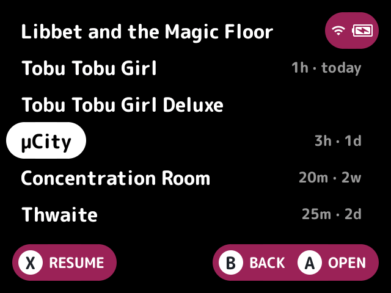
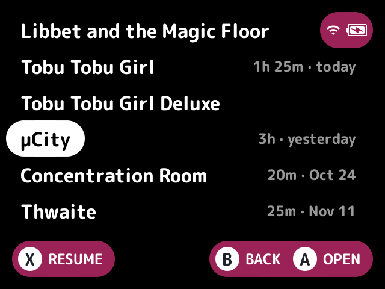

# playtime-captions

Shows a caption at the right of each played game's row, such as "2h 15m · 3 days ago".

## What it does

The caption comes from stock's [play tracker](../../docs/glossary.md#play-tracker), on the built-in list and in a plugin layout's cells. It's in the small font and the theme's hint colour moved toward its background.

- By default it shows the play time and when it was last played, by local days. Sessions (how many) can be added.
- Games the tracker hasn't seen get nothing, or "Never played" with the Never played setting. With no play history (no database yet, or no sqlite) no game gets a caption.
- The caption sits on the name's line, right-aligned, never over the name. It leaves room after the name for [`row-badges`](../row-badges/README.md)' dots while row-badges is loaded with them on. In a cell with no name it goes along the bottom, under row-badges' corner dots.
- When the row is too narrow it tries the compact format, then drops parts from the end, and shows nothing when even one doesn't fit.
- In the game switcher, [`switcher-plus`](../switcher-plus/README.md) shows the same captions with its `captions` setting, in the parts and format these settings pick while this plugin is loaded. The built-in switcher shows none.
- With Achievements on, it adds the game's local RetroAchievements progress last, as "3/12 achievements" ("3/12" compact), from what minarch keeps on the card. It shows once the launcher has worked out the game's hash, also on games the tracker hasn't seen or with no play history, and not on games with no achievements cached.

## Turn it on

Turn on **Play time captions** in Launcher > Plugins ([how](../../docs/plugins.md#turning-plugins-on-and-off)).

## Screenshots

Captions in the Homebrew collection, with the default settings.

Format set to compact.

Format set to date.

Sessions on.

Never played on.

With row-badges' unplayed dots on.

## Settings

| Setting | Choices | Default | What it does |
|---|---|---|---|
| Play time (`time`) | on, off | on | Shows the play time |
| Last played (`last`) | on, off | on | Shows when it was last played |
| Sessions (`sessions`) | on, off | off | Shows how many sessions it has |
| Format (`format`) | relative, compact, date | relative | `relative`: "2h 15m · 3 days ago · 4 sessions". `compact`: "2h · 3d · 4x". `date`: "2h 15m · Nov 5 · 4 sessions" |
| Never played (`never`) | on, off | off | "Never played" on games the tracker hasn't seen |
| Achievements (`achievements`) | on, off | off | Local RetroAchievements progress, such as "3/12 achievements", from minarch's files on the card |

## For plugin authors

- Provides the `captions.text` service (`provides=captions.text`): a game's caption as the rows show it. Ask with the game's `path` and optionally a `width` in the small font, and get `text` and its `width` (see [plugin-api.md](../../docs/plugin-api.md)).
- All six settings are `public`, so other plugins can read them with `cfg_read`.
- Reads stock's play tracker, and the host's `achievements` call.

## Credits

Bramley, LodorOS and nx-redux.
