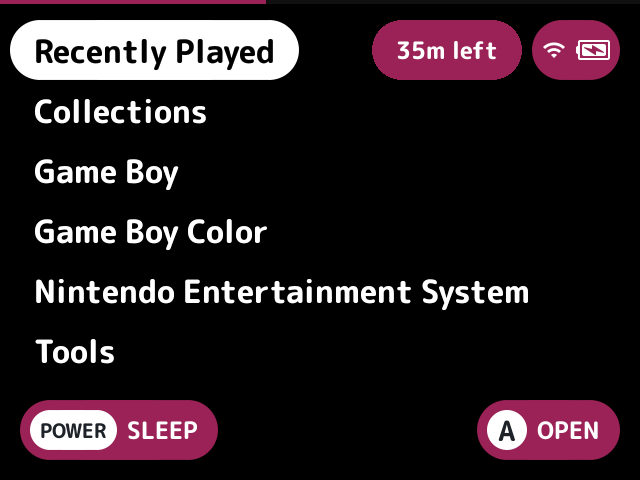
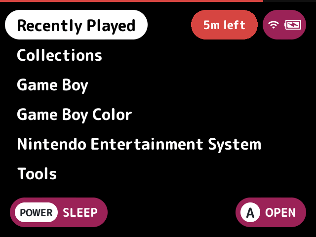
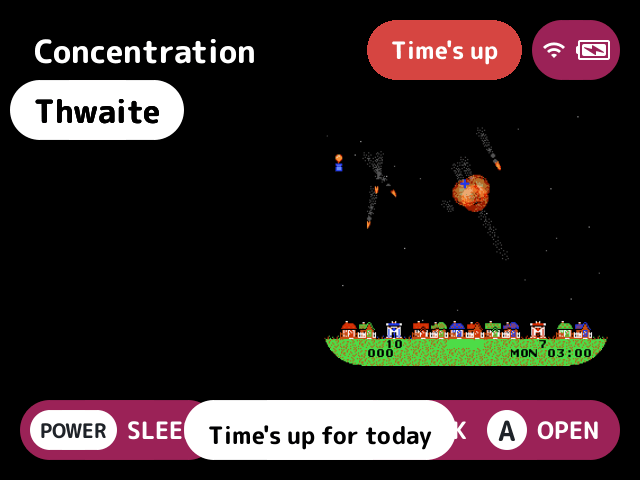
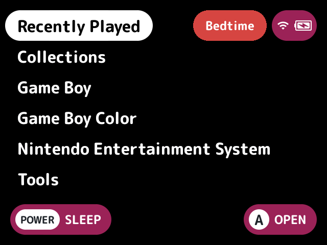
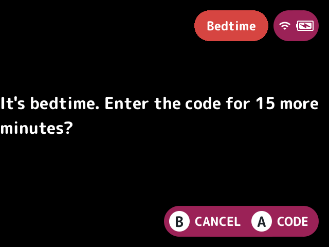
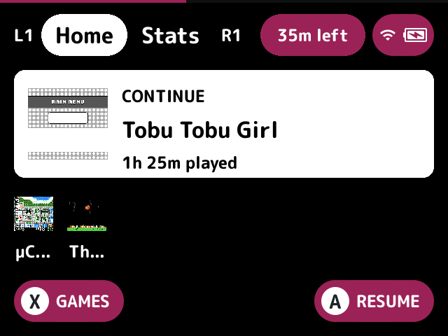

# playtime-limit

Sets a daily limit on how long games can be played, from the play history stock's [play tracker](../../docs/glossary.md#play-tracker) keeps, with its own weekend limit and a bedtime.

## What it does

Once today's play across every game reaches today's limit, launching a game is refused with a message. [Paks](../../docs/glossary.md#pak) such as Tools still open.

- The limits and bedtime are off by default, so turning the plugin on changes nothing until one is set.
- A header widget beside the status pill shows the time left, such as `45m left`, in the theme's accent, and in a warning colour at or under the Warn at setting. Coming back from a game with little or no time left says so too. The widget is redrawn only when the minute it shows changes, or the day does.
- A game already running isn't stopped when the time runs out. That needs minarch to save and quit on a signal, which stock minarch doesn't do, so that part is left out.
- While a limit is set, [`home-dashboard`](../home-dashboard/README.md)'s Stats tab shows the time left of today's limit, and [`gamification`](../gamification/README.md) leaves out play time quests that need more time than is left.
- A thin budget bar across the top of the home screen shows today's play against today's limit, in the theme's accent, and in the warning colour at or under the Warn at setting. The home screen is [`home-dashboard`](../home-dashboard/README.md)'s while it's on, else the first screen of games. The bar shows only while there's a limit today, and Budget bar turns it off.
- When the play history can't be read (no `game_logs.sqlite` before the first game, or no sqlite library), games launch as usual, the widget stays hidden, and the plugin logs why once.

### Weekday and weekend limits

Weekday limit counts Monday to Friday, and Weekend limit Saturday and Sunday, each from midnight. Weekend limit is `same` by default, which follows Weekday limit, so a cfg from before there were two limits, with only `limit=`, keeps limiting every day the same way. Set it to `off` for no limit at weekends.

### Bedtime

With Bedtime starts set, games are refused from that time until Bedtime ends, across midnight when the end comes first, such as 21:00 to 07:00. The header widget says `Bedtime` meanwhile, in the warning colour. Bedtime doesn't need the play history, so it works with no limit set, and before the first game. It's off by default.

### Extra time

With a Code for extra time set, a refused launch offers the Extra time minutes after typing that code. Past the limit, the grant is kept with its date in `.userdata/<platform>/launcher/playtime-limit.cfg`, along with the code, and runs out at midnight. At bedtime, the code unlocks games for the Extra time minutes from then, kept as the time it ends in the same cfg. When both refuse a launch, the code grants both. The code is never logged.

### PIN

Every setting is protected, and the code is secret. With the launcher's PIN set, the Plugins page asks for it before showing or changing them or turning the plugin off, and never shows the code once it's set (see [the PIN](../../docs/plugin-api.md#the-pin)).

## Turn it on

Turn on **Play time limit** in Launcher > Plugins ([how](../../docs/plugins.md#turning-plugins-on-and-off)), then pick a limit or a bedtime.

## Screenshots

Weekday and weekend limits set to 60 minutes: the time left in the header, and the budget bar at the top.

Weekday and weekend limits set to 30 minutes: the time left and the budget bar in the warning colour.

Weekday and weekend limits set to 15 minutes: a launch refused once it's used up.

Bedtime from 21:00 to 07:00, at 22:00: Bedtime in the header.

Bedtime from 21:00 to 07:00, at 22:00: a launch refused, offering the code.

With home-dashboard, and a 60 minute limit: the budget bar at the top of its home screen.

## Settings

| Setting | Choices | Default | What it does |
|---|---|---|---|
| Weekday limit, in minutes (`limit`) | off, 15, 30, 45, 60, 90, 120, 180, 240 | off | Minutes of games a day, Monday to Friday, across every game. Once they're used up, games don't launch |
| Weekend limit, in minutes (`weekend`) | same, off, 15, 30, 45, 60, 90, 120, 180, 240 | same | The same for Saturday and Sunday. `same` follows Weekday limit |
| Warn at, minutes left (`warn`) | off, 5, 10, 15, 30 | 10 | The time left in the header and the budget bar turn the warning colour at or under this many minutes |
| Extra time, in minutes (`extra`) | 15, 30, 60 | 15 | With a code set, a refused launch offers this many more minutes after typing it |
| Code for extra time (`code`) | text | empty | Kept only in this plugin's cfg and never logged or shown. Empty for no extra time |
| Bedtime starts (`bedtime`) | off, 18:00 to 23:30 every half hour, 00:00 | off | Games don't launch from this time until Bedtime ends. `off` for no bedtime |
| Bedtime ends (`wake`) | 05:00 to 10:00 every half hour | 07:00 | When games launch again after bedtime |
| Budget bar (`bar`) | on, off | on | A thin bar across the top of the home screen showing today's play against today's limit, while there's one |

All of them are protected, and `code` is also secret.

## For plugin authors

- Refuses launches in `pre_launch`, draws a header widget, and draws the budget bar in `overlay_render`, on the screen `home_screen` names, else on the game list at the card's root.
- Provides the `limit.left` service (`provides=limit.left`): where today stands, as `state` (`off`, `unknown`, `ok`, `warn` or `up`), today's `limit` (weekday or weekend) and the minutes `granted` today, the seconds `left`, the widget's `text`, then `bedtime` (`1` while bedtime refuses games, else `0`) and `bedtime_start` and `bedtime_end` (`HH:MM`, empty while bedtime is off) (see [plugin-api.md](../../docs/plugin-api.md)). It answers with `state=off` while there's no limit today, bedtime or not.
- Reads stock's play tracker.
- Writes the day's grant, the end of a bedtime unlock (`bedtime_until`) and the code to its `playtime-limit.cfg`.
- Every setting carries the `protected` flag, and `code` the `secret` flag in `plugin.txt` (see [plugin-api.md](../../docs/plugin-api.md#plugintxt)).

## Credits

dalexanco (FlexUI).
