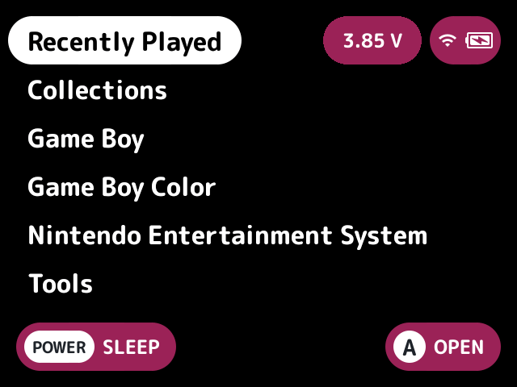

# power-plus

Guards against a flat battery: it warns when the battery runs low and powers the device off cleanly, and can power it off after a long sleep. It can also show a second battery reading, worked out from the battery's voltage, beside stock's percentage.

On the desktop build, which has no battery, it loads and does nothing, saying so in the log.

## Turn it on

Turn on **Power plus** in Launcher > Plugins ([how](../../docs/plugins.md#turning-plugins-on-and-off)).

## Low battery guard

While the launcher is on screen it reads the battery every 5 seconds.

1. At or below the warning level (5% by default) for 3 readings in a row, it warns once.
2. At or below the power-off level (2% by default) for 3 readings in a row, it counts down 30 seconds on screen and then powers off the way the quick menu's Poweroff does, so every plugin's `before_poweroff` runs.

Charging, or a reading above the power-off level, stops the countdown. A failed reading counts for nothing, and it never powers off while charging.

The launcher doesn't run while a game does, so the guard only watches the battery in the launcher. Turn it off with the Low battery guard setting.

## Battery from its voltage

Stock's battery percentage comes from the battery's own fuel gauge. Power plus can show a second reading beside it, worked out from the battery's voltage, in the header left of stock's status pill. Set Battery from its voltage to:

- **off**, the default: nothing shows;
- **percent**: the charge along the device's voltage curve, such as `V 57%`;
- **volts**: the voltage itself, such as `3.85 V`.

It reads the voltage every 5 seconds while the launcher is on screen, on the same timer as the guard. The voltage jumps about with the load, so each reading moves the shown value only an eighth of the way to it, and the value shown only changes once it's 10 mV or a whole percent away. It starts again from the next reading when charging starts or stops, and after a sleep. While charging, the voltage, and so the percentage, reads higher than the charge.

With Low battery guard uses the voltage on, the guard above goes by this percentage in place of stock's. Without a voltage to read it goes by stock's, saying so in the log.

The voltage curves are written fresh for each device, from these sources:

| Device | Platform | Curve | Source |
|---|---|---|---|
| TrimUI Smart Pro and Brick | `tg5040` | X-Powers' default | The AXP fuel gauge's default open-circuit voltage table in Allwinner's kernel, `drivers/power/axp_power/axp-cfg.h` (`OCVREG0` to `OCVREG1F`), from [allwinner-zh/linux-3.4-sunxi](https://github.com/allwinner-zh/linux-3.4-sunxi/blob/master/drivers/power/axp_power/axp-cfg.h). Stock reads this device's battery from the AXP2202's `axp2202-battery` supply |
| TrimUI Smart Pro S | `tg5050` | X-Powers' default | The same table. Stock reads its battery from `axp2202-battery` too |
| Anbernic's H700 devices | `h700` | X-Powers' default | The same table. Stock reads its battery from `axp2202-battery` too, and mainline Linux's RG35XX device tree gives its cell's full charge as 4.2 V (`voltage-max-design-microvolt`), which the table's top fits |

None of these devices publishes a measured curve of its own, so each has X-Powers' default for now, held at 0% below 3.55 V and 100% above 4.15 V. Each device has its own entry, so a measured curve can replace one. They're resting voltages, and the device under load reads a little lower.

## Power off after a long sleep

Nothing in the launcher runs while the device sleeps. So for power-off after a long sleep, it sets the RTC's wake alarm before a sleep from the launcher, for the chosen hours.

- When the device wakes at that alarm, it says so and powers off.
- Waking it yourself, before or after then, resumes as usual and clears the alarm.
- It doesn't set the alarm while charging or while `/tmp/stay_awake` or `/tmp/stay_alive` exists, and doesn't power off if one of them holds when the alarm wakes it.
- Without a writable wake alarm this part is off.
- It's off by default and not yet tested on hardware.

Stock's screen and suspend timeouts still decide when the device sleeps.

## Screenshots

With Battery from its voltage set to volts, the test voltage of 3.85 V shows left of stock's status pill.

Set to percent, the same voltage shows as 57% along the curve.

## Settings

| Setting | Choices | Default | What it does |
|---|---|---|---|
| Low battery guard (`guard`) | on, off | on | Warns, then powers off cleanly, when the battery runs low |
| Low battery warning at, in % (`warn_at`) | 3, 5, 10, 15 | 5 | The level at or below which it warns |
| Low battery power off at, in % (`off_at`) | 1, 2, 3, 5 | 2 | The level at or below which it counts down and powers off |
| Low battery guard uses the voltage (`guard_volts`) | on, off | off | The guard goes by the battery's voltage, along the device's curve, in place of stock's percentage |
| Battery from its voltage (`volts`) | off, percent, volts | off | Shows the battery from its voltage beside stock's percentage: as a percentage, or in volts |
| Power off after a long sleep (`sleep_off`) | on, off | off | Powers off when the device has been asleep this long, by waking it with the RTC's wake alarm |
| Hours asleep before powering off (`sleep_hours`) | 1, 2, 4, 8, 12, 24 | 4 | How long it sleeps before powering off |

## For plugin authors

- Powers off the way the quick menu's Poweroff does, so every plugin's `before_poweroff` hook runs.
- Sets the RTC's wake alarm before a sleep, and reads `/tmp/stay_awake` and `/tmp/stay_alive`.
- Provides a header widget (`header_width` and `header_widget`) while Battery from its voltage isn't off, drawn from the last reading, never reading the battery while it draws.
- Reads the voltage from `/sys/class/power_supply/axp2202-battery/voltage_now`, or else the first supply under `/sys/class/power_supply` whose `type` is `Battery` and that has a `voltage_now`, in microvolts (or millivolts, from a driver that gives those).
- For the tests and screenshots only, on desktop, `MOSAIC_POWER_PLUS_FAKE_VOLTS` names a file holding a voltage in mV or uV, such as `3850`, read in place of the battery's. Device builds never read it. With it, the readout shows on desktop, and with Low battery guard uses the voltage on, the guard runs there too.

## Credits

The low battery guard is from Bramley, power-off after a sleep from NextUI-plus, and the battery from its voltage from Knulli's BatteryPlus.
