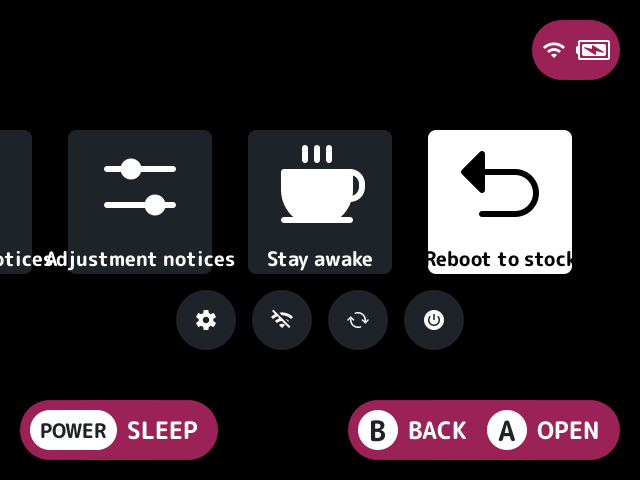
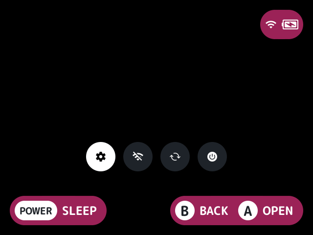
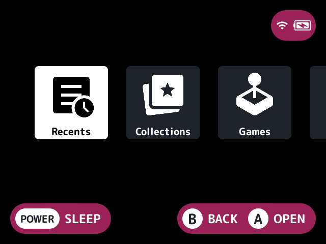
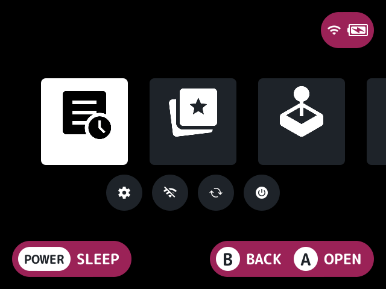
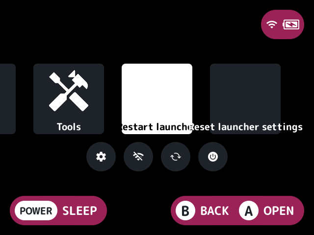
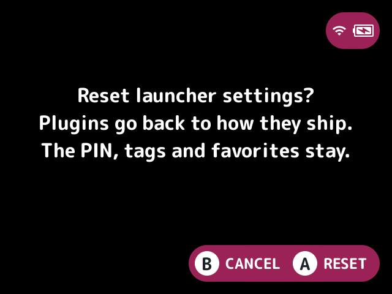

# quick-menu-plus

Changes the [quick menu](../../docs/glossary.md#quick-menu): renames or hides its tiles, rows and labels, and adds tiles that flip stock's settings or restart the launcher.

## Turn it on

Turn on **Quick menu plus** in Launcher > Plugins ([how](../../docs/plugins.md#turning-plugins-on-and-off)).

## What it does

- **Rename tiles:** the Tile labels setting renames the top row's built-in tiles with `name=label` pairs, such as `Recents=Played, Games=Library`.
- **Hide tiles:** the Hidden tiles setting hides tiles by name, such as `Pak Store, Bluetooth`, or a plugin tile by its action id, such as `random-game.tile`.
- **Toggle tiles:** the Toggle tiles setting picks which of stock NextUI's on/off settings get a tile that flips them, as stock's Settings app does. The choices are `save`, `load`, `screenshot` and `adjustments` (the in-game notifications, the default), `clock`, `battery` (the battery percentage) and `haptics`.
- **Stay awake tile:** holds off auto-sleep while it's on, until the device reboots or powers off.
- **Reboot to stock tile:** asks first, then turns the launcher off with `manage.sh turn-off` and reboots, so the device comes back on stock NextUI's launcher. Turn Launcher back on from Tools.

- **Hide rows and labels:** the Top row of tiles and Bottom row of icons settings hide a whole row, plugins' tiles in it too, and Labels on the top row's tiles hides the top tiles' names, leaving their icons. All show by default. The two rows can't both be hidden: with both off, the bottom row, with Settings, Sleep and Power off, stays. With the top row hidden the quick menu opens on the bottom row.
- **Restart launcher tile:** restarts the launcher at once, without asking, such as after changing a setting that applies at start. Off by default.
- **Reset launcher settings tile:** asks first, then puts every plugin's settings back to their defaults and restarts the launcher. Every plugin goes back to on or off as it ships, so this plugin is off afterwards. The PIN, tags, favorites, collections, play history and other things you made stay, and so do stock NextUI's own settings. In [simple mode](../simple-mode/README.md#kiosk-mode)'s kiosk mode it asks for the PIN first. Off by default.

All of these tiles go in the top row.

## Screenshots

The quick menu's new tiles, with the default settings.

Tile labels set to `Recents=Played, Games=Library`.

Hidden tiles set to `Collections`.

Top row of tiles off: only the bottom row shows, and the quick menu opens on it.

Bottom row of icons off.

Labels on the top row's tiles off: the tiles show only their icons.

The Restart launcher and Reset launcher settings tiles turned on, with Restart launcher selected.

Reset launcher settings asks first.

## Settings

| Setting | Choices | Default | What it does |
|---|---|---|---|
| Tile labels (`labels`) | text | empty | New labels for the top row's built-in tiles, as `name=label` pairs, such as `Recents=Played, Games=Library` |
| Hidden tiles (`hide`) | text | empty | Tiles to hide, by name or a plugin tile's action id, such as `Pak Store, Bluetooth` |
| Toggle tiles (`toggles`) | text | `save, load, screenshot, adjustments` | Stock settings with a toggle tile, from `save`, `load`, `screenshot`, `adjustments`, `clock`, `battery` and `haptics` |
| Stay awake tile on the quick menu (`awake_tile`) | on, off | on | A Stay awake tile that holds off auto-sleep while it's on |
| Reboot to stock tile on the quick menu (`stock_tile`) | on, off | on | A Reboot to stock tile that turns the launcher off and reboots into stock NextUI |
| Top row of tiles (`top_row`) | on, off | on | The quick menu's top row of large tiles; it and the bottom row can't both be off, so the bottom row stays |
| Bottom row of icons (`bottom_row`) | on, off | on | The quick menu's bottom row of small icons (Settings, Wifi, Sleep, Power off) |
| Labels on the top row's tiles (`tile_labels`) | on, off | on | The labels on the top row's tiles; off leaves only their icons |
| Restart launcher tile on the quick menu (`restart_tile`) | on, off | off | A Restart launcher tile that restarts the launcher at once |
| Reset launcher settings tile on the quick menu (`reset_tile`) | on, off | off | A Reset launcher settings tile that asks first, then resets `plugins.txt` and every plugin's settings to their defaults |

## For plugin authors

- Hides tiles by name or by a plugin tile's action id, and registers its own tiles.
- Calls `manage.sh turn-off` for Reboot to stock, registered with `MOSAIC_ACTION_EDITS`.
- Hides rows and labels with `hide_quick_row` and `hide_quick_labels`, and restarts with `restart`.
- Reset launcher settings calls `reset_settings`, registered with `MOSAIC_ACTION_EDITS` so kiosk mode asks for the PIN. After every plugin's `quit`, the launcher removes `.userdata/<platform>/launcher/plugins.txt` and, from each installed plugin's `<id>.cfg`, the keys its `plugin.txt` lists as settings, apart from `secret` ones such as API keys, removing a cfg left empty. It keeps `pin.txt`, the Launcher page's `settings.txt`, the keys plugins keep in their cfgs that aren't settings, cfgs of plugins that aren't installed, every plugin's other files (such as `tags.txt`, `status.txt`, favorites, collections and their order, and profiles), the card index, play data and stock's `minuisettings.txt`.

## Credits

Tile labels and hidden tiles are from Xisrith, quick toggles from nx-redux, Reboot to stock from hp7hao, and hidden rows, hidden labels, launcher restart and settings reset from Xisrith and Knulli.
