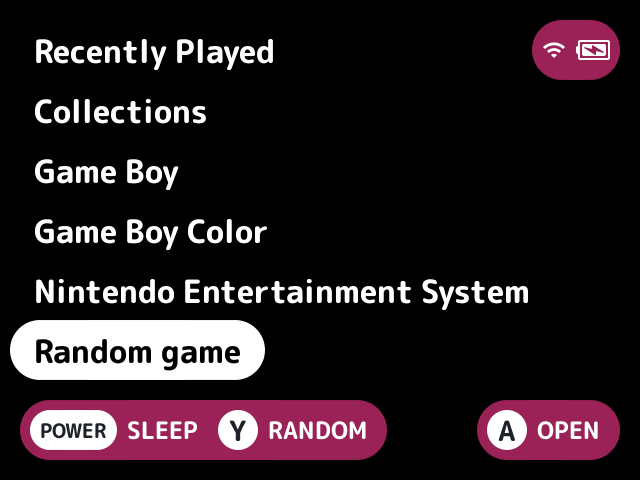
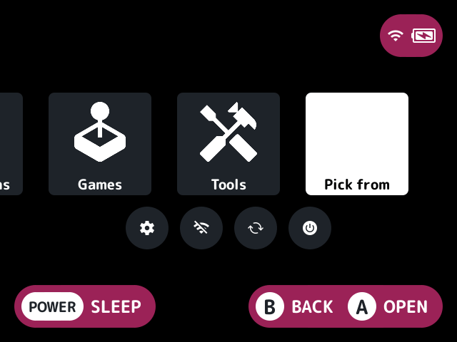
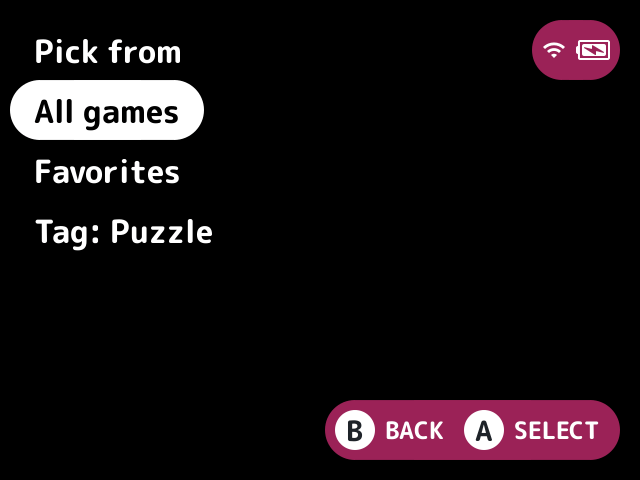

# random-game

Picks a game at random and launches it.

## Turn it on

Turn on **Random game** in Launcher > Plugins ([how](../../docs/plugins.md#turning-plugins-on-and-off)).

## How to use

- On the game list, press **Y** to pick from the system you're in, or from every system on the first screen.
- A Random game row on the first screen and a Random tile on the [quick menu](../../docs/glossary.md#quick-menu) pick from every system.

Every game is as likely as any other, so bigger systems come up more often. With Prefer unplayed games on (the default), games not in Recently Played are four times as likely. Games the [`hidden`](../hidden/README.md) plugin hides, or any other plugin's filter, are never picked.

### Picking from favorites, a tag or a collection

Every pick can come from one set of games instead of all of them: your [favorites](../favorites/README.md), a [tag](../tags/README.md) or a [smart collection](../smart-collections/README.md). Run Pick from, from the Pick from tile on the quick menu or the Pick from button (both off by default) or an [FN button](../../docs/glossary.md#fn-button) set to `action:random-game.from`, and choose All games or a set. Y in a system then picks from the set's games in that system. While the plugin a set comes from is off, there's nothing to pick from it.

## Screenshots

The Random game row on the first screen, with the default settings.

Random tile on the quick menu on.

Pick from tile on the quick menu on.

With favorites and tags: the Pick from list.

## Settings

| Setting | Choices | Default | What it does |
|---|---|---|---|
| Prefer unplayed games (`unplayed`) | on, off | on | Games not in Recently Played are four times as likely |
| Random game on the root (`root`) | on, off | on | A Random game row on the first screen that picks from every system |
| Random tile on the quick menu (`tile`) | on, off | off | A Random tile on the quick menu that picks from every system |
| Pick from (`from`) | text | all | The games every pick comes from: `all`, or a set's name, such as `favorites`, `tags:RPG` or `smart:Mario` |
| Pick from tile on the quick menu (`from_tile`) | on, off | off | A Pick from tile on the quick menu that lists All games and every set to pick from |
| Pick from button (`from_button`) | none, L2, R2, SELECT | none | A game list button that lists All games and every set to pick from |

## For plugin authors

- Registers the `random-game.pick` action, the `random-game.tile` quick menu tile and the `random-game.from` action, which the `from_tile` and `from_button` settings follow.
- Lists the sets with `set_names` and reads the one `from` names with `set_list`. A set nobody registered has no games.
- Skips what `is_filtered` says is hidden.

## Credits

casualducko and kUI.
