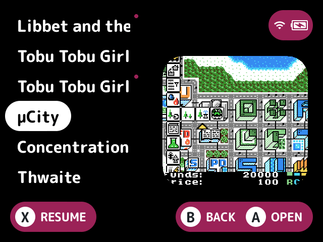
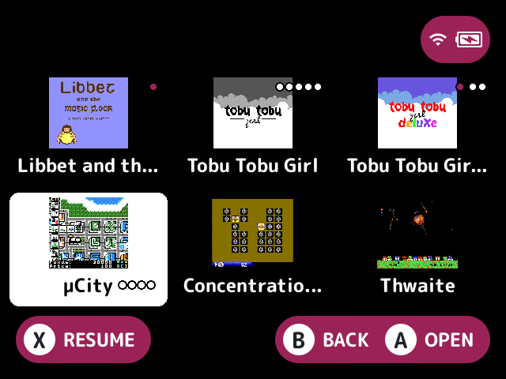

# row-badges

Adds small dots after a row's name: one for games you haven't played, and 1 to 5 dots for a tier.

The dots show on the built-in list and in a plugin layout's cells. When there's no room after the name, or the layout doesn't say where it is, the dot goes in the row's or cell's top right corner. Each dot has a thin ring in the theme's background colour, so it shows on a layout's selection or art.

## Turn it on

Turn on **Row badges** in Launcher > Plugins ([how](../../docs/plugins.md#turning-plugins-on-and-off)), then turn on the dots you want. Both are off by default.

## The dots

- **Unplayed dot:** a dot in the theme's accent colour on games that weren't played.
- **Tier dots:** 1 to 5 dots in the theme's list text colour, for the `tier=` value in a game's or system folder's `.info` sidecar (`<folder>/.media/<name>.info`, so `Roms/.media/Game Boy (GB).info` for a system). The value is a whole number from 1 to 5.

### What counts as played

A game counts as played when any of these is true:

- It's in recents.
- It has a save in `Saves/<tag>/`.
- It has a state in `.userdata/shared/<tag>-<core>/`.
- It has a resume slot, state name or preview in `.userdata/shared/.minui/<tag>/`, under the file name stock and minarch save them by default.
- It has a session in stock's [play tracker](../../docs/glossary.md#play-tracker).

A disc of a multi-disc game counts as played when its `.m3u` was. Folders, paks and anything outside `Roms/` get no unplayed dot.

These are read from the card at start, back from a game and each time the launcher builds a list, never while drawing.

## Screenshots

Unplayed dot on.

Tier dots on, with tiers in the games' .info files.

With layout-grid: both on.

## Settings

| Setting | Choices | Default | What it does |
|---|---|---|---|
| Unplayed dot (`unplayed`) | on, off | off | A dot on games that weren't played: not in recents, with no save, state or resume slot, and no session in the play history |
| Tier dots (`tiers`) | on, off | off | Dots for the `tier=` value, 1 to 5, in a game's or system's `.info` sidecar |

Both are `public` settings, so other plugins can read them with `cfg_read`.

## For plugin authors

- Provides the `games.played` service (`provides=games.played`), the one definition of played. Ask for a game or game folder's `path`, whether or not the dot is on. With the dot off, the card is read for it on the first call after the start, a game's return or a list being built instead (see [plugin-api.md](../../docs/plugin-api.md)).
- Draws through the row decorators.

## Credits

casualducko and LodorOS.
