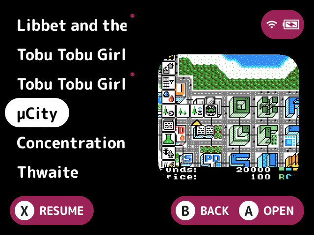
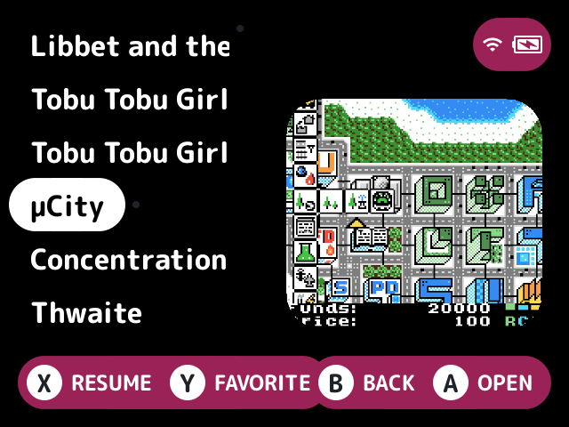
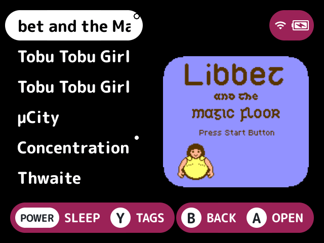
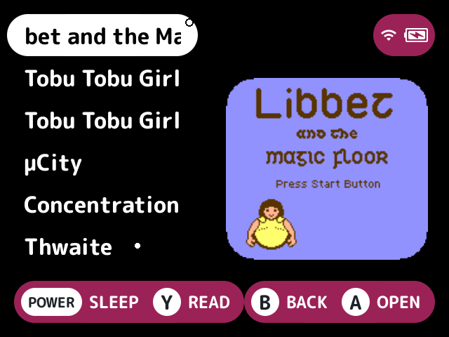
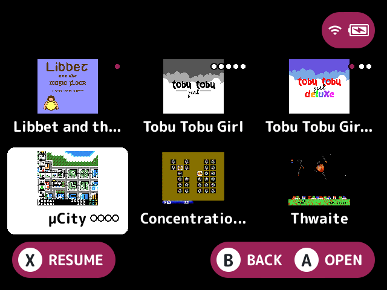
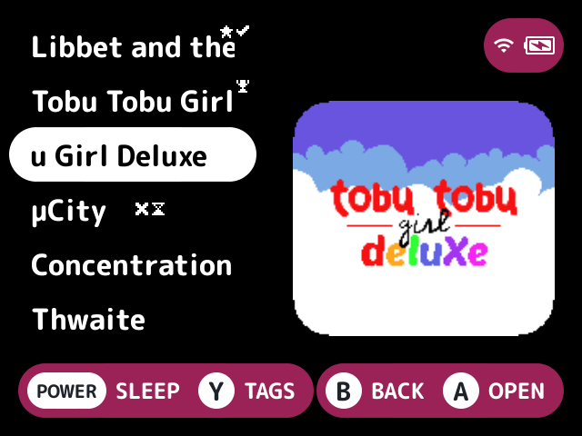

# row-badges

Adds small dots after a row's name: one for games you haven't played, one for your favorites, one for games with a tag, one for games with a manual, and 1 to 5 dots for a tier. It can also add small icons for a game's status from [`tags`](../tags/README.md) and a trophy for 100% of its achievements.

The dots show on the built-in list and in a plugin layout's cells. When there's no room after the name, or the layout doesn't say where it is, the dot goes in the row's or cell's top right corner. Each dot has a thin ring in the theme's background colour, so it shows on a layout's selection or art.

## Turn it on

Turn on **Row badges** in Launcher > Plugins ([how](../../docs/plugins.md#turning-plugins-on-and-off)), then turn on the dots and icons you want. They're all off by default.

## The dots

- **Unplayed dot:** a dot in the theme's accent colour on games that weren't played.
- **Favorite mark:** a dot in the theme's secondary accent colour on your [favorites](../favorites/README.md), while that plugin is on.
- **Tag mark:** a dot in the theme's hint colour on games with any [tag](../tags/README.md), while that plugin is on.
- **Manual mark:** a dot in the theme's main colour on games with a [manual](../manuals/README.md), while that plugin is on.
- **Tier dots:** 1 to 5 dots in the theme's list text colour, for the `tier=` value in a game's or system folder's `.info` sidecar (`<folder>/.media/<name>.info`, so `Roms/.media/Game Boy (GB).info` for a system). The value is a whole number from 1 to 5.

## The icons

The icons go after the dots and before the tier dots, in the theme's list text colour on a small square in its background colour.

- **Completed icon:** a star on games [tags](../tags/README.md#status)' Status menu marks Completed.
- **Beaten icon:** a tick on games marked Beaten.
- **Broken icon:** a cross on games marked Broken.
- **Backlog icon:** an hourglass on games marked Backlog.
- **100% achievements trophy:** a trophy on games with every RetroAchievement unlocked, in either mode, read from what minarch keeps on the card, as [`playtime-captions`](../playtime-captions/README.md) reads it. It shows once the launcher has worked out the game's hash, and only on games minarch has loaded with RetroAchievements on.

The status icons need the tags plugin on. The trophy's progress is read for each game in a folder when the launcher lists it, and again every half second for games whose hash isn't worked out yet, never while drawing. A card with no achievement sets cached gets nothing read.

### What counts as played

A game counts as played when any of these is true:

- It's in recents.
- It has a save in `Saves/<tag>/`.
- It has a state in `.userdata/shared/<tag>-<core>/`.
- It has a resume slot, state name or preview in `.userdata/shared/.minui/<tag>/`, under the file name stock and minarch save them by default.
- It has a session in stock's [play tracker](../../docs/glossary.md#play-tracker).

A disc of a multi-disc game counts as played when its `.m3u` was. Folders, paks and anything outside `Roms/` get no unplayed dot.

These are read from the card at start, back from a game and each time the launcher builds a list, never while drawing.

## Screenshots

Unplayed dot on.

Tier dots on, with tiers in the games' .info files.

Favorite mark on, with favorites: Libbet and µCity, favorites, are marked.

Tag mark on, with tags: Libbet and Concentration Room, tagged Puzzle, are marked.

Manual mark on, with manuals: Libbet and Thwaite, which have manuals, are marked.

With layout-grid: both on.

Every status icon and the trophy on, with statuses set in tags: Libbet is Beaten and Completed, µCity Broken and Backlog, and Tobu Tobu Girl has every achievement unlocked.

## Settings

| Setting | Choices | Default | What it does |
|---|---|---|---|
| Unplayed dot (`unplayed`) | on, off | off | A dot on games that weren't played: not in recents, with no save, state or resume slot, and no session in the play history |
| Tier dots (`tiers`) | on, off | off | Dots for the `tier=` value, 1 to 5, in a game's or system's `.info` sidecar |
| Favorite mark (`favorites`) | on, off | off | A dot on your favorites, from the favorites plugin |
| Tag mark (`tagged`) | on, off | off | A dot on games with any tag, from the tags plugin |
| Manual mark (`manual`) | on, off | off | A dot on games with a manual, from the manuals plugin |
| Completed icon (`completed`) | on, off | off | A star on games tags marks Completed, from its Status menu |
| Beaten icon (`beaten`) | on, off | off | A tick on games tags marks Beaten |
| Broken icon (`broken`) | on, off | off | A cross on games tags marks Broken |
| Backlog icon (`backlog`) | on, off | off | An hourglass on games tags marks Backlog |
| 100% achievements trophy (`perfect`) | on, off | off | A trophy on games with every RetroAchievement unlocked, from minarch's local progress |

The unplayed dot and tier dots are `public` settings, so other plugins can read them with `cfg_read`.

## For plugin authors

- Provides the `games.played` service (`provides=games.played`), the one definition of played. Ask for a game or game folder's `path`, whether or not the dot is on. With the dot off, the card is read for it on the first call after the start, a game's return or a list being built instead (see [plugin-api.md](../../docs/plugin-api.md)). [`search`](../search/README.md)'s `unplayed` filter, [`random-game`](../random-game/README.md) and [`gamification`](../gamification/README.md)'s never played quest ask it.
- Reads the `favorites` entry set, every `tags:<name>` set (from `set_names`), the `manual` set and tags' `tags.status.completed`, `tags.status.beaten`, `tags.status.broken` and `tags.status.backlog` sets for the marks while they're on, when a list is built, back from a game and on `launcher.set_changed` for one of them. A set nobody registered has nothing in it.
- Asks the host's `achievements` call about each game in a list as it's built, and from `tick` for the ones still unknown, while the trophy is on and `.userdata/shared/.ra/offline/cache/` has an `achievementsets_` or `patch_` file.
- Draws through the row decorators.

## Credits

casualducko and LodorOS.
