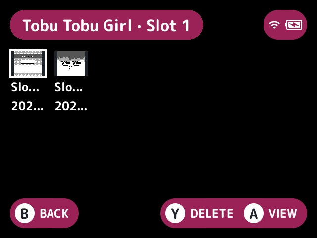
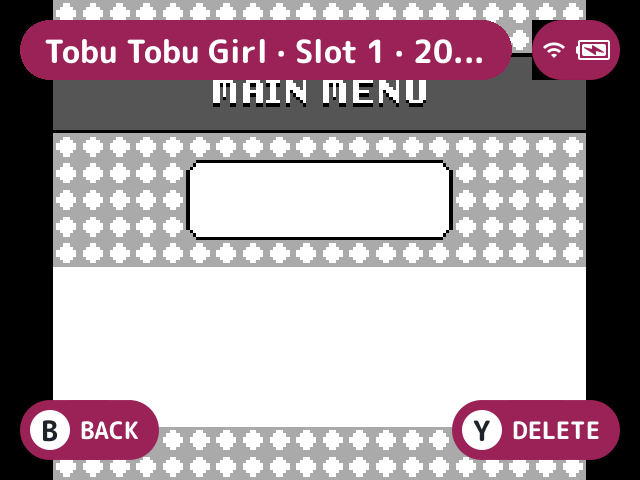
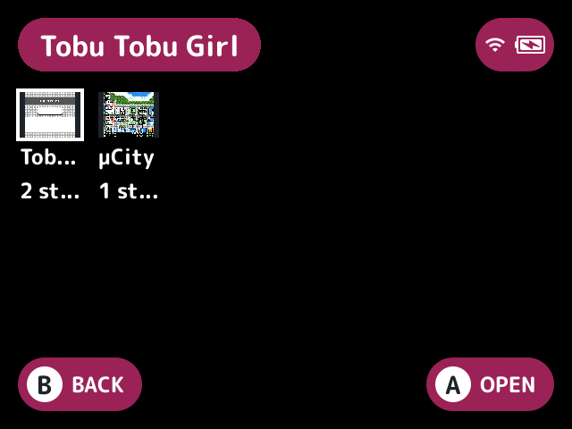

# save-state-manager

Browses, previews and deletes the [save states](../../docs/glossary.md#save-state) stock's [minarch](../../docs/glossary.md#minarch) keeps, on a screen of its own, so you can manage them without a Tools [pak](../../docs/glossary.md#pak).

## Turn it on

Turn on **Save state manager** in Launcher > Plugins ([how](../../docs/plugins.md#turning-plugins-on-and-off)).

## How to use

- On the game list, press **Y** (the Save states button setting picks another, or `none`) to open the selected game's states, while it has one. It shares a menu with other plugins' actions there. The `save-state-manager.game` action opens it too.
- A Save states tile on the [quick menu](../../docs/glossary.md#quick-menu) opens every game with states, the most recently saved first, through the `save-state-manager.open` action.

A game's states are a grid in slot order, each with its preview, name and time. Names are Slot 1 to 8, Default for MinUI's default state, and Auto for the one saved on sleep.

| Button | What it does |
|---|---|
| **A** | Shows the preview across the screen, where left and right step through the slots |
| **B** | Goes back |
| **Y** | Deletes the selected state after a confirm (Delete with Y) |

### What delete removes

- Its state files in every `.userdata/shared/<tag>-<core>` folder.
- Its preview and disc files in `.userdata/shared/.minui/<tag>`.
- The last-slot file, only when it names that slot, so the launcher stops offering to resume it.

Only regular files in real folders are deleted, and links are never followed. The `.srm` state formats' names, which drop the game's extension, are left alone when another game in the system has the same name less its extension.

Resuming from a chosen slot is left out: the launcher only resumes from the slot minarch last used, and the plugin doesn't write minarch's files to change it.

Previews are scaled copies kept in two small pools, the least recently drawn going first, and freed when the screen closes.

## Screenshots

Tobu Tobu Girl's states, with the default settings.

A state's preview across the screen.

Every game with states, from the quick menu tile.

## Settings

| Setting | Choices | Default | What it does |
|---|---|---|---|
| Quick menu tile (`tile`) | on, off | on | A Save states tile on the quick menu listing every game with states, shown while there are any |
| Save states button (`button`) | none, Y, L2, R2, SELECT | Y | The game list button that opens the selected game's states, shared with other plugins' actions on it |
| Delete with Y (`delete`) | on, off | on | **Y** deletes the selected state, after a confirm |

## For plugin authors

- Provides the `states.last` service (`provides=states.last`): ask for a game or game folder's `path` and get a game's most recently saved state as the slot, its label, when it was saved and its preview (see [plugin-api.md](../../docs/plugin-api.md)).
- Registers the actions `save-state-manager.game` and `save-state-manager.open`; `button` follows `save-state-manager.game`.
- Reads and deletes files in `.userdata/shared/<tag>-<core>` and `.userdata/shared/.minui/<tag>`.

## Credits

MaxUI.
