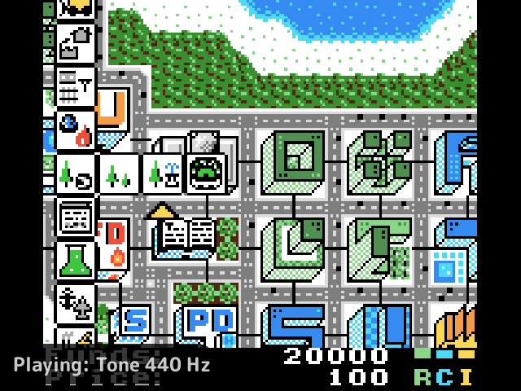
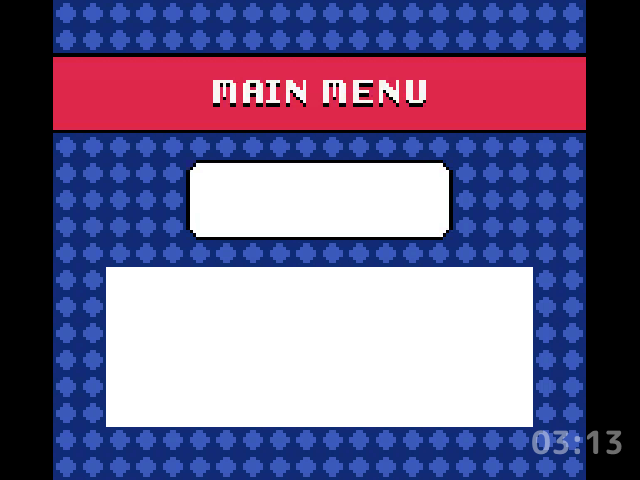

# screensaver

Cycles through images on a full screen once the game list or the home screen has been left alone.

## Turn it on

Turn on **Screensaver** in Launcher > Plugins ([how](../../docs/plugins.md#turning-plugins-on-and-off)). It shows after the Show after idle time (30 seconds by default, so it shows before stock's screen timeout, 60 seconds by default, turns the screen off).

## What it shows

The Images setting picks the source:

| Source | Images |
|---|---|
| `games` (the default) | The art of the recently played games and, while the [`favorites`](../favorites/README.md) plugin is loaded, the favorites, as box art (else the thumbnail) or screenshots by the Game art setting |
| `screenshots` | The card's `Screenshots` folder |
| `folder` | The images in the Image folder setting's folder on the card (`Screensaver` by default) |
| `videos` | The games' art, as `games` has it, with each game's clip played in its place while the [`video-previews`](../video-previews/README.md) plugin is on: a game with a clip in its folder's `.videos` folder plays it full screen until the next image, and a game without one shows its art. With video-previews off it's the `games` source |

PNG, JPEG and BMP files are shown in name order, fitted to the screen on black, up to 256 of them. Each shows for the Seconds per image setting (10 by default) and then changes to the next with a slow cross-fade or, with the Change setting, a slide. It starts after the image it last showed. The Clock setting puts a dim clock in the bottom right corner.

While the [`music`](../music/README.md) plugin has a track, what it plays shows dim in the bottom left corner, as "Playing: <title> - <artist>" or "Paused: ...".

## How it behaves

- It's one of the launcher's ambient screens: the launcher opens it after the idle time over the game list or the home [slot](../../docs/glossary.md#slot)'s screen, not over the quick menu, the game switcher or other plugins' screens. The Ambient screens page on the Launcher page sets which ambient screen comes first; by default the lock and then the [`charging-screen`](../charging-screen/README.md) plugin's screen come before it, so while the device charges the charging screen takes over from it once its own idle time has passed.
- Any button closes it, back to where it opened, and is taken until it's let go, so that press doesn't also act on the screen under it.
- While the music plugin has a track, **X** plays or pauses it without closing the screensaver. With music off or nothing to play, X closes it as any button does.
- With the `videos` source and Sound on in video-previews, music pauses while a clip plays, and plays on when the screensaver moves on to an image without a clip or closes, if it was playing before.
- The power button still sleeps the device, and waking closes the screen.
- It never holds off sleep: stock counts its screen timeout from the last button press, not from redraws, so the screen still turns off and the device sleeps on time while it shows. With a screen timeout shorter than the idle time it never shows.
- While the device charges, stock never turns the screen off, so it keeps cycling until a button is pressed.
- It holds at most two scaled images, the one showing and the next, and frees them when it closes, and redraws every frame only while an image changes.

## Screenshots

µCity's art, with Show after idle set to 15 seconds and the other settings at their defaults.

Clock set to 24h.

With the music plugin playing a track.

The videos source with video-previews, playing µCity's clip (made from Tobu Tobu Girl Deluxe's screenshot), with Clock set to 24h.

## Settings

| Setting | Choices | Default | What it does |
|---|---|---|---|
| Show after idle, in seconds (`idle`) | off, 15, 30, 45, 60, 120, 300, 600 | 30 | How long the game list or home is left alone before the screensaver shows |
| Images (`source`) | games, screenshots, folder, videos | games | Where the images come from |
| Game art (`art`) | box, screenshot | box | Which of the games' art: box art (else the thumbnail) or screenshots |
| Image folder (`folder`) | text | Screensaver | A folder on the card, for the folder source |
| Seconds per image (`interval`) | 5, 10, 20, 30, 60, 120 | 10 | How long each image shows |
| Change (`effect`) | fade, slide | fade | How one image changes to the next |
| Clock (`clock`) | off, 24h, 12h | off | A dim clock in the bottom right corner |

## For plugin authors

- Its screen, `screensaver.main`, is an ambient screen: it lists it in `ambient=` and registers it with `register_ambient`, and its `wants` says yes once the launcher's idle time reaches the Show after idle setting.
- Lists `favorites` as `optional`, so it loads after it, since it asks about it as it starts. The favorites are the `favorites` entry set, read with `set_list`.
- Reads what music plays with music's `music.now` service and plays or pauses it with `music.toggle`, about once a second while it shows.
- For the `videos` source, calls video-previews' `video.play` with each image's game, which opens video-previews' own screen over this one for a game with a clip.
- Leaves out games `is_filtered` says a plugin's filter hides, such as the [`hidden`](../hidden/README.md) plugin's.
- Reads the card's art, `Screenshots/` and its image folder.

## Credits

msigl.
