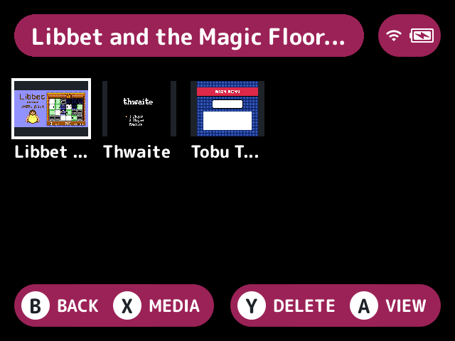
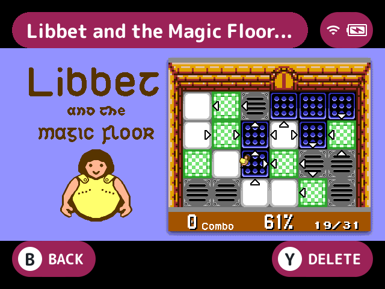
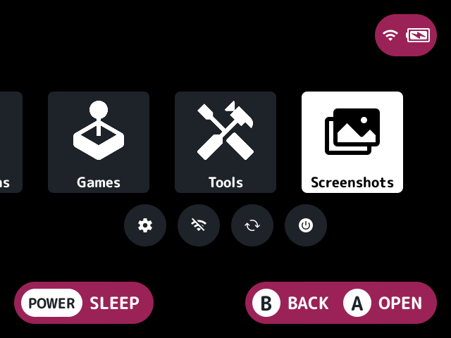

# screenshot-viewer

Browses the screenshots stock saves in a game, newest first, on a screen of its own, so you can look at them without a Tools [pak](../../docs/glossary.md#pak). It also shows a game's media: every image it has and its clip, one at a time.

The screenshots are `Screenshots/<game>.<YYYY-MM-DD-HH-MM-SS>.png` on the card.

## Turn it on

Turn on **Screenshot viewer** in Launcher > Plugins ([how](../../docs/plugins.md#turning-plugins-on-and-off)).

## How to use

Open it from a Screenshots tile on the [quick menu](../../docs/glossary.md#quick-menu), which shows while there are screenshots, or from a game list button if you set one. The `screenshot-viewer.open` action opens it too, and [`button-remap`](../button-remap/README.md) or an [FN button](../../docs/glossary.md#fn-button) set to `action:screenshot-viewer.open` can.

It starts on a grid of thumbnails with each game's name under it. The selected one's game and date, from the file name, show on a pill in the top left. Files named another way show their name, and sort by when they were changed.

| Button | What it does |
|---|---|
| D-pad | Moves through the grid |
| **A** | Shows the selected screenshot across the screen, where left and right step to the next and previous |
| **B** | Goes back |
| **X** | Shows the selected screenshot's game's media (see below) |
| **Y** | Deletes the selected screenshot after a confirm (Delete with Y), removing only that file |

Only regular files directly in the folder are listed or deleted, and links are never followed. Thumbnails and full views are scaled copies kept in two small pools, the least recently drawn going first, and freed when the screen closes.

### A game's media

Press **Y** on a game in the game list to see its media, or the Media button if you set one. **Y** is shared with other plugins' actions there, so with [`game-actions`](../game-actions/README.md) or [`manuals`](../manuals/README.md) on, **Y** opens a menu of them all, with Media in it. **X** on a screenshot in the grid opens the media of the game it's from, found by the name the screenshot has; when no game has that name, it shows that name's screenshots alone.

Each one shows across the screen with its number and the file it is, such as `2/9 · .media/boxart/Tetris (USA).png`, on the pill in the top left. **Left** and **right** step to the previous and next, wrapping round at the ends, and **B** goes back.

A game's media, in the order it's shown, where `<name>` is its file name without its extension, as stock names its `.media` thumbnail:

1. Stock's thumbnail, `.media/<name>.png`.
2. nx-redux's art: `.media/boxart/`, `.media/boxart2d/`, `.media/mix/`, `.media/screenshot/` and `.media/wheel/`, each `<name>.png`, `.jpg` and `.jpeg`.
3. MyMinUI's `Imgs/<name>.png`.
4. Its screenshots in `Screenshots/`, newest first: the ones named after the game as the list shows it, as stock names them.
5. Its clip, `.videos/<name>.mp4`, while [`video-previews`](../video-previews/README.md) is on. It plays full screen, looping, with its file shown for a moment at the bottom, and **A** plays it again when it couldn't play. With video-previews off, or without ffmpeg, the clip is skipped.

The folders are the ones beside the game. Only regular files are shown, and links, to a file or a folder, are never followed.

### Taking a screenshot

The `screenshot-viewer.capture` action saves what's on screen as `Screenshots/Launcher.<YYYY-MM-DD-HH-MM-SS>.png`, with stock's notification when its screenshot notification setting is on. Run from a menu or dialog, it saves what was on screen before the menu opened. It binds no button itself: put it on an FN button in Settings (`action:screenshot-viewer.capture`) or on another button through `button-remap`.

## Screenshots

The grid, with the default settings.

A screenshot across the screen.

The Screenshots tile on the quick menu (on by default).

## Settings

| Setting | Choices | Default | What it does |
|---|---|---|---|
| Quick menu tile (`tile`) | on, off | on | A Screenshots tile on the quick menu, shown while there are screenshots |
| Screenshots button (`button`) | none, Y, L2, R2, SELECT | none | A game list button that opens the screenshots |
| Delete with Y (`delete`) | on, off | on | **Y** deletes the selected screenshot, after a confirm |
| Media button (`media_button`) | none, L2, R2, SELECT | none | A second game list button for a game's media, besides **Y** |

## For plugin authors

- Registers the actions `screenshot-viewer.open`, `screenshot-viewer.capture` and `screenshot-viewer.media`; `button` follows `screenshot-viewer.open`, and `media_button` follows `screenshot-viewer.media`, which takes the game's path and is bound to **Y** on the game list too. Registers a quick menu tile, and the screens `screenshot-viewer.main` and `screenshot-viewer.media-view`.
- `screenshot-viewer.capture` uses the launcher's `save_screenshot`.
- Reads and deletes files in `Screenshots/`, and writes `Launcher.<date>.png` there. Reads the media files listed above beside a game.
- Finds a game's name, and a screenshot's game, with the card index (`index_find`, `index_entry`), and tidies the file name as stock does without it.
- Plays a game's clip with `video-previews`' `video.play` service (`path=<game>`, `clock=off`), on that plugin's own screen over the media screen, and closes it by calling `video.play` without a game. While it shows, its `input_filter` takes **left**, **right** and **B**, which that screen doesn't take. It doesn't list `video-previews` in `requires` or `optional`: without it, or without ffmpeg (`video.play` doesn't answer), clips are left out.

## Credits

MaxUI.
