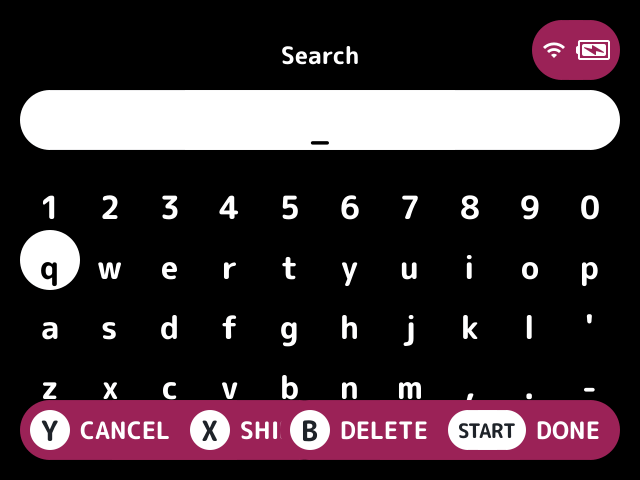
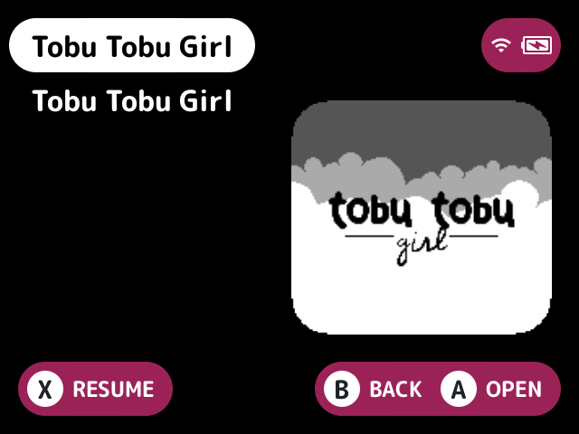

# search

Finds games from every system by typing part of a name.

## Turn it on

Turn on **Search** in Launcher > Plugins ([how](../../docs/plugins.md#turning-plugins-on-and-off)).

## How to use

- Open the Search row on the first screen (the Search on the root setting). It asks for the query on the on-screen keyboard, and cancelling backs out of the folder again.
- Or run the `search.open` action from anywhere on the game list. It asks for the query and opens the results. The Search button setting puts it on a button, and [`button-remap`](../button-remap/README.md) or an [FN button](../../docs/glossary.md#fn-button) set to `action:search.open` can too.
- With Remember recent searches on, the last 8 queries are offered before the keyboard, after New search.

A game matches when every word of the query is in the name the game list shows for it (`map.txt` names included), in any order, with case, accents and punctuation left out. So "pokemon" finds "Pokémon Red" and "links" finds "Link's Awakening".

The best matches come first, each by name:

1. The name itself.
2. Names starting with the query.
3. Names in which each word starts a word.
4. The rest.

Games are found as stock lists them, in every system with an emulator and up to three folders deep, with a folder holding a `.cue` or `.m3u` named after itself as one game. Games the [`hidden`](../hidden/README.md) plugin hides are left out.

The card is scanned the first time a search needs it, and again only when a folder it read changes. The query is kept, so the folder lists the same results after the launcher restarts, and back from a game launched from them the results open again with it selected.

## Screenshots

Opening Search on the first screen, with the default settings.

Results for "tobu".

## Settings

| Setting | Choices | Default | What it does |
|---|---|---|---|
| Search on the root (`root`) | on, off | on | A Search row on the first screen that asks for a query when it's opened |
| Search button (`button`) | none, Y, L2, R2, SELECT | none | A game list button that asks for a query from anywhere |
| Remember recent searches (`recents`) | on, off | on | Recent queries are offered before the keyboard |

## For plugin authors

- Registers the `search.open` action, which the `button` setting follows, and adds a root folder.
- Keeps the query in `.userdata/<platform>/launcher/search.cfg`.
- Reads the `hidden` entry set.

## Credits

nx-redux and LodorOS.
