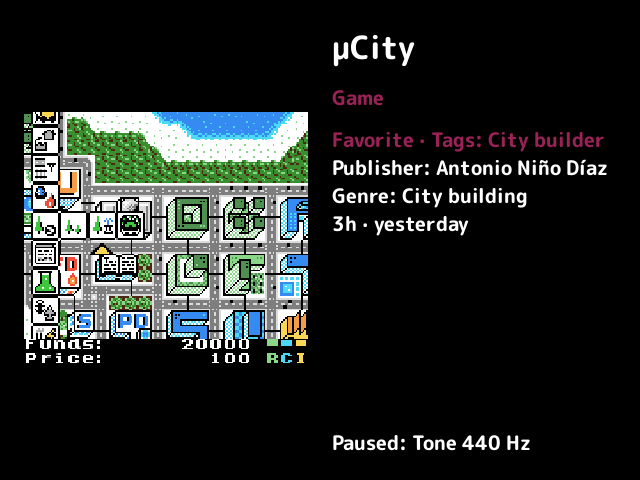
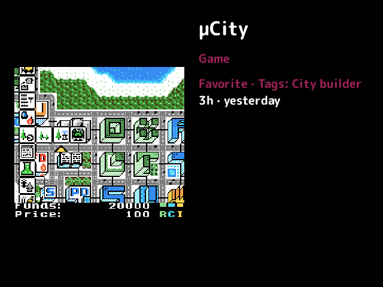
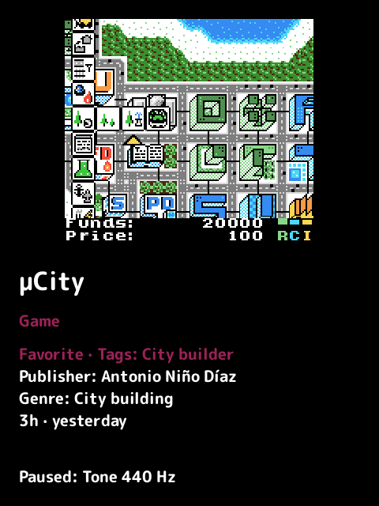

# second-screen

Shows the game list's selection in a second window. It's experimental, and desktop only.

No NextUI device has a second display. On tg5040, tg5050 and h700 it declines to start and logs why, and its name on the Plugins page says "(experimental, desktop only)".

## Turn it on

Turn on **Second screen** in Launcher > Plugins on the desktop build ([how](../../docs/plugins.md#turning-plugins-on-and-off)).

## What it shows

Each time the selection settles, the second window shows:

- The entry's name, wrapped onto up to three lines.
- Its thumbnail or, without one, its box art.
- Whether it's a game, folder or [pak](../../docs/glossary.md#pak).
- "Favorite" when it's one of your favorites, from [`favorites`](../favorites/README.md), and its tags, from [`tags`](../tags/README.md).
- The fields [`metadata-band`](../metadata-band/README.md) shows under a game's art, such as its year, publisher and genre, from its `.info` sidecar, each on a line of its own and tidied the same way.
- The play time caption [`playtime-captions`](../playtime-captions/README.md) shows on a game's row.
- At the bottom, what [`music`](../music/README.md) plays, while it has a track.
- "Empty folder" for an empty folder.

The marks, the details, the caption and what music plays each show only while the plugin they come from is on, and each has a setting to turn it off. What music plays is looked at once a second, and a change to the favorites or tags shows straight away.

In a window at least 4:3 wide the art is a square on the left with the text beside it. In a narrower one the art is on top and the text under it.

Closing the second window stops it until the launcher restarts, and it closes when the launcher quits.

## Screenshots

The second window with µCity selected, with metadata-band, playtime-captions, favorites, tags and music on: µCity is a favorite tagged "City builder", and music has a track paused.

Game details and Now playing turned off.

Window size set to `480x640`: the art on top and the text under it.

## Settings

| Setting | Choices | Default | What it does |
|---|---|---|---|
| Window size (`size`) | 480x320, 640x480, 800x480, 480x640 | 640x480 | The second window's size, width by height |
| Game details (`details`) | on, off | on | The fields metadata-band shows under a game's art, from its `.info` sidecar |
| Play time caption (`caption`) | on, off | on | The play time caption playtime-captions shows on a game's row |
| Favorite and tag marks (`marks`) | on, off | on | Whether a game is a favorite, from the favorites plugin, and its tags, from the tags plugin |
| Now playing (`music`) | on, off | on | What the music plugin plays, at the bottom |

## For plugin authors

- The window is a separate program, `second-screen-display`, which the plugin starts from beside its `plugin.so` and which needs SDL2. It's built only for desktop, and without it the plugin declines to start (see "Helper programs" in [plugin-api.md](../../docs/plugin-api.md)).
- The launcher's own window, input and frames are left as they are: the plugin draws each frame on a surface of its own in the launcher's fonts and theme, reads it back a few rows a frame, and hands it over in a file under `/tmp`.
- The window's program logs to `.userdata/desktop/logs/second-screen.txt`.
- The panel asks the other plugins on the launcher's thread, as the plugin API requires, and draws their answers into the frame, so the window's program only gets pixels: `info.format` from metadata-band with the game's `path`, `captions.text` from playtime-captions with its `path` and the text column's `width`, the `favorites` and `tags:<name>` entry sets through `set_has` and `set_names`, and `music.now`'s `line` from music. It asks when the selection changes, again for the marks on `launcher.set_changed` for those sets, and for music once a second. A service nobody provides, or a set nobody registered, leaves its piece out, so none of those plugins is required.
- With `MOSAIC_SECOND_SCREEN_SHOT` set to a folder, the window's program saves each frame it shows there as `frame-<n>.bmp`, read back from its window. The desktop tests and `make screenshots` use it (see "Screenshots" in [DEVELOPMENT.md](../../docs/DEVELOPMENT.md)).

## Credits

tapionallanaire.
