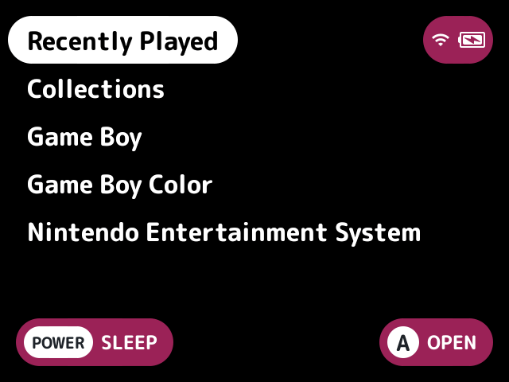
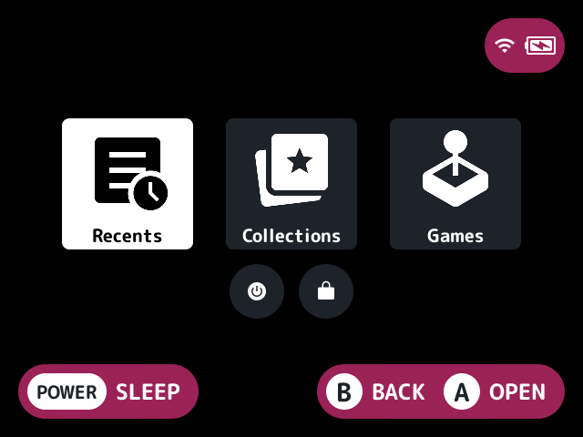
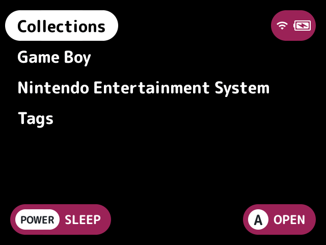
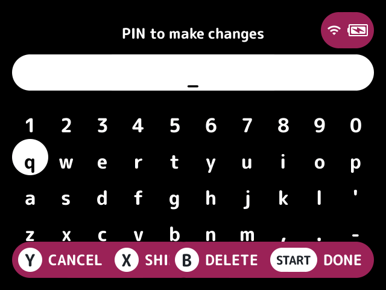

# simple-mode

A simple mode for kids or a shared device: it hides Tools and the settings, so nothing gets changed by accident.

## What it does

While it's on:

- The Tools folder is gone from every list (the first screen, Recently Played and collections).
- Tools [paks](../../docs/glossary.md#pak) don't launch from the game switcher or an [FN button](../../docs/glossary.md#fn-button).
- The [quick menu](../../docs/glossary.md#quick-menu) drops its Tools and Pak Store tiles, plus Settings, Wifi, Bluetooth and Reboot with Hide settings tiles on (the default).

It's separate from stock NextUI's own simple mode file, which it never touches.

Two more parts, each with its own setting, only apply while simple mode is on, so the one Simple mode tile and its PIN turn everything on and off together.

### Kid tag

With **Kid tag** set to the name of a [tag](../tags/README.md), every list shows only the games with that tag:

- Systems and folders without one are hidden.
- Recently Played and collections show only those games, and are hidden when they have none.
- A game without the tag doesn't launch from the game switcher either.
- Tools paks stay hidden, as above.

The name matches the tag's, ignoring case. Leave it empty to turn this part off. With `tags` off, or no tag by that name, no games show at all.

### Kiosk mode

With **Kiosk mode** on, actions that change things ask for the launcher's PIN first: tags, status flags, favorites, hide, rename, delete, sort, collections and the others listed below. Ones that only show things, such as manuals, media and system info, still work. This covers the game list's buttons, the menu of a shared button, quick menu tiles, [FN buttons](../../docs/glossary.md#fn-button) and [`button-remap`](../button-remap/README.md).

With no PIN set, those actions are refused, with a message saying to set one, since a confirm alone wouldn't keep anyone out.

The bundled actions that ask: `tags.edit`, `tags.status`, `favorites.toggle`, `hidden.hide`, `hidden.unhide`, `game-actions.rename`, `game-actions.collect`, `game-actions.delete`, `sort-modes.next`, `sort-modes.pick`, `filter-presets.prev`, `filter-presets.next`, `filter-presets.pick`, `focus-mode.toggle`, `focus-mode.pick`, `clear-recents.remove`, `clear-recents.clear`, `clear-recents.tile`, `smart-collections.dismiss`, `smart-collections.restore`, `smart-collections.save_tag`, `multi-disc.combine`, `emulator-override.choose`, `localization.map`, `guest-profile.clear`, `first-run.open`, `theme-plus.pick`, `sync.open`, `quick-menu-plus.stock` (Reboot to stock) and each of `tasks`' game tasks. Deletes inside plugin screens ask too, before their confirm: `screenshot-viewer.delete` and `save-state-manager.delete`.

## Turn it on

Turn on **Simple mode** in Launcher > Plugins ([how](../../docs/plugins.md#turning-plugins-on-and-off)).

## Leaving simple mode

A Simple mode tile on the quick menu turns it on, and off again after a confirm, or after typing the launcher's PIN when one is set (the PIN row on the Plugins page; see [the PIN](../../docs/plugin-api.md#the-pin)). The launcher keeps the PIN and checks it; the plugin never sees it.

A forgotten PIN is cleared by deleting `.userdata/<platform>/launcher/pin.txt` on a computer. Simple mode can also be left by setting `on=off` in `simple-mode.cfg` or `simple-mode=off` in `plugins.txt`.

## Screenshots

The first screen without Tools, with the default settings.

The quick menu without Tools and the settings tiles.

With the kid tag Puzzle: the first screen with only the collections and systems that have a Puzzle game.

With kiosk mode on and a PIN set: Y on a game asks for the PIN before its tags.

## Settings

| Setting | Choices | Default | What it does |
|---|---|---|---|
| Simple mode on (`on`) | on, off | on | Hides Tools and its tiles. The Simple mode tile on the quick menu turns it off, after the launcher's PIN when one is set |
| Hide settings tiles (`settings`) | on, off | on | Also hides Settings, Wifi, Bluetooth and Reboot |
| Kid tag (`kid`) | text | empty | While simple mode is on, every list shows only the games with this tag. Empty for off. Asks for the PIN to change |
| Kiosk mode (`kiosk`) | on, off | off | While simple mode is on, actions that change things ask for the launcher's PIN first, and are refused with no PIN set. Asks for the PIN to change |

## For plugin authors

- Hides quick menu tiles with `hide_quick_tile`, and asks the launcher to check the PIN with `ask_pin`; the plugin never sees the PIN.
- Writes `on` to its own `simple-mode.cfg`.
- Reads the kid tag's games from the `tags:<name>` entry set with `set_list`, again on `launcher.set_changed` for a tag and after a game, and reads the `.txt` files in `Collections/` and the recents to decide on Recently Played and collections.
- Answers `action_gate` for every action: while simple mode and kiosk mode are on, `MOSAIC_GATE_PIN` for an action registered with `MOSAIC_ACTION_EDITS`, or `MOSAIC_GATE_REFUSE` with no PIN set. A plugin whose action changes things registers it with `MOSAIC_ACTION_EDITS` so kiosk mode covers it, and one that changes things on a screen of its own asks `gate_edit` first, which the launcher answers through the same `action_gate`.

## Credits

Xisrith, MinUI-Zero, nx-redux (PIN), kUI and Nocturne.
