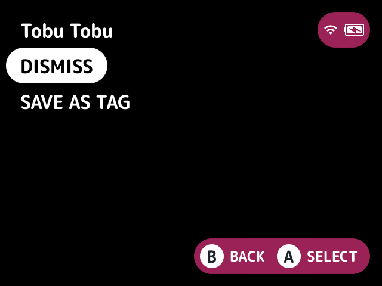

# smart-collections

Sorts your games into franchise collections, such as Mario, Zelda and Sonic, without you building any lists.

## What it does

A Smart Collections folder on the first screen has one [collection](../../docs/glossary.md#collection) per franchise, matched by game name across every system.

## Turn it on

Turn on **Smart Collections** in Launcher > Plugins ([how](../../docs/plugins.md#turning-plugins-on-and-off)).

## How to use

| Where | Button | What it does |
|---|---|---|
| On a collection | **Y** | Dismisses it. With [`tags`](../tags/README.md) on, Y opens a menu of Dismiss and Save as tag |
| On the Smart Collections folder | **Y** | Brings dismissed ones back |

Save as tag asks for a tag name on the keyboard, starting with the collection's, and puts that new tag on every game the collection has now. It's a copy made once: the tag doesn't follow the collection afterwards, so games added to the card later aren't tagged, and the tag stays when the collection is dismissed.

## Screenshots

More franchises set to `Tobu Tobu`: a collection of the two Tobu Tobu Girl games.

With tags: Y on a collection opens Dismiss and Save as tag.

## Settings

| Setting | Choices | Default | What it does |
|---|---|---|---|
| Built-in franchises (`builtin`) | on, off | on | The franchises that ship with the plugin, such as Mario, Zelda and Sonic |
| More franchises (`extra`) | text | empty | More franchises, comma-separated, such as `Kirby, Bomberman` |
| Smallest collection (`min`) | 1, 2, 3, 5, 10 | 2 | The fewest games a franchise needs to become a collection |

## For plugin authors

- Provides the `smart:<name>` entry sets (`provides=sets.smart`), one per franchise, holding the games its collection lists, and none while it has too few games or is dismissed. They're announced as changed (`launcher.set_changed`) as a franchise is dismissed or brought back.
- Registers the `smart-collections.dismiss`, `smart-collections.restore` and `smart-collections.save_tag` actions, all on Y. Save as tag shows only while a plugin offers the `tags.copy` service, which it calls with `tag=<name>` and `set=smart:<name>`.
- Adds a root folder.

## Credits

kUI.
