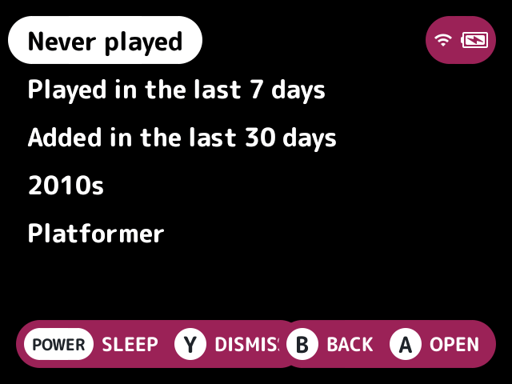
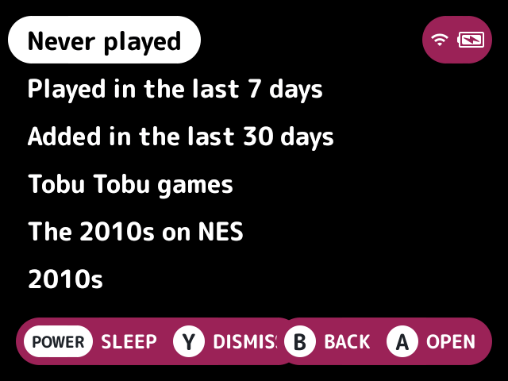
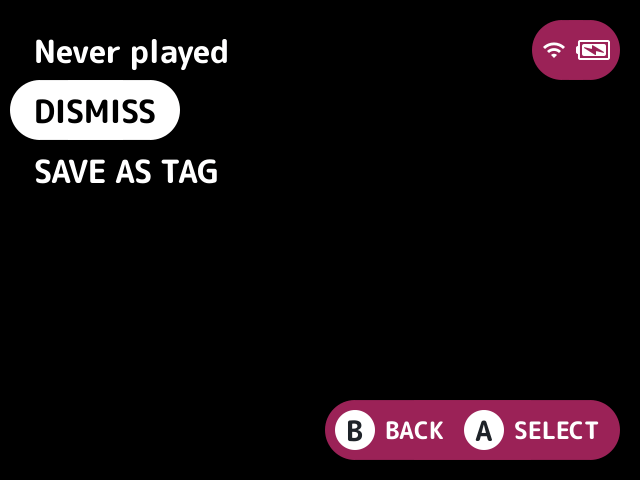

# smart-collections

Sorts your games into collections without you building any lists: franchises such as Mario and Zelda, games never or recently played, genres, decades and rules of your own.

## What it does

A Smart Collections folder on the first screen has [collections](../../docs/glossary.md#collection) that fill themselves, across every system:

- **Never played**: games you haven't played.
- **Played in the last 7 days**: games you played lately.
- **Over 10 hours**: games you've played for more than 10 hours in all.
- **Added in the last 30 days**: games put on the card lately.
- **Your own rules**, from a `rules.txt` file (see below).
- **One per decade**, such as **1990s**, and **one per genre**, such as **Platform**, from the year and genre in each game's `.info` file.
- **One per franchise**, such as Mario, Zelda and Sonic, matched by game name.

They come in that order, the franchises by name. The number of days and hours is a setting, and each kind can be turned off. A collection shows once it has at least the Smallest collection setting's number of games (2 at first), so an empty one never shows.

The collections keep up with you: they're worked out again when you come back from a game, after switching [profiles](../guest-profile/README.md), when your favorites or tags change while one of your rules uses them, and when the games on the card change.

## Turn it on

Turn on **Smart Collections** in Launcher > Plugins ([how](../../docs/plugins.md#turning-plugins-on-and-off)).

## How to use

| Where | Button | What it does |
|---|---|---|
| On a collection | **Y** | Dismisses it. With [`tags`](../tags/README.md) on, Y opens a menu of Dismiss and Save as tag |
| On the Smart Collections folder | **Y** | Brings dismissed ones back |

Save as tag asks for a tag name on the keyboard, starting with the collection's, and puts that new tag on every game the collection has now. It's a copy made once: the tag doesn't follow the collection afterwards, so games added to the card later aren't tagged, and the tag stays when the collection is dismissed.

## Your own rules

Write your own collections in `.userdata/<platform>/launcher/smart-collections/rules.txt` on the card, one a line: the collection's name, `=`, and a [search](../search/README.md) query. A game is in the collection when the query finds it, as Search would. For example:

```
# lines starting with # are notes
RPGs I haven't played = genre:rpg unplayed
Nineties Game Boy = decade:90s system:gb
Favorites to finish = fav: -tag:beaten
Played this month = played:30
Long Zelda sessions = zelda hours:5
```

A query has words a game's name has to have, filters, or both. Each filter can be turned around by a leading `-`:

| Filter | Finds |
|---|---|
| `fav:` | Your [favorites](../favorites/README.md) |
| `tag:<name>` | Games with that [tag](../tags/README.md) |
| `unplayed` | Games you haven't played |
| `system:<name>` | Games in a system, such as `system:gb` |
| `genre:<name>` | Games of that genre, such as `genre:rpg` |
| `year:<year>` | Games from that year, or a range such as `year:1990-1994` |
| `decade:<decade>` | Games from that decade, such as `decade:90s` |
| `played:<days>` | Games last played in that many days |
| `hours:<hours>` | Games played for more than that many hours in all |
| `added:<days>` | Games put on the card in that many days |

[Search's page](../search/README.md) says more about each one. A collection's name can't start with `.`, have a `/` or `,` in it, or be a name another collection has, and it shows in the folder as you wrote it. A line the plugin can't use, such as one without an `=` or with a filter written wrong (`played:soon`), is left out, and the launcher's log says which line and why. The file is read again each time the collections are worked out, so a change shows the next time you come back from a game or the launcher starts.

## Screenshots

With the default settings: the collections the built-in rules make from the sample card's six games.



With a `rules.txt` of `Tobu Tobu games = tobu` and `The 2010s on NES = decade:2010s system:fc`: the two after the built-in ones.



More franchises set to `Tobu Tobu`, with the rule collections off: a collection of the two Tobu Tobu Girl games.


With tags: Y on a collection opens Dismiss and Save as tag.



## Settings

| Setting | Choices | Default | What it does |
|---|---|---|---|
| Built-in franchises (`builtin`) | on, off | on | The franchises that ship with the plugin, such as Mario, Zelda and Sonic |
| More franchises (`extra`) | text | empty | More franchises, comma-separated, such as `Kirby, Bomberman` |
| Smallest collection (`min`) | 1, 2, 3, 5, 10 | 2 | The fewest games a collection needs to show |
| Never played (`never`) | on, off | on | A collection of the games you haven't played |
| Recently played (`recent`) | on, off | on | A collection of the games played in the last Recently played (days) |
| Recently played (days) (`recent_days`) | 1, 3, 7, 14, 30 | 7 | How many days back Recently played goes |
| Long played (`long`) | on, off | on | A collection of the games played for more than Long played (hours) in all |
| Long played (hours) (`long_hours`) | 1, 5, 10, 20, 50 | 10 | How many hours a game needs for Long played |
| Recently added (`added`) | on, off | on | A collection of the games put on the card in the last Recently added (days) |
| Recently added (days) (`added_days`) | 7, 30, 90 | 30 | How many days back Recently added goes |
| By decade (`decades`) | on, off | on | A collection for each decade the games' `.info` years fall in |
| By genre (`genres`) | on, off | on | A collection for each genre the games' `.info` files name |

## For plugin authors

- Provides the `smart:<name>` entry sets (`provides=sets.smart`), one per collection, holding the games its collection lists, and none while it has too few games or is dismissed. A franchise's is `smart:<franchise>`, the built-in rules' are `smart:Never played`, `smart:Recently played`, `smart:Long played` and `smart:Recently added` whatever their numbers, a decade's is like `smart:1990s`, a genre's `smart:<genre>` and a line of `rules.txt` `smart:<its name>`. The franchises', the built-in rules' and `rules.txt`'s sets are registered from `init`, the decades' and genres' once the card index has been read.
- Announces a set as changed (`launcher.set_changed`) as its collection is dismissed or brought back, and when a rule's games change after the rules are matched again: back from a game (`post_return`), on `launcher.profile_changed`, on `launcher.set_changed` for `favorites` or a `tags:<name>` set while a rule reads `fav:` or `tag:`, and, for `played:` and `added:`, when the collections are next listed or asked for an hour or more after they last were matched. Matching again uses the games already listed, reading nothing from the card but `added:`'s file times the first time each game is asked. Matching 34 rules (the built-ins, 2 of the user's, 4 decades and 24 genres) against 5,000 games takes about 10 ms on a computer, plus a `games.played` call for each game while a rule has `unplayed`.
- Registers the `smart-collections.dismiss`, `smart-collections.restore` and `smart-collections.save_tag` actions, all on Y. Save as tag shows only while a plugin offers the `tags.copy` service, which it calls with `tag=<name>` and `set=smart:<name>`.
- Adds a root folder.
- Groups the games in the launcher's card index (`index_count` and `index_entry`, see [plugin-api.md](../../docs/plugin-api.md#features-added-since-the-first-api)), in systems with an emulator, two folders deep, without paks, by the names the index gives them, with the genre and year the index has from their `.info` files. It asks for the index from `init` and groups them again on `launcher.index_ready`. Until the index is first ready there are no collections. A game with no genre or year is in no genre or decade collection. Each genre is a collection, told apart by its name without case, spaces or punctuation, and named as the first game with it has it, with each `/`, `,`, `;` or `|` as ` - `; a genre with no letters or digits, or a name of 64 bytes or more, has none, and the log says how many were left out. A year is the first four digits in a row, from 1900 to 2099.
- Matches rules with search's own model, `plugins/search/search_model.c`, built into its `plugin.so` through its `plugin.mk`: `unplayed` asks `row-badges`' `games.played` service (recents without it), `played:` and `hours:` read the play history (`last_played` and `play_time`), `added:` the later of the game's file modified and changed times (`stat`), and `fav:` and `tag:` the `favorites` and `tags:<name>` sets.
- Reads `.userdata/<platform>/launcher/smart-collections/rules.txt`, and never writes it. Up to 128 rule collections are kept, the built-ins first, and up to 64 KB of the file is read; past either, the log says so. Keeps dismissed collections in its `.cfg` (`dismissed`).

## Credits

kUI.
